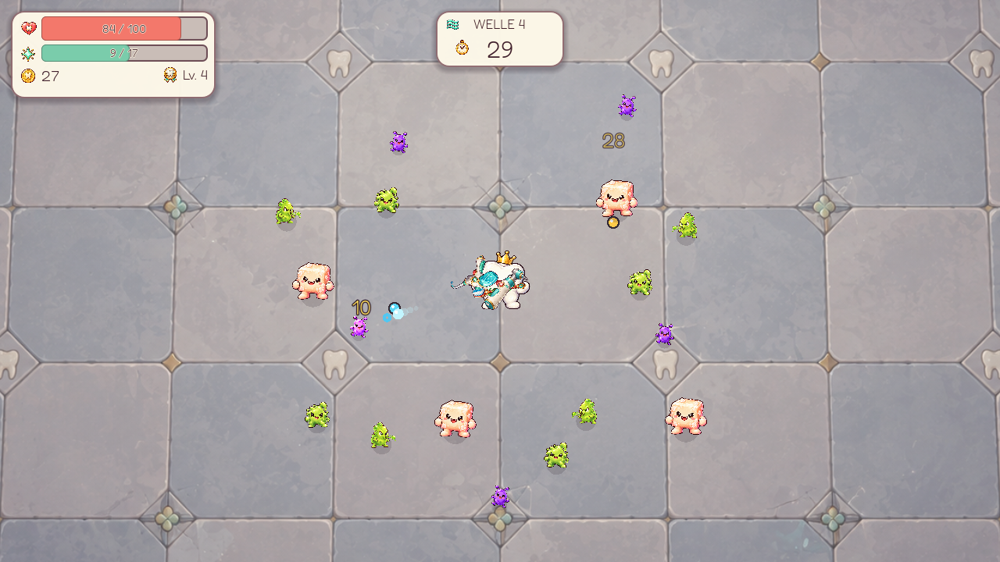
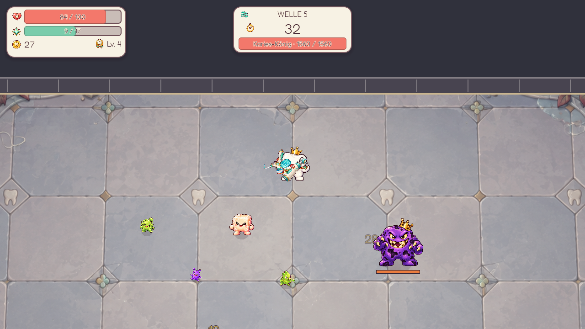
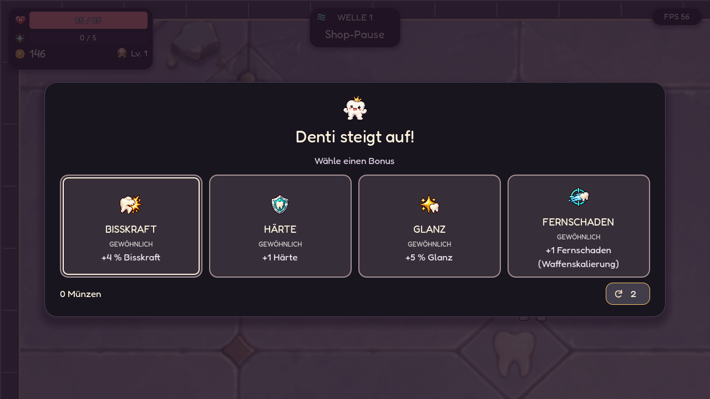
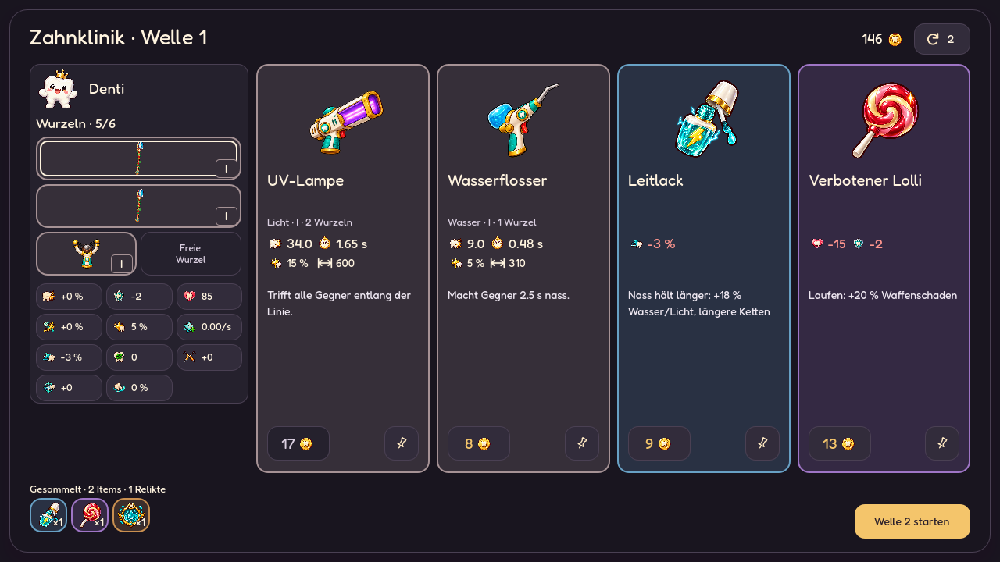
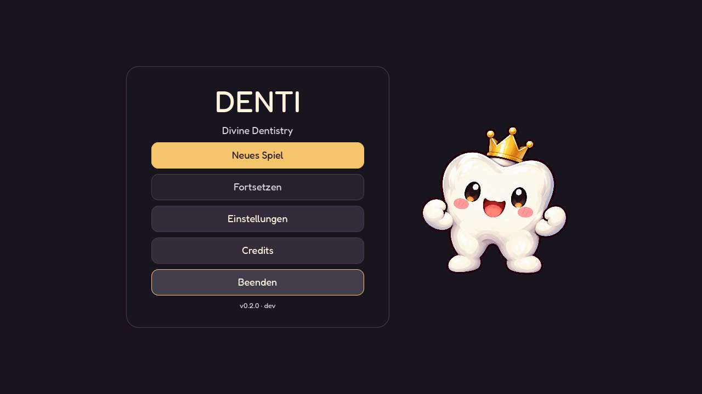
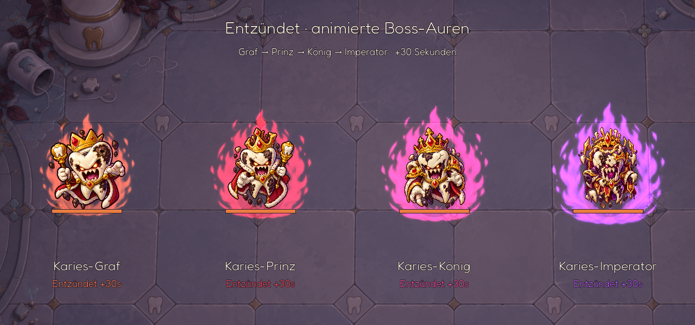
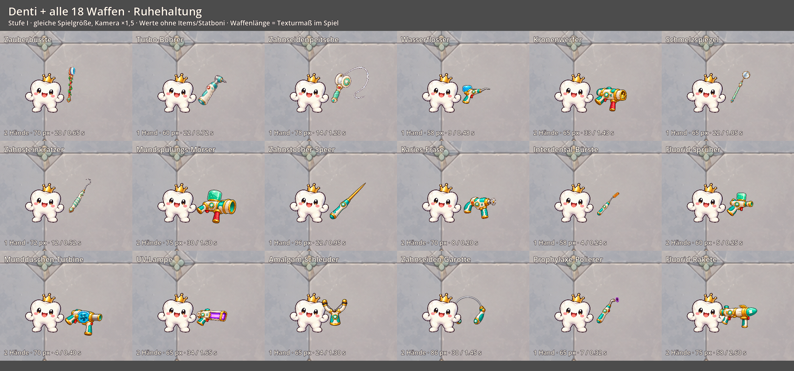

# Denti: Divine Dentistry

Ein kleiner 2D-Arena-Survivor über einen göttlichen Backenzahn, der Plaque, Zucker und Karies den Kampf ansagt. Du steuerst Denti direkt; seine Waffen greifen automatisch an. Zwischen den Wellen entscheiden Levelaufstiege und Einkäufe, wie der nächste Kampf läuft.

**Aktuelle Version: 0.7.0.** Alle Änderungen seit 0.1 stehen in der [Patchnote-Historie](CHANGELOG.md).

GitHub Actions testet und baut **Web und Windows**. Testpakete stehen bei den
[Actions-Läufen](https://github.com/othaldo/denti/actions) zum Download bereit;
Versionstags erzeugen Release-Entwürfe. Veröffentlichte Versionen stehen unter
[Releases](https://github.com/othaldo/denti/releases). Portable Windows-Builds
prüfen veröffentlichte Stable-/Beta-Updates im Hauptmenü und installieren sie
auf Wunsch mit Neustart und Rückfallkopie. [Builds, Releases und Updater](docs/RELEASES.md).



## Ein Blick ins Spiel

| Bosskampf am Arenarand | Levelaufstieg |
| --- | --- |
| [](docs/screenshots/bosskampf.png) | [](docs/screenshots/nightclinic_upgrade.png) |

| Shop zwischen den Wellen | Hauptmenü |
| --- | --- |
| [](docs/screenshots/nightclinic_shop_1280x720.png) | [](docs/screenshots/nightclinic_menu.png) |

Die Bilder sind direkt aus Godot aufgenommen. Für die Kampfbilder wurden Gegner und Beute in einem separaten Testlauf arrangiert. Die Nachtklinik zeigt die aktuelle dunkle Oberfläche mit vier Shopangeboten und vier Level-up-Boni.

[](docs/BOSS_INFLAMMATION.md)

Die vier Farbstufen der Boss-Entzündung. Die Vorschau zeigt einen Frame der Animation; für den direkten Vergleich sind die Bosse gleich groß dargestellt. [Details zur Entzündung](docs/BOSS_INFLAMMATION.md).

[](docs/WEAPON_SIZE_BALANCE.md)

[Alle Waffen in Ruhe und im Angriff](docs/WEAPON_SIZE_BALANCE.md), einschließlich Größenvergleich und Messungen zum kleineren, schnelleren Turbo-Bohrer.

[Neue Waffengrafiken und animierte Vorschau](docs/WEAPON_ART_REFINEMENT.md): klarere Geräteformen, separat rotierende Arbeitsköpfe und eine Schleuder mit beweglichen Gummibändern und Beutel.

[Startwaffe wählen](docs/STARTER_SELECTION.md): Schwierigkeit und eine von 18 Standardwaffen im Menü vorbereiten, mit Zurück/Weiter und ausdrücklichem Run-Start.

## Spielen

Für Performance-Tests im Web-Build: Im Hauptmenü siebenmal **Einstellungen → Zurück**, dann **Code eingeben**. `debug map` startet die volle Welle-17-Testarena, `boss charge` den Boss-Test. Der normale Spielstand bleibt erhalten. [Testarenen und Messwerte](docs/TEST_ARENAS.md).

Das Projekt mit **Godot 4.4 oder neuer** öffnen und mit **F5** starten. Unter Linux geht es auch im Projektordner:

```bash
./play.sh
```

`play.sh` aktualisiert vor jedem Start den Godot-Klassen-Cache und die Asset-Imports, damit neue Dateien nach Git-Updates erkannt werden. Es nutzt `/usr/local/bin/godot`, falls vorhanden, sonst `godot` aus dem `PATH`. Mit `DENTI_GODOT_BIN=/pfad/zu/godot ./play.sh` lässt sich eine andere Installation wählen. `./play.sh --probe` misst die Bildrate im Fenster, im Vollbild und mit 100 Gegnern.

| Eingabe | Aktion |
| --- | --- |
| WASD oder Pfeiltasten | Denti bewegen |
| Shift | Wurzelsprung: Dash in Bewegungsrichtung, sonst zuletzt verwendete Richtung |
| Escape | Kartendetails schließen; sonst Pause, Stats und Einstellungen öffnen |
| F3 (Debug-Build) | Kampf-Telemetrie ein- und ausblenden |
| F4 (lokaler Debug-Build) | Testmenü: Waffen, Items, Münzen, Stats und Wellen |
| Maus | Waffen, Boni und Shopangebote wählen |
| Tastatur in Menüs | Pfeiltasten und Tab / Shift+Tab navigieren. Enter wählt oder kauft, Esc geht zurück bzw. pausiert. R würfelt, F schließt den Schritt ab, I zeigt Details, P merkt Angebote, Backspace nimmt Verzauberungen zurück. Q/E wechseln Tab, Waffe oder Bereich. Die eingeblendete Aktionsleiste ist auch anklickbar. |
| Controller | Linker Stick bewegt Denti; Steuerkreuz oder linker Stick navigieren Menüs. A / Kreuz bestätigt, B / Kreis geht zurück. RB / R1 löst den Dash aus, Menu / Options pausiert. X / Quadrat würfelt Angebote oder Level-Boni neu; RS / R3 zeigt Details. Y / Dreieck merkt Angebote oder nimmt Entwurfsänderungen zurück; RT / R2 schließt den aktuellen Arbeitsschritt ab. Rechter Stick scrollt Listen und Details. |
| Touchscreen | Auf der freien Spielfläche ziehen und halten zum Bewegen. Nachziehen ändert die Richtung, Loslassen stoppt. Zweiter Finger auf Dash unten rechts für Wurzelsprung. Pause, Menüs und Shop per Tippen bedienen. |

Unter **Einstellungen → Controller-Modus** lässt sich **Automatisch, Xbox, PlayStation oder Aus** speichern. Automatisch folgt dem bewusst verwendeten Gamepad; Xbox und PlayStation halten die jeweilige Anzeige fest. Aus deaktiviert Controller-Eingaben vollständig. Lenkräder und Simulator-Panels übernehmen nicht automatisch die Steuerung; nur das aktive Gamepad löst Spielaktionen aus. Verliert es während des Kampfes die Verbindung, öffnet sich die Pause; erneutes Verbinden setzt den Kampf nicht automatisch fort. [Controller-Steuerung und Prüfungen](docs/CONTROLLER_SUPPORT.md).

Vor einem neuen Run wählst du **Easy, Normal oder Hard**; **Hell** wird nach einem Sieg auf Hard freigeschaltet. Der Grad bleibt beim Fortsetzen erhalten. Normal entspricht der bisherigen Balance, während die anderen Grade vor allem Gegnerdichte, Horden, Eliten und Projektilmuster verändern.

Zu Beginn wählst du eine Startwaffe. Im Kampf sammelst du XP und Münzen. Erreichte Level werden vorgemerkt, ohne die Welle anzuhalten. Zufällig kann eine Upgrade-Kapsel fallen; auch ihr Einsammeln unterbricht den Kampf nicht. Am Wellenende fliegt verbliebene Beute erst zu Denti. Danach wählst du für jedes erreichte Level einen von vier Stat-Boni und verteilst die gesammelten Upgradepunkte gezielt auf einzelne Waffen. Jede Kapsel gibt zwei Punkte. Aktivieren und jeder weitere Rang kosten einen Punkt je belegter Wurzel; Verzauberungen reichen von 1/10 bis 10/10. Mk I bis IV öffnen einen bis vier sichtbare Effektplätze. Pro Waffe ist ein Element wählbar: Feuer, Eis, Gift, Blutung, Elektro oder Wasser. Die übrigen Plätze tragen Verstärkungen wie Tempo, Reichweite, Lebensraub, Krit-Chance, Krit-Schaden und Wucht. Wasser verursacht eigenen Schaden und trifft Zucker und Plaque besonders stark; Weihe bleibt nur in alten Builds erhalten. Rückgängig korrigiert die laufende Verteilung, Fertig übernimmt sie; Restpunkte bleiben für spätere Wellen erhalten. Nach den Bossen in Welle 5, 10 und 15 wählst du außerdem eines von drei göttlichen Relikten. Erst dann öffnet der Shop. Dort kannst du Waffen und Items kaufen oder die vier Angebote neu würfeln oder kostenlos mit Preisbindung merken. Waffen und Boni haben vier farblich markierte Stufen. Items bieten 17 Familien von Common bis Legendary und neun einmalige Mythics ohne Nachteil; Varianten teilen ein Familienlimit. Gleiche Waffen bleiben bei freien Plätzen einzeln ausgerüstet; bei voller Ausrüstung verschmilzt ein passender Kauf. Angebote öffnen zunächst ihre Details; der Preisbutton auf jeder Karte kauft direkt. Nicht kaufbare Angebote bleiben inspizierbar, ihr Preisbutton wird ausgegraut. Tippe eine belegte Wurzel an, um die Waffe zu vergleichen, mit einem passenden Exemplar zu fusionieren oder nach Bestätigung zu verkaufen. Fusionen reichen bis Stufe IV; Rechtsklick bleibt als Abkürzung erhalten. Die gesammelten Items und Relikte stehen unten als Icons mit Anzahl, Effekt beim Hover und Details per Antippen. Auf kleinen Bildschirmen ordnet der Shop Angebote und Details untereinander an und hält die Aktionen erreichbar. Höheres Glück erhöht innerhalb fester Grenzen die Chance auf Upgrade-Kapseln, seltene Angebote und Boni; Waffen, die du schon trägst, erscheinen häufiger. Items können sich stapeln und bilden Kombinationen aus Blutung, Flächenschaden, Schild, Heilung und Münzgewinn. Unter **Escape → Stats** stehen die Werte und Waffen, unter **Escape → Items** die gesammelten Icons mit Anzahl und anwählbaren Effekten. Alle Effekte stehen in der [Item-Übersicht](docs/items.md) und der [Relikt-Übersicht](docs/relics.md).

## Was schon spielbar ist

Nach dem Sieg in Welle 20 kannst du **Endlos weiterspielen** wählen. Dein Sieg und Build bleiben erhalten; der Shop führt anschließend in Welle 21. Endloswellen dauern 60 Sekunden, Gegner und Preise steigen stärker, und Welle 30/40/... bringt zwei Bosse. Auch Endlosruns lassen sich speichern und fortsetzen. [Brotato-Vergleich, Balancekurve und Vorschau](docs/ENDLESS_MODE.md).

Auf Normal fällt Gold in Welle 1–4 garantiert und sinkt bis Welle 20 auf 55 % Drop-Chance. Goldsonde und Goldextraktor ermöglichen wertvollere Drops; Level-up-Angebote lassen sich gegen Münzen neu würfeln. Wiederholte Rerolls werden zunehmend teurer: Ein normaler Shop beginnt bei 2/3/5/8/12 Münzen. XP bleibt unabhängig. Shoppreise steigen nach der Brotato-Kurve; gemerkte Angebote behalten ihren Preis. Economy und Messungen stehen in [ECONOMY_BALANCE.md](docs/ECONOMY_BALANCE.md).

Ab Welle 8 kann in normalen Wellen höchstens ein **Goldzahn-Gauner** auftauchen. Der animierte Beutedieb sammelt lose Münzen, flieht vor Denti und sucht Deckung hinter Gegnern. Entkommt er am Wellenende, ist sein Beutel verloren; beim Töten gibt es die Münzen zurück und eine goldene Upgrade-Kapsel. [Regeln, Vorschau und Prüfung](docs/LOOT_GOBLIN.md).

- **20 Wellen mit variabler Dauer**: normale Wellen dauern 35–50 Sekunden. Bosswellen in Welle 5, 10, 15 und 20 laufen ohne Wellentimer und enden mit dem letzten Boss. Plaquula, Don Karamello, Korrodon, der Ätzkoloss und Karies-Imperator besitzen eigene angekündigte Angriffe. Bossstages enthalten keinen normalen Trash; besondere Ziele und Minions gehören zum jeweiligen Boss. Don Karamello erhält gestaffelte Herzprüfungen und auf Hard/Hell seinen Keks-Leibwächter Brösel, Korrodon Schildventile, die sein eigener Strahl zerstören muss, samt bleibenden Säurespuren und auf Hard/Hell dem Säurespucker Schlacko. [Abläufe, Schwierigkeiten und Beute](docs/BOSS_STAGES.md).
- **Sechs normale Gegnertypen** und zwei Eliten, die schrittweise hinzukommen. Der Säurespucker kündigt seine Schüsse an; das zähe Zuckerstück startet ab Welle 7 einen langen Ansturm mit markiertem Einschlagbereich. Ab Welle 8 kann die Säurekrone als Elite mit angekündigtem Projektilring erscheinen. Ab Welle 12 bringt der Jagdkeim drei Bakterien mit, beschleunigt nahe Gegner und stürmt selbst an. Beide Eliten haben einen sichtbaren Schmelzschild gegen hohen Schaden in kurzer Zeit. Giftkeim (Giftschuss-Fächer) und Zahnfleischbeißer (Blutungsansturm) ergänzen den Spawnmix mit eigenen Sprites. Einführung, Häufigkeit und Statuseffekte skalieren je Schwierigkeit; spätere gewöhnliche Gegner und Eliten können eine erkennbare Gift-/Blutungseigenschaft tragen. [Regeln und Messungen](docs/PLAYER_STATUS_EFFECTS.md). Normale Wellen variieren ihre Gegnerverteilung durch die Profile Schwarm, Kreuzfeuer, Ansturm oder Zuckerflut. Das Profil verändert nur die Gegnerverteilung im normalen Spawnmix; Bosswellen, Spawnrate und Gegnerwerte bleiben davon unberührt. Wellen enthalten zusätzlich mehrere zeitlich variierende Gegnergruppen; ab Welle 6 kommen zum Schluss weitere Säurespucker und ab Welle 12 in normalen Wellen ein zusätzlicher Druckschub. Plaque bleibt leicht zu besiegen, während Zuckerstück und Säurespucker später stärker wachsen und häufiger erscheinen. In späteren Wellen schießen Säurespucker dichtere Fächer. Ab Welle 11 erscheinen mehrere Elite-Gruppen pro normaler Welle; später treten bis zu drei Eliten gleichzeitig auf. Einzelne Wellen bringen außerdem größere Themenhorden. Mehr Kills bedeuten in späten Wellen nicht mehr garantiert mehr XP und Münzen.
- **18 Waffen und 94 Shop-Items** für unterschiedliche Builds. Stichlinien, Frontbögen, Sprühkegel, Ziel-Fokus und durchdringende UV-Strahlen erweitern die bisherigen Angriffe. Fluorid-Spray bereitet Gegner für Schmelzschaden vor; Turbine und Polierer ergänzen Wasser- und Crit-Builds. Items können sich innerhalb ihrer Stapellimits ergänzen; der Shop bevorzugt gelegentlich Angebote mit passenden Eigenschaften zu deinem Build. Levelaufstiege verbessern zwölf Grundwerte, einschließlich Zahnflutsch (Ausweichen) und Wurzelkraft. Waffenkarten zeigen Rolle, Treffer, Angriffspause und Reichweite mit den aktuellen Buildwerten. Die Details ergänzen Crit, Effekte, Synergien und Vergleich.
- **Waffenmeisterschaften:** Jede Startwaffe verdient Zahnprüfung, Bronze, Silber und Gold. Höhere Siege schließen niedrigere Medaillen ein. Das eigene Menü **Achievements** zeigt alle Siegel, Fortschritte und Anforderungen; die Erfolge bleiben dauerhaft erhalten. [Regeln und Vorschau](docs/WEAPON_MASTERIES.md).
- **Individuelle Shop-Waffen** würfeln Grundschaden, Angriffstempo, Reichweite und Crit zwischen Schrott und Göttlich, unabhängig von ihrer Mk-Stufe. Der Namenszusatz folgt der stärksten Verzauberung; Mk steht separat. Der Rahmen zeigt Mk, während die Zahlenwerte ihre eigene Rollqualität farbig anzeigen. Reservieren und Fortsetzen behalten die Werte; Fusion übernimmt je Attribut den besseren Wert und erhält die Verzauberungen. Bei mehreren passenden Waffen wird das stärkste Fusionsergebnis gewählt.
- **Wurzeln als Spielerparameter:** Standardmäßig stehen 6 Wurzeln zur Verfügung. Klassen oder Challenges können künftig einen anderen gespeicherten Wert verwenden; Waffenlimits, Startauswahl und Anzeigen berücksichtigen ihn bereits. [Konfiguration und Regeln](docs/PLAYER_ROOTS.md).
- **Eigene Elementformen für alle Waffen:** 18 Standardwaffen und sechs Evolutionen mit je Normal-, Feuer-, Eis-, Gift-, Elektro-, Blutungs- und Wasserbild. Die Verzauberung zeigt die Form sofort als Vorschau; Ausrüstung, Shop und Kampf verwenden dasselbe Bild. Fusion und Fortsetzen erhalten das Element. [Waffenbilder und Animationen](docs/WEAPON_SKINS.md).
- **Angriffe passend zum Element:** Geschosskerne, Begleitpartikel, Nahkampfspuren, Strahlen, Sprühangriffe, Treffer und Evolutionseffekte folgen dem gewählten Element. Flugbahn und Trefferflächen bleiben erhalten. [Animierte Vorschau](docs/WEAPON_ELEMENT_EFFECTS.md).
- **Gezielte Waffenverzauberung:** Jede neue Upgrade-Kapsel gibt zwei frei einsetzbare Punkte. Waffenwahl, große Vorschau und vier sichtbare Effektplätze zeigen eindeutig das Ziel. Mk I–IV öffnen einen bis vier Plätze. Aktivieren auf 1/10 und jeder weitere Rang kosten einen Punkt pro Wurzel der Zielwaffe; höchstens 10/10. Rückgängig, gespeicherte Entwürfe und übertragbare Restpunkte erlauben die gemeinsame Verteilung nach der Welle. Wurzelkosten, Basisintervall und anfängliche Projektilsalve bestimmen das Schadensbudget. Alte Verzauberungen und bereits gespeicherte Zufallsangebote bleiben ladbar. Glück verbessert begrenzt die Fundchance und kann eine Bonuskapsel nach der Welle geben. Runenpolitur belohnt jede fünfte gesammelte Kapsel; goldene Träger und Gauner liefern zusätzliche Punkte. [Regeln und native Vorschau](docs/WEAPON_UPGRADES.md).
- **Fünf göttliche Relikte** mit besonderen Effekten für Blutung, Wasser, Schild, kritische Treffer und Bewegung. Nach den ersten drei Bossen erscheint jeweils eine Auswahl aus drei noch nicht gewählten Relikten.
- **Story-Modus** im Hauptmenü: Denti landet durch den Hilferuf der Zahnfee außerhalb des Mundes. Vier Schauplätze mit Bossabschlüssen, kurzen Übergangsdialogen und einem Reisezeitstrahl führen durch die 20 Wellen. Zukünftige Welten werden erst bei Ankunft enthüllt. [Ablauf, Assets und Prüfung](docs/STORY_MODE.md).
- Eine **scrollende Arena**, größer als der Bildschirm, mit Mauer und dunklem Außenbereich. Das kompakte HUD zeigt Leben, XP, Münzen, Welle und verbleibende Sekunden.
- Automatisches Speichern während des Laufs. **Fortsetzen** lädt ihn auch nach einem Neustart; ein neues Spiel fragt vor dem Überschreiben nach.
- Musik für Menü, Wellen und Bosse, Kampfgeräusche sowie Regler für Gesamt-, Musik- und SFX-Lautstärke. Eine FPS-Anzeige lässt sich einschalten.
- **Nachtklinik:** dunkle Spielansichten, große Objektbilder und kompakte Iconwerte. Hover erklärt Werte, Klick öffnet Details oder das Dentikon. Kurze Hover-, Klick-, Kauf- und Fusionsreaktionen laufen auch in der Shop-Pause. UI-Klänge und reduzierte Bewegung werden unter **Escape → Einstellungen** gespeichert; Kauf, Pins, Preisbindung, Vergleich, Verkauf und Fusion bleiben erhalten. [Gestaltung und Aufnahmen](docs/UI_ART_DIRECTION.md).

Das Spiel ist ein **spielbarer Prototyp**. Balancing, Effekte und weitere Inhalte sind noch in Arbeit.

**0.7.0** ergänzt Controller-Steuerung mit Xbox-/PlayStation-Symbolen, ein gemeinsames Tastenschema und gezielte Fokusführung in Shop, Verzaubern und Dentipedia. Einstellbare Controller-Modi schützen vor Eingaben angeschlossener Lenkräder und Simulator-Panels. Waffenmeisterschaften, gezielte Aufstiege ab Mk V und aktivere Bossangriffe bündeln die weiteren Änderungen seit 0.6.0. [Controller-Steuerung und Ansichten](docs/CONTROLLER_SUPPORT.md), [Waffenaufstiege](docs/WEAPON_ASCENSION.md) und [Patchnotes](CHANGELOG.md).

**0.6.0** bringt gezielte Waffenpunkte mit Mk-abhängigen Effektplätzen, ein Element pro Waffe und manuelle Verzauberungsfusion mit Punkteerstattung. Alle 24 Waffen einschließlich Evolutionen besitzen sieben Formen sowie passende Elementangriffe und Einschläge. Überarbeitete Zahnseidenwaffen, schnellere Dashes mit festem Ausdauerregen und die aktualisierte Dentipedia ergänzen das Update. [Waffenverzauberung](docs/WEAPON_UPGRADES.md), [Waffenformen](docs/WEAPON_SKINS.md) und [Dentipedia](docs/DENTIPEDIA.md).

**0.5.0** bringt gemalte Projektile, Lichtstrahlen, Sprühnebel, Bodenwarnungen sowie eigene XP- und Gold-Sprites. Bis zu vier Verzauberungen werden gemeinsam als animierter Partikellook in einem Projektil-Sprite dargestellt. Überlagerte Warnflächen bleiben transparenter; Boss-Charges werden hervorgehoben. Gemeinsame Texturatlanten und vorbereitete Effekte begrenzen zusätzliche Zeichenaufrufe. [Darstellung, Belastungsszenen und Messwerte](docs/ATTACK_EFFECTS.md), [Verzauberungs-Projektile](docs/ENCHANTMENT_PROJECTILES.md) und [Beutegrafiken](docs/LOOT_ART.md).

**0.4.0** erweitert Upgrade-Kapseln um individuelle Waffen-Verzauberungen mit fortlaufender Verstärkung, bis zu vier Effekt-Slots, Reichweite, Angriffstempo und seltene Mk-Aufstiege über IV. Shopwaffen besitzen gewürfelte Attribute; Feuer, Gift und Blutung verursachen Schaden über Zeit. Mehr Gegnerdruck und steilere Hard-/Hell-Kurven ergänzen die neue Progression. Details stehen in den [Patchnotes](CHANGELOG.md).

**0.2.0 · Pressure + Build Depth** bündelte mehr Gegnerdruck, häufigere Horden, Bullet-Hell-Muster, neue Bossmechaniken, seltene Item-Upgrade-Kapseln mit Behalten/Scrappen und mehr Synergien. Die [Patchnotes](CHANGELOG.md) beschreiben die Änderungen gegenüber 0.1.0. Weitere Balance-Arbeit und geplante Ausbaustufen stehen in der [Roadmap](docs/ROADMAP.md).

## Entwicklung

**Bossstage-Prototyp:** Bosswellen enthalten keinen normalen Trash mehr und enden
beim letzten Boss-Tod, ohne Wellentimer oder zeitgesteuerte Entzündung. Der Prinz besitzt
gestaffelte Prüfungen: eine auf Normal, zwei auf Hard/Hell samt Herzboten.
`.\tools\play_boss_stage.ps1` startet den vollständigen Kampf
mit getrennten Test-Spielständen. Beim König lenkt Denti den Säurestrahl auf
Schildventile; auf Hell wiederholt sich die Prüfung bei 90/60/30 % Restleben.
`.\tools\play_boss_stage.ps1 -Boss king -Difficulty hell` startet diesen Kampf.
[Ablauf, Varianten und Beutebudgets](docs/BOSS_STAGES.md).
Der Imperator ruft zwei Kronenvasallen auf Normal und drei auf Hard/Hell,
während er sein Urteil auflädt und begrenzt regeneriert.
`.\tools\play_boss_stage.ps1 -Boss emperor -Difficulty hell` startet den Kampf.
Im F4-Testmenü lassen sich unter **Run** Welle und Schwierigkeit gemeinsam
starten; der aktuelle Build bleibt erhalten.

**F4** öffnet in lokalen Desktop-Debug-Builds das pausierende Testmenü. Die Oberfläche wird erst beim ersten Öffnen aufgebaut, damit sie Starten/Fortsetzen nicht verzögert. Dort lassen sich Waffen samt Stufe hinzufügen, ändern und entfernen, Items mit ihren normalen Stack-Limits hinzufügen sowie Münzen und Stats setzen. Wellen 1–20 starten direkt mit dem aktuellen Build und vollem Leben, einschließlich der jeweiligen Bosse. F4 oder Escape schließt das Menü und stellt den vorherigen Pausezustand wieder her. Änderungen werden im Run-Spielstand gespeichert; Web- und Release-Builds enthalten keinen zugänglichen Cheat-Modus.

Mit **F3** zeigt ein Debug-Build rollenden DPS, Kills pro Sekunde, Gegnerdichte, Spawns, durch das Gegnerlimit blockierte Spawns, erlittenen Schaden, Boss-Kampfzeit und Wellenbeute. Nach Sieg oder Niederlage zeigt der Run-Rückblick unter anderem Spieldauer, Kills, Schaden, Beute, Kapselentscheidungen sowie die stärksten Waffen und Synergien. Ein JSON-Bericht mit detaillierten Werten pro Welle wird zusätzlich unter `user://run_reports/` gespeichert. Darin stehen auch die mittlere und höchste Zahl gleichzeitig lebender Gegner, das Maximum feindlicher Projektile, Elite-Spawns und -Kills.

Ein reproduzierbarer Boss-/Projektil-Benchmark und der Vorher/Nachher-Vergleich
stehen im [Performance-Bericht](docs/PERFORMANCE_PROJECTILES.md).
Der [Performance-Audit vom 03.10.2026](docs/PERFORMANCE_AUDIT.md) optimiert zusätzlich
Gegnerabfragen, Spielerprojektile, Beute, Telemetrie und Trefferfeedback.
Die [zentrale Gegnerbewegung](docs/CENTRAL_ENEMY_MOTION.md) beschreibt den gemeinsamen Physikschritt, den Referenztest und Messungen mit sowie ohne Diagnoseinstrumentierung.
Der [Spielerprojektil-Pool](docs/PLAYER_PROJECTILE_POOL.md) bereitet Geschosse vor dem Kampf vor und verwendet deren Nodes und Sprites erneut; der Bericht enthält Lebenszyklus-Benchmark und Save/Resume-Prüfungen.
Der [gemeinsame Gegner-Atlas](docs/ENEMY_SPRITE_ATLAS.md) reduziert Texturwechsel mit den bisherigen Sprites; Bildvergleich und Messungen prüfen Darstellung und Renderaufwand.
Die [häufigen Kampfpfade](docs/COMBAT_HOT_PATHS.md) verwenden zentrale Statusbewegung und vorbereitete Text-/Grafikabfragen; der Bericht enthält gezielte CPU-Vergleiche und ihre Grenzen.
Unter **Einstellungen → Grafik** startet **Automatisch** mit voller Auflösung und
wechselt bei drei aufeinanderfolgenden Messfenstern von je mindestens einer
Sekunde mit durchschnittlich unter 20 FPS im Kampf für den Run auf Sparsam.
Die ersten drei Kampfsekunden, Pausen, Menüs und Hintergrund-Tabs zählen nicht.
**Sparsam** begrenzt die Renderauflösung und Schadenszahlen,
**Voll** verwendet die Bildschirmauflösung.

Putzeifer und Bewegung verwenden additive Prozentboni; Speichel zählt Regenerationspunkte mit langsamen HP-Ticks. Formeln, Level-up-Werte und die Umrechnung alter Spielstände stehen in [Tempo und Regeneration](docs/STATS_BALANCE.md). Bisskraft verstärkt Schaden prozentual; Nah- und Fernschaden ergänzen gewichteten Basisschaden. Härte reduziert Treffer prozentual. Formeln, Waffenkoeffizienten und gemessene Bosskämpfe stehen im [Schadens- und Verteidigungsbericht](docs/DAMAGE_DEFENSE_BALANCE.md).

Level-up-Karten zeigen den aktuellen Attributwert und den wirksamen Wert nach der Auswahl. Bei Zahnflutsch, Glanz und Wurzelkraft steht die Obergrenze dabei; erreicht die Auswahl sie, erscheint **MAX**.

Nach dem ersten Godot-Import lassen sich die Tests so ausführen:

```bash
python3 tools/run_tests.py --godot godot
```

Unter Windows können die Tests mit dem Godot-Konsolenprogramm ausgeführt werden
(Namen bei anderer Godot-Version anpassen):

```powershell
python tools/run_tests.py --godot Godot_v4.7.2-stable_win64_console.exe
```

Der Runner benötigt Python 3.10+ (keine Zusatzpakete). Standardmäßig laufen 177 Tests für Spielfluss, Spielstände, Kampf, Balance, Shop und bedienbare UI. 21 zusätzliche Grafik-, Debug-, Waffenvergleichs- und umfassende Boss-Routenprüfungen sind mit `--suite extended` gezielt aufrufbar; `--suite all --timeout 300` führt beide Gruppen aus. Normale CI-Builds verwenden die Kernprüfung, Release-Tags die vollständige Suite. Bis zu vier Tests laufen parallel, mit getrennten Godot-Benutzerdaten und unverändertem Simulationsschritt von 1/60 Sekunde. `--jobs 1` läuft seriell; `--filter 'weapon_*'` wählt innerhalb der Suite eine Teilmenge. Fehlercodes, `SCRIPT ERROR:`, Engine-`ERROR:`, Ressourcen-/Objektlecks und Zeitüberschreitungen lassen den Lauf fehlschlagen. Laufzeiten und Logs stehen unter `.godot/test_results.json` und `.godot/test_runs/`. [Auswahl, Befehle und Laufzeitvergleich](docs/TEST_RUNTIME.md).

[Testpiloten und Zeitraffer](docs/BOT_SIMULATION.md) vergleichen Reaktion,
Kampfstrategie und Buildregel getrennt über verdiente Runs bis W20 (`--last-wave 20`).
`python tools/bot_launcher.py` öffnet den lokalen UI-Launcher mit Waffen-,
Bot-, Strategie- und Schwierigkeitsauswahl sowie Berichtzugriff.
`python tools/run_bot_comparison.py --visible --speed 8` zeigt einen Botlauf mit
Pause, Tempowahl und sichtbaren Belohnungs-/Shopentscheidungen; ohne `--visible` werden Vergleichsmatrizen headless und mit
bis zu vier Workern berechnet. Messdaten landen in einem neuen Verzeichnis
unter `.godot/bot_runs/`.

Ein reproduzierbarer [Buildvergleich auf Normal](docs/BUILD_COMPARISON.md) prüft ganze Wellen mit vier Waffenrollen, Verzauberungen, Heilung und normaler Spielerbewegung. `python tools/run_build_comparison.py --godot Godot_v4.7.2-stable_win64_console.exe` erzeugt Rohdaten und Vergleichstabellen mit isolierten Benutzerdaten.

Der [erste darauf aufbauende Balancepass](docs/BALANCE_FIRST_PASS.md) verbessert die Interdental-Bürste, lässt den Imperator begrenzt vorhalten und reduziert nur den Heilertrag hoher Lebensraub-Ränge.

Der [anschließende Kontaktwaffen-Pass](docs/CONTACT_WEAPON_BALANCE.md) ergänzt
kleine Rückstöße, begrenzte Kratzer-Folgetreffer und einen gespeicherten
Polierer-Crit-Zyklus über Zielwechsel hinweg. 78 neue verdiente Einstiegsproben
zeigen bessere Bossankünfte auf Hell, aber weiterhin eine deutliche Lücke zu
sicheren Linienwaffen und gemischte Werte beim Fräsen-Rückstoß.

Der anschließende [Vergleich aller 18 Standardwaffen und sechs Evolutionen](docs/WEAPON_ROSTER_REVIEW.md) trennt Rohschaden, tatsächliche Kampfleistung und den Wert einer Unterstützungswaffe; einschließlich gezielter Turbinen-/Wasserflosser-Vergleiche.

Der [verdiente Einstieg auf Hell](docs/EARNED_PROGRESSION.md) ergänzt echte Startwaffen, verdientes Gold/XP, bezahlte Angebote und mitgenommenes Leben über die Wellen 1–5. `python tools/run_earned_progression.py` prüft den Weg zum ersten Boss ohne vorgegebene Ausbau-Budgets.

Der [Bohrwerkzeug-Pass](docs/DRILL_CONTACT_BALANCE.md) verbessert den Turbo-Bohrer durch begrenzten Vorwärtskontakt und die Karies-Fräse durch sichere Reichweite und vollen normalen Gegnerschaden. Neun Hell-Seeds je Variante prüfen den verdienten Einstieg; Speichern und Kontaktgrenzen sind automatisiert abgedeckt.

Eine Vorschau aller neuen Waffen im Shop und ihrer Effekte im Kampf erstellt
`Godot_v4.7.2-stable_win64_console.exe --path . --script res://tools/preview_weapon_expansion.gd`
unter `docs/screenshots/weapon_expansion_*.png`, mit einem getrennten Testspielstand.

Die ursprünglichen README-Screenshots erzeugt:

```bash
godot --path . --script res://tools/capture_readme.gd
```

Das Aufnahmeskript schreibt nach `docs/screenshots/` und verändert den normalen Spielstand nicht. Hinweise zu Grafiken, Musik, Sound und Schrift stehen in [CREDITS.md](CREDITS.md).

Den responsiven Shop zeigt `Godot_v4.7.2-stable_win64_console.exe --path . --script res://tools/preview_shop_workbench.gd` mit getrenntem Testspielstand in Desktop-, Hoch- und Querformat.

Aktuelle Nachtklinik-Aufnahmen erzeugt `Godot_v4.7.2-stable_win64_console.exe --path . --fixed-fps 60 --script res://tools/preview_nightclinic.gd`: Shop und ausgeklappte Details in vier Größen, Hauptmenü, Einstellungen, HUD und Level-up. Der Testspielstand ist getrennt; Originalreferenzen bleiben erhalten.

Das [Zahn-HUD](docs/COMBAT_HUD.md) zeigt Leben mit 18 Pixeln in der Zahnkrone, das Maximum kleiner darunter mit Schrägstrich. Schildladungen bilden eine leicht schimmernde blaue Hülle mit einer vollständigen Kontur pro Ladung; Münzen und Kapseln stehen rechts neben dem Zahn. Level und XP bleiben unten; Flamme und Zeit bilden eine zentrierte Gruppe. Bossleisten sind bei 1280 Pixeln 450×22 Pixel groß, mit vier Pixeln Abstand; bei 1920 Pixeln stehen zwei Bosse nebeneinander. Gemalte Endstücke behalten ihre Proportionen. `Godot_v4.7.2-stable_win64_console.exe --path . --fixed-fps 60 --script res://tools/preview_combat_hud.gd` erzeugt native Aufnahmen unter `docs/screenshots/combat_hud/` in sechs Auflösungen, normal und mit großen Zahlen, langen Bossnamen, Entzündung und Touchsteuerung.

Eine [vergrößerte native Animation](docs/screenshots/combat_hud/animated_tooth.gif) zeigt Wellengang, Bläschen und den Schadensnachlauf. Die gleiche Spielkomponente lässt sich mit `Godot_v4.7.2-stable_win64_console.exe --path . --fixed-fps 30 --script res://tools/preview_tooth_animation.gd` aufnehmen.

[Szenenübergänge mit Zahnblende und Zoom](docs/SCENE_TRANSITIONS.md) verbinden Hauptmenü, Kampf, Belohnungen, Shop und Story mit einer wachsenden Goldzahn-Silhouette und sanftem Kameraeffekt. Reduzierte UI-Animationen überspringen sie; die [native Vorschau](docs/screenshots/scene_transitions/flow.gif) zeigt den Ablauf.
