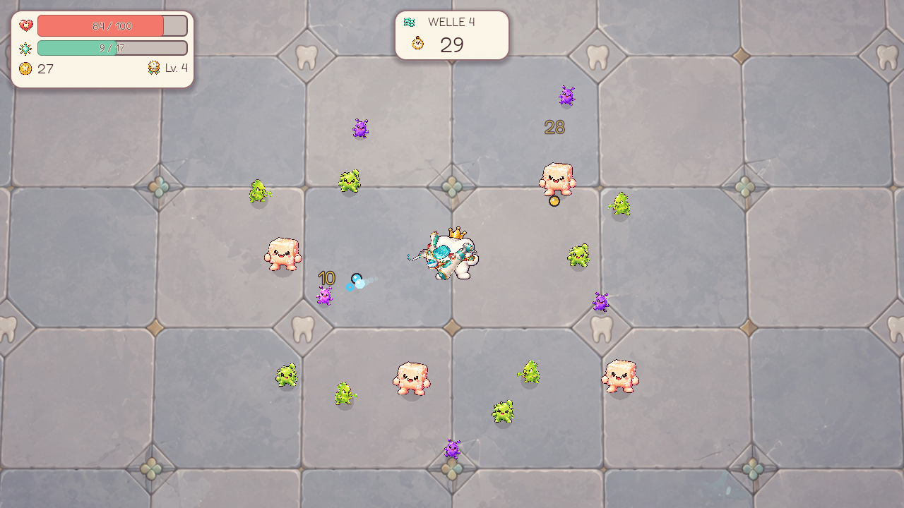
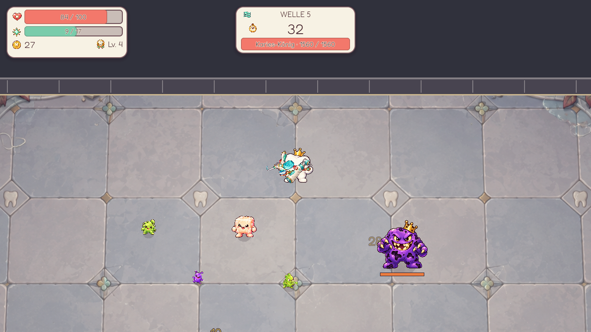
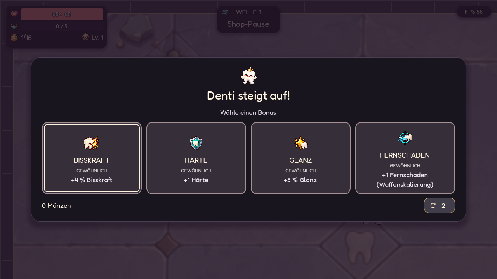
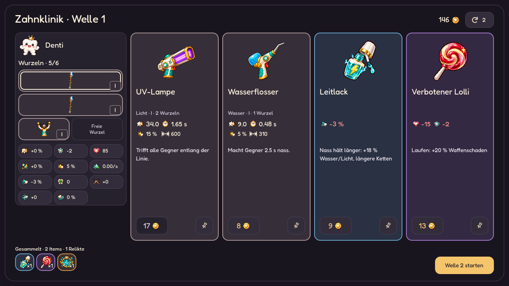
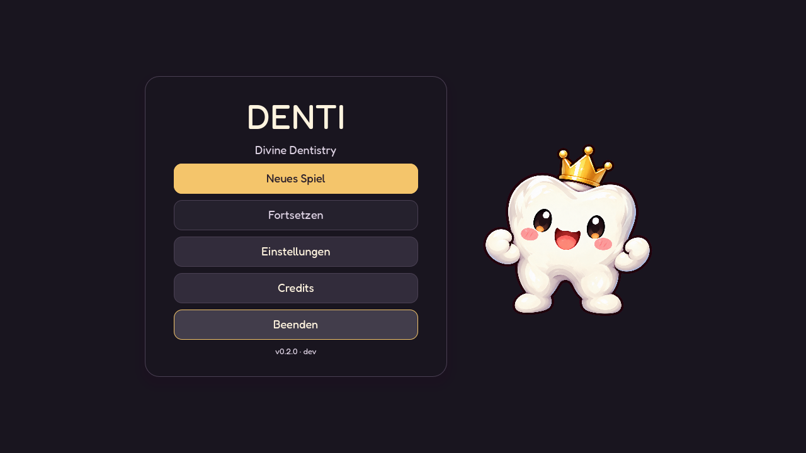
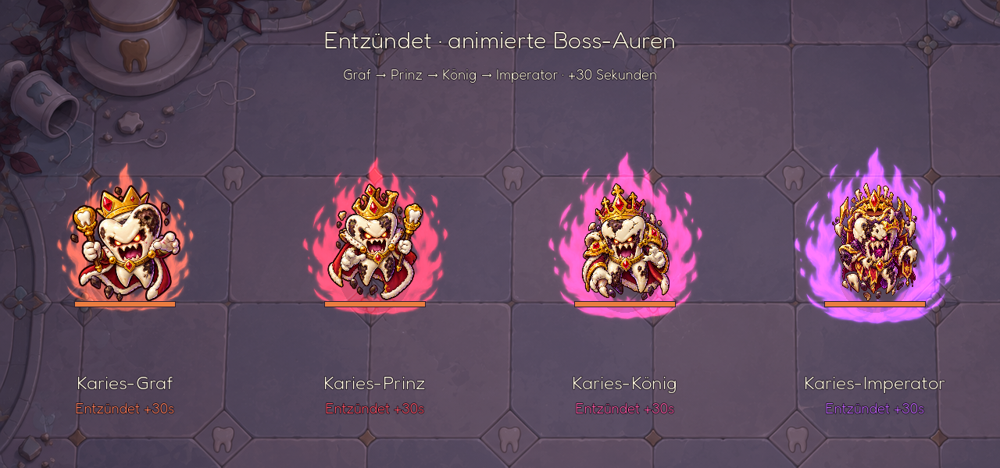
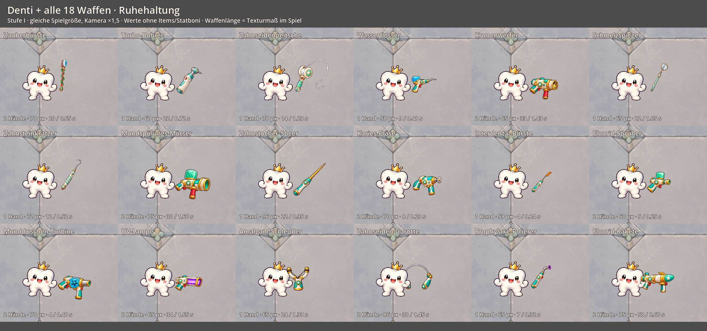

# Denti: Divine Dentistry

Ein kleiner 2D-Arena-Survivor über einen göttlichen Backenzahn, der Plaque, Zucker und Karies den Kampf ansagt. Du steuerst Denti direkt; seine Waffen greifen automatisch an. Zwischen den Wellen entscheiden Levelpunkte, Verzauberungen, Relikte und Einkäufe, wie der nächste Kampf läuft.

**Aktuelle Version: 0.9.0** (24.11.2026). Alle Änderungen seit 0.1 stehen in der [Patchnote-Historie](CHANGELOG.md). Das Spiel ist ein **spielbarer Prototyp**; Balancing, Effekte und weitere Inhalte sind noch in Arbeit.

GitHub Actions testet und baut **Web und Windows**. Testpakete stehen bei den
[Actions-Läufen](https://github.com/othaldo/denti/actions) zum Download bereit;
Versionstags erzeugen Release-Entwürfe. Veröffentlichte Versionen stehen unter
[Releases](https://github.com/othaldo/denti/releases). Portable Windows-Builds
prüfen veröffentlichte Stable-/Beta-Updates im Hauptmenü und installieren sie
auf Wunsch mit Neustart und Rückfallkopie. [Builds, Releases und Updater](docs/RELEASES.md).
Pushes auf `feat/...` oder `feature/...` veröffentlichen nach erfolgreichen Tests einen eigenen
[Branch-Testbuild](https://othaldo.github.io/denti/preview/).



## Ein Blick ins Spiel

| Bosskampf am Arenarand | Levelaufstieg |
| --- | --- |
| [](docs/screenshots/bosskampf.png) | [](docs/screenshots/nightclinic_upgrade.png) |

| Shop zwischen den Wellen | Hauptmenü |
| --- | --- |
| [](docs/screenshots/nightclinic_shop_1280x720.png) | [](docs/screenshots/nightclinic_menu.png) |

Die Bilder sind direkt aus Godot aufgenommen. Für die Kampfbilder wurden Gegner und Beute in einem separaten Testlauf arrangiert.

[](docs/BOSS_INFLAMMATION.md)

Die vier Farbstufen der Boss-Entzündung. Die Vorschau zeigt einen Frame der Animation; für den direkten Vergleich sind die Bosse gleich groß dargestellt. [Details zur Entzündung](docs/BOSS_INFLAMMATION.md).

[](docs/WEAPON_SIZE_BALANCE.md)

[Waffen in Ruhe und im Angriff](docs/WEAPON_SIZE_BALANCE.md) mit Größenvergleich, dazu [Waffengrafiken und animierte Vorschau](docs/WEAPON_ART_REFINEMENT.md).

## Spielen

Das Projekt mit **Godot 4.7** öffnen und mit **F5** starten. Unter Linux geht es auch im Projektordner:

```bash
./play.sh
```

`play.sh` aktualisiert vor jedem Start den Godot-Klassen-Cache und die Asset-Imports, damit neue Dateien nach Git-Updates erkannt werden. Es nutzt `/usr/local/bin/godot`, falls vorhanden, sonst `godot` aus dem `PATH`. Mit `DENTI_GODOT_BIN=/pfad/zu/godot ./play.sh` lässt sich eine andere Installation wählen. `./play.sh --probe` misst die Bildrate im Fenster, im Vollbild und mit 100 Gegnern.

| Eingabe | Aktion |
| --- | --- |
| WASD oder Pfeiltasten | Denti bewegen |
| Shift | Wurzelsprung: Dash in Bewegungsrichtung, sonst zuletzt verwendete Richtung |
| Escape | Kartendetails schließen; sonst Pause, Stats und Einstellungen öffnen |
| F3 (Debug-Build) | Kampf-Telemetrie ein- und ausblenden |
| F4 (lokaler Debug-Build) | Testmenü: Klasse, Waffen, Items, Münzen, Stats und Wellen |
| Maus | Waffen, Boni und Shopangebote wählen |
| Tastatur in Menüs | Pfeiltasten und Tab / Shift+Tab navigieren. Enter wählt oder kauft, Esc geht zurück bzw. pausiert. R würfelt, F schließt den Schritt ab, I zeigt Details, P merkt Angebote, Backspace nimmt Verzauberungen zurück. Q/E wechseln Tab, Waffe oder Bereich. Die eingeblendete Aktionsleiste ist auch anklickbar. |
| Controller | Linker Stick bewegt Denti; Steuerkreuz oder linker Stick navigieren Menüs. A / Kreuz bestätigt, B / Kreis geht zurück. RB / R1 löst den Dash aus, Menu / Options pausiert. X / Quadrat würfelt Angebote oder Level-Boni neu; RS / R3 zeigt Details. Y / Dreieck merkt Angebote oder nimmt Entwurfsänderungen zurück; RT / R2 schließt den aktuellen Arbeitsschritt ab. Rechter Stick scrollt Listen und Details. |
| Touchscreen | Auf der freien Spielfläche ziehen und halten zum Bewegen. Nachziehen ändert die Richtung, Loslassen stoppt. Zweiter Finger auf Dash unten rechts für Wurzelsprung. Pause, Menüs und Shop per Tippen bedienen. |

Unter **Einstellungen → Controller-Modus** lässt sich **Automatisch, Xbox, PlayStation oder Aus** speichern. Lenkräder und Simulator-Panels übernehmen nicht automatisch die Steuerung; verliert das aktive Gamepad im Kampf die Verbindung, öffnet sich die Pause. [Controller-Steuerung und Prüfungen](docs/CONTROLLER_SUPPORT.md).

Für Performance-Tests im Web-Build: Im Hauptmenü siebenmal **Einstellungen → Zurück**, dann **Code eingeben**. `debug map` startet die volle Welle-17-Testarena, `boss charge` den Boss-Test. Der normale Spielstand bleibt erhalten. [Testarenen und Messwerte](docs/TEST_ARENAS.md).

## Ablauf eines Runs

Vor einem Run wählst du Klasse, Schwierigkeit und Startwaffe ([Startauswahl](docs/STARTER_SELECTION.md)). **Easy, Normal und Hard** sind sofort verfügbar, **Hell** nach einem Sieg auf Hard. Die Grade verändern vor allem Gegnerdichte, Horden, Eliten und Projektilmuster.

**Im Kampf** sammelst du XP, Münzen und gelegentlich Upgrade-Kapseln. Erreichte Level werden nur vorgemerkt; nichts unterbricht die Welle. Am Wellenende fliegt verbliebene Beute zu Denti, danach folgt die Belohnungsphase:

1. **Levelpunkte** verteilst du im [Talentbaum](docs/TALENT_TREE_V3_PLAN.md) der Klasse: drei Äste mit Attribut-Wegknoten, sichtbaren Skills, Modifikatoren und Schlüsselsteinen. Bosse geben mehrere Punkte.
2. **Waffenpunkte** aus Kapseln (zwei je Kapsel) verzaubern einzelne Waffen. Mk I–IV öffnen einen bis vier Effektplätze: ein Element (Feuer, Eis, Gift, Blutung, Elektro oder Wasser) und Verstärkungen wie Tempo, Reichweite, Lebensraub, Krit und Wucht. Ränge reichen bis 10/10 und kosten einen Punkt je belegter Wurzel; ab Mk IV sind Aufstiege auf Mk V und höher möglich. [Verzauberung](docs/WEAPON_UPGRADES.md), [Aufstiege](docs/WEAPON_ASCENSION.md).
3. **Relikte:** Nach den Bossen in Welle 5, 10 und 15 wählst du eines von vier göttlichen Relikten. [Relikt-Übersicht](docs/relics.md).
4. **Shop:** Waffen und Items kaufen, die vier Angebote neu würfeln oder mit Preisbindung merken. Shopwaffen würfeln ihre Grundwerte zwischen Schrott und Göttlich. Gleiche Waffen fusionieren bei voller Ausrüstung bis Stufe IV; belegte Wurzeln lassen sich vergleichen, fusionieren oder verkaufen.

Höheres Glück erhöht innerhalb fester Grenzen die Chance auf Kapseln und seltene Angebote; Waffen, die du schon trägst, erscheinen häufiger. Unter **Escape → Stats** und **Escape → Items** stehen Werte, Waffen, Items und Relikte. Der Run wird automatisch gespeichert; **Fortsetzen** lädt ihn auch nach einem Neustart.

Nach dem Sieg in Welle 20 kannst du **Fertig** oder **Endlos weiterspielen** wählen. Endloswellen dauern 60 Sekunden, Gegner und Preise steigen stärker, und Welle 30/40/... bringt zwei Bosse. [Endlosmodus](docs/ENDLESS_MODE.md).

Der **Story-Modus** im Hauptmenü erzählt die 20 Wellen als Reise: Denti landet durch den Hilferuf der Zahnfee außerhalb des Mundes und zieht durch vier Schauplätze mit Bossabschlüssen und kurzen Dialogen. [Story-Modus](docs/STORY_MODE.md).

## Klassen

Jede Klasse hat eigene Wurzeln, Startwerte, einen klaren Nachteil und einen eigenen Talentbaum. [Klassen-Essenz](docs/CLASS_ESSENCE.md), [Freischaltungen](docs/META_PROGRESSION.md).

| Klasse | Spielprinzip | Freischaltung |
| --- | --- | --- |
| Good Old Molar | Generalist mit 6 Wurzeln und freier Waffenwahl; Skills lassen alle Waffen gleichzeitig oder im Gleichtakt feuern. | sofort |
| Assassine | Dash zieht eine Giftschneise; 4 Wurzeln. | Run ab Welle 10 mit Gift-Waffe beenden |
| Spültechniker | Nasse Laufspur, Strom folgt ihr. | … mit Wasser-Waffe |
| Glutzahn | Hitze aufbauen und in der Horde ausbrechen. | … mit Feuer-Waffe |
| Frostwächter | Dash zieht eine Eiswand. | … mit Eis-Waffe |
| Zahnfee | Eingesammelte Beute feuert Lichtsplitter. | … mit Elektro-Waffe |
| Kräuterzahn | Der Pflanzstab setzt Salbei, Kamille und Nelke, die selbst kämpfen; bis zu drei Stäbe mit eigenem Garten. [Konzept](docs/CLASS_HERB_DRUID.md) | Run ab Welle 15 mit drei Fernkampfwaffen beenden |
| Nekrodent | Kämpft nicht selbst, sondern führt mit dem Extraktionsstab ein Gefolge aus Milch-, Backen- und Wachzähnen. | Welle 20 auf Normal oder höher mit Blutungs- oder Gift-Waffe gewinnen |

Zehn Waffen öffnen sich über Zähler aus allen Runs (Kills, Bosse, Elites, Münzen, erster Tod) oder den ersten Sieg mit einer Klasse; das Run-Ende zeigt die nächsten Ziele.

## Inhalte

- **20 Wellen:** Normale Wellen dauern 35–50 Sekunden und mischen Gegnergruppen, Themenhorden, Elite-Gruppen und Druckschübe. Wellenprofile (Schwarm, Kreuzfeuer, Ansturm, Zuckerflut) variieren die Gegnerverteilung.
- **Bosswellen** in Welle 5, 10, 15 und 20 laufen ohne Timer und enden mit dem letzten Boss: Plaquula, Don Karamello, Korrodon, der Ätzkoloss und Karies-Imperator mit angekündigten Angriffen, Phasen und eigenen Minions. [Bossstages](docs/BOSS_STAGES.md).
- **Sechs normale Gegnertypen** und zwei Eliten (Säurekrone, Jagdkeim) mit Schmelzschild. Säurespucker, Giftkeim und Zahnfleischbeißer bringen Projektile, Gift und Blutung ins Spiel. [Statuseffekte](docs/PLAYER_STATUS_EFFECTS.md).
- **Goldzahn-Gauner:** Ab Welle 8 kann ein Beutedieb lose Münzen stehlen und fliehen. [Regeln](docs/LOOT_GOBLIN.md).
- **20 Waffen und sechs Evolutionen**, darunter Pflanzstab und Extraktionsstab der Bonusklassen. Jede Waffe hat sieben Formen (Normal und sechs Elemente) mit passenden Angriffen und Einschlägen. [Waffen](docs/waffen.md), [Evolutionen](docs/WEAPON_EVOLUTIONS.md), [Waffenformen](docs/WEAPON_SKINS.md).
- **110 Shop-Items:** 17 Familien von Common bis Legendary, Spezialitems, 14 Synergie-Items für Gefolge, Dash, Element-Reaktionen und Minzblatt-Ernte sowie neun einmalige Mythics. Klassen-Items erscheinen nur, wenn sie zum Run passen. [Item-Übersicht](docs/items.md).
- **18 göttliche Relikte:** sechs Grundrelikte und zwölf Synergie-Relikte, die allen Klassen offenstehen und mit einzelnen Klassen besonders gut zusammenspielen.
- **Waffenmeisterschaften:** Zahnprüfung, Bronze, Silber und Gold je Startwaffe, im Menü **Achievements**. [Regeln](docs/WEAPON_MASTERIES.md).
- **Dentipedia** mit Klassen, Waffen, Items und Mechanikthemen. [Dentipedia](docs/DENTIPEDIA.md).
- **Nachtklinik-Oberfläche:** dunkle Ansichten, große Objektbilder, kompakte Iconwerte, Szenenübergänge mit Zahnblende. [Gestaltung](docs/UI_ART_DIRECTION.md), [Zahn-HUD](docs/COMBAT_HUD.md).
- **Musik und Klang:** Originalaufnahmen für Menü, Arena und Bosse; Story-Kapitel, Endlos, Rast und Sieg haben eigene Fassungen. Beim Start der Beutesammlung blendet die Kampfmusik zur Rast über. Optionen regeln Gesamt-, Musik- und SFX-Lautstärke, UI-Klänge, reduzierte Bewegung, Grafikqualität und die FPS-Anzeige.

Weitere Hintergründe: [Economy](docs/ECONOMY_BALANCE.md), [Tempo und Regeneration](docs/STATS_BALANCE.md), [Schaden und Verteidigung](docs/DAMAGE_DEFENSE_BALANCE.md), [Wurzeln](docs/PLAYER_ROOTS.md), [Roadmap](docs/ROADMAP.md).

## Versionen

- **0.9.0** – Bonusklasse Nekrodent, neue Klasse Kräuterzahn, 14 Synergie-Items, Freischaltungen über Run-Zähler und Klassensiege.
- **0.8.x** – Sechs Klassen mit eigenem Spielprinzip, Talentbaum mit Skills und Schlüsselsteinen, Bosse geben Levelpunkte; Autosave im Hintergrund, Treffer- und Skill-Effekte.
- **0.7.0** – Controller-Steuerung, Waffenmeisterschaften, Aufstiege ab Mk V, aktivere Bosse.
- **0.6.0** – Gezielte Waffenpunkte, ein Element pro Waffe, sieben Formen für alle Waffen.
- **0.5.0** – Gemalte Projektile, Strahlen, Bodenwarnungen und Beutegrafiken.
- **0.4.0** – Waffen-Verzauberungen, gewürfelte Shopwaffen, Schaden über Zeit.
- **0.2.0** – Pressure + Build Depth: mehr Gegnerdruck, Bullet-Hell-Muster, Bossmechaniken, Upgrade-Kapseln.

Details stehen in den [Patchnotes](CHANGELOG.md).

## Entwicklung

### Tests

Ein frischer Checkout wird einmal importiert. `tools/import_project.py` importiert dabei zuerst ohne Autoloads, damit Godot sie nicht vor den Bildern und Tönen kompiliert und Hunderte irreführende Ladefehler meldet; der anschließende normale Start muss fehlerfrei sein. Danach lassen sich die Tests so ausführen:

```bash
python3 tools/import_project.py --godot godot
python3 tools/run_tests.py --godot godot
```

Unter Windows mit dem Godot-Konsolenprogramm (Namen bei anderer Godot-Version anpassen):

```powershell
python tools/run_tests.py --godot Godot_v4.7.2-stable_win64_console.exe
```

Der Runner benötigt Python 3.10+ (keine Zusatzpakete). Standardmäßig laufen 194 Tests für Spielfluss, Spielstände, Kampf, Balance, Shop und bedienbare UI. 21 zusätzliche Grafik-, Debug-, Waffenvergleichs- und Boss-Routenprüfungen sind mit `--suite extended` aufrufbar; `--suite all --timeout 300` führt beide Gruppen aus. Normale CI-Builds verwenden die Kernprüfung in drei parallelen Teilen (`--shard 1/3` usw.), Release-Tags die vollständige Suite. Bis zu vier Tests laufen parallel mit getrennten Godot-Benutzerdaten; `--jobs 1` läuft seriell, `--filter 'weapon_*'` wählt eine Teilmenge. Fehlercodes, `SCRIPT ERROR:`, Engine-`ERROR:`, Ressourcen-/Objektlecks und Zeitüberschreitungen lassen den Lauf fehlschlagen. Laufzeiten und Logs stehen unter `.godot/test_results.json` und `.godot/test_runs/`. [Auswahl, Befehle und Laufzeitvergleich](docs/TEST_RUNTIME.md).

### Debug-Werkzeuge

**F4** öffnet in lokalen Desktop-Debug-Builds das pausierende Testmenü. Dort lassen sich die Klasse wechseln, Waffen samt Stufe hinzufügen, ändern und entfernen, Items mit ihren normalen Stack-Limits hinzufügen sowie Münzen und Stats setzen. Unter **Run** starten Welle 1–20 und Schwierigkeit gemeinsam mit dem aktuellen Build; **Nekrodent freischalten** und **Alles freischalten** öffnen Klassen und Waffen im lokalen Profil. Web- und Release-Builds enthalten keinen zugänglichen Cheat-Modus.

Mit **F3** zeigt ein Debug-Build rollenden DPS, Kills pro Sekunde, Gegnerdichte, Spawns, durch das Gegnerlimit blockierte Spawns, erlittenen Schaden, Boss-Kampfzeit und Wellenbeute. Nach Sieg oder Niederlage zeigt der Run-Rückblick Spieldauer, Kills, Schaden, Beute sowie die stärksten Waffen und Synergien. Ein JSON-Bericht pro Welle wird zusätzlich unter `user://run_reports/` gespeichert.

`.\tools\play_boss_stage.ps1` startet einen Bosskampf mit getrennten Test-Spielständen, z. B. `.\tools\play_boss_stage.ps1 -Boss emperor -Difficulty hell`. [Abläufe und Beutebudgets](docs/BOSS_STAGES.md).

Unter **Einstellungen → Grafik** wechselt **Automatisch** bei anhaltend unter 20 FPS im Kampf für den Run auf **Sparsam** (begrenzte Renderauflösung und Schadenszahlen); **Voll** verwendet die Bildschirmauflösung.

### Bots und Balance-Messungen

[Testpiloten und Zeitraffer](docs/BOT_SIMULATION.md) vergleichen Reaktion, Kampfstrategie und Buildregel über verdiente Runs bis W20 (`--last-wave 20`). `python tools/bot_launcher.py` öffnet den lokalen UI-Launcher; `python tools/run_bot_comparison.py --visible --speed 8` zeigt einen Botlauf mit sichtbaren Entscheidungen, ohne `--visible` laufen Vergleichsmatrizen headless mit bis zu vier Workern. Messdaten landen unter `.godot/bot_runs/`.

Weitere reproduzierbare Messungen:

- [Buildvergleich auf Normal](docs/BUILD_COMPARISON.md) (`python tools/run_build_comparison.py --godot …`)
- [Verdienter Einstieg auf Hell](docs/EARNED_PROGRESSION.md) (`python tools/run_earned_progression.py`)
- [Vergleich aller Waffen und Evolutionen](docs/WEAPON_ROSTER_REVIEW.md)
- Balancepässe: [erster Pass](docs/BALANCE_FIRST_PASS.md), [Interdental-Bürste auf Hell](docs/INTERDENTAL_HELL_BUFF.md), [Kontaktwaffen](docs/CONTACT_WEAPON_BALANCE.md), [schwache Waffen](docs/WEAK_WEAPON_BUFF_2026_11_04.md), [Bohrwerkzeuge](docs/DRILL_CONTACT_BALANCE.md)
- Performance: [Projektil-Benchmark](docs/PERFORMANCE_PROJECTILES.md), [Audit](docs/PERFORMANCE_AUDIT.md), [zentrale Gegnerbewegung](docs/CENTRAL_ENEMY_MOTION.md), [Spielerprojektil-Pool](docs/PLAYER_PROJECTILE_POOL.md), [Gegner-Atlas](docs/ENEMY_SPRITE_ATLAS.md), [häufige Kampfpfade](docs/COMBAT_HOT_PATHS.md)

### Vorschauen und Screenshots

Die Vorschau-Skripte verwenden getrennte Testspielstände und schreiben nach `docs/screenshots/`:

```bash
godot --path . --script res://tools/capture_readme.gd
godot --path . --fixed-fps 60 --script res://tools/preview_nightclinic.gd
godot --path . --fixed-fps 60 --script res://tools/preview_combat_hud.gd
godot --path . --script res://tools/preview_shop_workbench.gd
godot --path . --script res://tools/preview_weapon_expansion.gd
godot --path . --fixed-fps 30 --script res://tools/preview_tooth_animation.gd
```

Hinweise zu Grafiken, Musik, Sound und Schrift stehen in [CREDITS.md](CREDITS.md).
