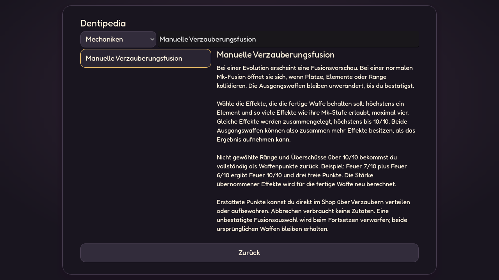

# Dentipedia

Stand: 27.10.2026. Das Nachschlagewerk ist im Hauptmenü und über Escape
erreichbar. Ein pausierter Kampf bleibt beim Lesen pausiert. Die Suche filtert
Titel und Text innerhalb des gewählten Bereichs.

- **Waffen:** 18 Standardwaffen mit Spielweise, Skalierung, Effekten und
  Basiswerten Mk I–IV; entdeckte Spezialwaffen ergänzen die Liste.
- **Items:** Effekte, Stapel- und Familienlimits aus den aktuellen Ressourcen.
- **Relikte:** alle fünf Relikte mit ihren Effekten.
- **Werte:** dieselben Attribute, Namen und Icons wie in HUD und Shop.
- **Mechaniken:** 25 Themen zu aktuellen Systemen und ihrem Zusammenspiel.
- **Verzauberungen:** Übersicht und Einzeleinträge aller Elemente und
  Verstärkungen, einschließlich ausdrücklich markiertem Altbestand.

## Aktuelle Regeln

Die Texte unterscheiden Waffenpunkte, Effektränge, Mk-Stufen und Wurzeln.
Neue Kapseln geben Punkte für ein konkretes Waffenexemplar; Mk öffnet bis zu
vier Plätze, jeder Effekt reicht bis 10/10, und pro Waffe ist ein Element wählbar.
Reichweite, Tempo, Lebensraub, Krit-Chance, Krit-Schaden und Wucht ergänzen es.

Die manuelle Verzauberungsfusion erklärt Auswahl, Zusammenlegen und vollständige
Punkteerstattung. Feuer 7/10 plus Feuer 6/10 ergibt Feuer 10/10 und drei Punkte.
Konflikte blockieren die Fusion nicht pauschal. Neue Punkte erzeugen keine
zufälligen Effekt-Seltenheiten, Slotfunde oder Mk-Aufstiege; alte gespeicherte
Angebote werden im eigenen Altbestand-Thema erklärt.

Weitere Themen behandeln Dash und festen Ausdauerregen, den erhöhten
Körperkontaktschaden beim Dash, Lebensraub, Elementformen und Einschläge,
die ein- und zweifädigen Zahnseidenwaffen, Goldzahn-Gauner, Waffenrollen,
Shopwerte, Belohnungsfolge, Gegner, Boss-Entzündung, Schwierigkeit, Story,
Endlos und Fortsetzen. Kurze kosmetische Elementspuren sind von schädlichen
Item-Bodenwirkungen getrennt.

Dashkosten, Cooldown, Regeneration und Kontaktmultiplikator stammen direkt
aus PlayerDash.DEFAULT. Lebensraub liest Intervall und Obergrenze aus seiner
Affix-Ressource; Gauner und Aufstiegswahl verwenden ebenfalls ihre aktuellen
Spieldaten. Waffen-, Item-, Relikt- und Werteeinträge bleiben katalogbasiert.

## Waffenformen und Bedienung

Ein Waffeneintrag zeigt Normal, Feuer, Eis, Gift, Elektro, Blutung und Wasser
über die bestehenden Elementsymbole. Die Ansicht wechselt nur das Bild und
den Formzusatz; Basiswerte, Ausrüstung und Verzauberungen bleiben unverändert.
Die Formbilder werden über den vorhandenen Skin-Cache geladen.

[Desktop-Formvorschau](screenshots/dentipedia_update/weapon_forms_1280x720.png),
[Hochformat](screenshots/dentipedia_update/weapon_forms_360x640.png).

Die Suche findet die Zahnseiden-Schneide auch unter ihrem früheren Namen
Garotte. Beim Öffnen eines anderen Eintrags beginnt dessen Text wieder oben.
Im Hochformat stehen Liste und Details untereinander. Bei nur ein oder zwei
Suchtreffern benötigt die Liste weniger Höhe; die Formbuttons umbrechen
innerhalb des Detailbereichs. Kurzes Querformat behält die beiden Spalten.

Unentdeckte Spezialwaffen zeigen nur ihre schwarze Alpha-Silhouette.
Namen, Zutaten, Effekte, Werte und Formvorschau bleiben verborgen, bis die
erste Evolution bestätigt wurde. Der dauerhafte Fortschritt bleibt über Runs,
Verkäufe und Neustarts erhalten. Familienzutaten akzeptieren jede Seltenheit.

## Prüfung

tests/dentipedia.gd prüft Kataloge, neue Themen, Schriftzeichen, echte
Freischaltung, Spoilerschutz, Suche, alle sieben Formbuttons, unveränderte
Waffenvorlagen, Scrollpositionen und vier Bildschirmgrößen. Menü- und
Belohnungsansichten werden zusätzlich durch ihre bestehenden Tests geprüft.

tools/preview_dentipedia.gd erzeugt native Ansichten für Fusion, Dash,
Waffenpunkte, Feuerform und Lebensraub in 1280×720, 360×640 und 568×320.
Die Aufnahmen liegen unter docs/screenshots/dentipedia_update/; das Werkzeug
verwendet getrennte Sitzungsdateien.
