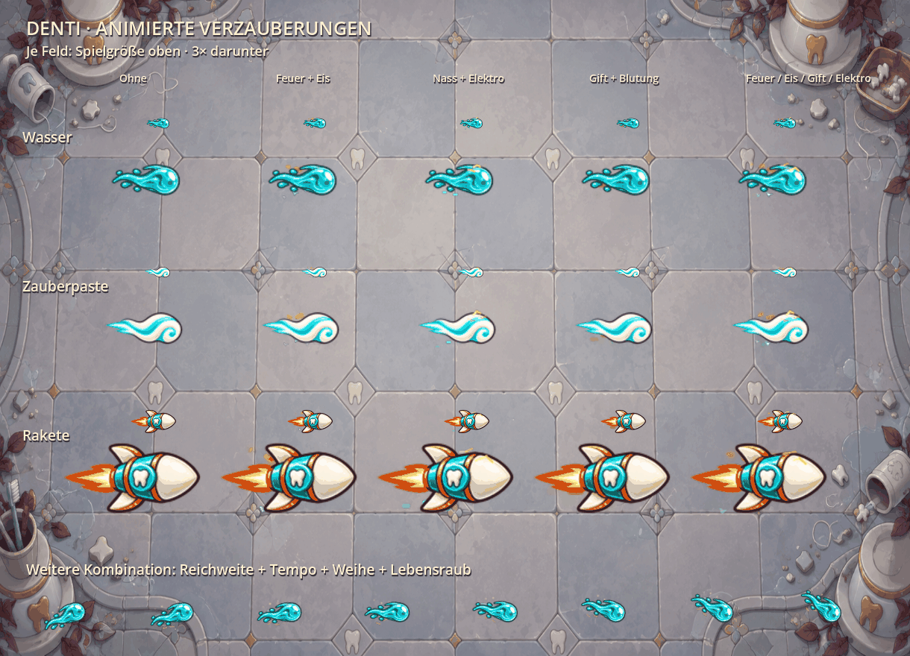

# Animierte Verzauberungen auf Projektilen

Geschosse zeigen bis zu vier Verzauberungen gleichzeitig durch bewegte Spuren:
Flammen und Glut, Eisstaub, Giftnebel, Bluttröpfchen, kleine elektrische Entladungen,
Geschwindigkeits-/Reichweitenstreifen, Wassertropfen, goldene Lichtpartikel und
rosige Lebensraubfäden. Es werden keine Icons auf Geschosse gesetzt. Die
bisherigen Icons in Waffeninfos bleiben erhalten.

## Darstellung und Kosten

`ProjectileParticleFrames` rastert acht zyklische Bilder pro Kombination. Die
Animation läuft mit zwölf Bildern pro Sekunde, mit versetzter Phase zwischen
Geschossen. Partikel sind Bestandteil der gemeinsamen Geschosstextur: Im Kampf
gibt es einen Sprite und einen einfachen Framewechsel, keine zusätzlichen
Emitter oder Partikel-Nodes, keine Effekt-Shader und keine Pixelgenerierung.
Die animierten Spuren drehen sich mit dem Geschoss; sie sind keine unabhängig
in Weltkoordinaten zurückbleibenden Partikel. Bei einem abrupten Richtungswechsel
dreht sich damit auch die kurze Spur.

`ProjectileEnchantmentSkins` stellt für die aktuelle Ausrüstung einen Atlas
zusammen. Nur tatsächlich benötigte Kombinationen werden vorbereitet. Reihenfolge,
Schadenswerte und Stärke derselben Verzauberungen verändern den Schlüssel nicht.
Auch unverzauberte ausgerüstete Geschosse werden bei gemischter Ausrüstung in
diesen Atlas aufgenommen, damit der Wechsel zwischen normalen und verzauberten
Schüssen keine Texturwechsel erzwingt.

Die Vorbereitung läuft bei Kauf/Fusion/Evolution, Verzauberungswahl und Laden.
Pro Vorbereitung wird jede Atlas-Seite nur einmal hochgeladen. Das benutzt
Godots [ImageTexture](https://docs.godotengine.org/en/stable/classes/class_imagetexture.html),
nicht eine neue Textur pro Abschuss oder Animationsbild im laufenden Kampf.
Ein Fallback erstellt noch nicht vorbereitete Varianten für direkte Toolaufrufe.

Der Cache hält höchstens sechs Kombinationen und eine Atlas-Seite. Je nach
benötigter Fläche ist diese 512 × 256, 1024 × 512 oder höchstens 2048 × 1024 groß.
Die größte Variante kostet 8 MiB Pixel auf GPU-Seite und zusätzlich 8 MiB für
die CPU-Kopie, zuzüglich Grundgrafiken und Verwaltungsdaten. Ohne Verzauberungen
wird kein dynamischer Atlas angelegt.

Beim Ausrüstungswechsel behalten bereits fliegende Geschosse ihre unveränderten
alten Atlas-Referenzen bis zum Flugende. Idle-Reserven und zurückgegebene alte
Geschosse geben diese Referenzen frei. Kurzzeitig können daher zusätzlich alte
Seiten existieren. Die aktiven Texturen werden niemals für neue Kombinationen
überschrieben. Nach Save/Resume werden alle aktuell ausgerüsteten Varianten vor
dem Fortsetzen erneut vorbereitet, auch wenn alte Schüsse andere Kombinationen
mitbringen. Texturen/Frames sind abgeleitet und werden nicht im JSON gespeichert.

## Messung und Prüfungen

Isolierter nativer Compatibility-Rendertest, RTX 4070: 200 gemischte Geschosse
(unverzaubert plus fünf unterschiedliche Kombinationen) benötigen 200 Sprites
und insgesamt einen Zeichenaufruf. Während acht dargestellter Animationsschritte
entstehen null zusätzliche Kompositionen und null zusätzliche Textur-Uploads.
Der Test ersetzt keine Browser-/Laptopmessung und simuliert keine vollständige
Kampf-Framezeit.

`tests/projectile_enchantment_skins.gd` prüft:

- alle zehn Verzauberungen und den Beitrag jedes Effekts einer Viererkombination;
- unterschiedliche Animationsframes, gemeinsame Textur und gebündelte Vorbereitung;
- denselben Cache-Schlüssel bei anderer Reihenfolge/Stärke;
- sechs große Raketenvarianten und Begrenzung bei weiteren Varianten;
- unveränderte alte In-flight-Grafiken nach einem Ausrüstungswechsel;
- 100 Salven samt Animation ohne neue Grafiken, Uploads oder Projektil-Nodes;
- Rücksetzen beim Recycling und Mischung normaler/verzauberter Schüsse;
- Save/Resume sowie vorbereitete erste Angriffe nach dem Laden.

Die Projektil-, Verzauberungs-, Evolutions- und Reward-Tests ergänzen diese
Prüfungen für unveränderte Kampfmechanik.

Die Vorschau erzeugt `tools/preview_enchanted_projectiles.gd` mit normalem
Rendering und isolierten Benutzerdaten. Sie schreibt ein Vergleichsbild nach
`docs/screenshots/enchanted_projectiles.png` und acht Animationsframes nach
`.godot/enchantment_frames/`. Der zusätzliche GIF-Vergleich zeigt dieselben
gerenderten Frames mit gemeinsamer Farbpalette.

