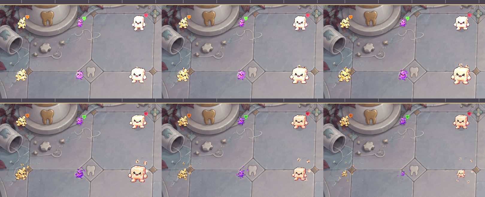

# Treffer- und Todesimpact der Gegner

Stand: 21.11.2026. Treffer sollen sich nach Wucht anfühlen, ohne die Arena bei
hoher Gegnerdichte zu verdecken. Beide Effekte sind rein kosmetisch: Schaden,
Trefferflächen, Bewegung, Beute und Spielstände bleiben unverändert.



## Treffer-Zucken

Ein getroffener Gegner wird kurz in Schlagrichtung gestaucht, ein Stück
zurückgestoßen und federt einmal nach (0,16 s). Dazu kommt das bisherige
Aufblitzen.

- Die Stärke richtet sich nach dem Anteil am maximalen Leben. Kritische Treffer
  wirken etwas stärker, Schaden über Zeit und indirekte Procs nur schwach.
- Eliten reagieren schwächer und Bosse nur leicht, weil ihre Rigs mitskaliert
  werden. Karamell-Pylone und andere Bossziele animieren ihr Sprite selbst und
  bleiben ausgenommen.
- Ohne Waffenrichtung weicht der Gegner von Denti weg.
- Unter Dauerbeschuss startet ein schwächerer Treffer erst neu, wenn der
  vorherige Impuls größtenteils abgespielt ist. So bleibt ein lebendiges
  Wackeln statt eines eingefrorenen ersten Bildes.

Die Werte stehen in `scripts/enemies/enemy_hit_reaction.gd`. Ein kleines
`RefCounted` pro Gegner hält Zeit, Stärke und Richtung. Es entstehen keine
Nodes, und außerhalb eines aktiven Impulses fällt keine Arbeit an.

## Plopp beim Tod

Gewöhnliche Gegner verschwinden nicht mehr schlagartig. Ihr Körper bläht sich
hell auf und fällt zusammen. Ein dünner Ring breitet sich aus, und einige Krümel
aus der eigenen Gegnertextur fliegen von der letzten Trefferrichtung weg
(0,24 s). Bosse behalten ihre eigene Todesanimation.

`EnemyDeathPops` (`scripts/enemies/enemy_death_pops.gd`) zeichnet alle Plopps
in einem gemeinsamen Canvas-Item direkt über den Gegnerkörpern und unter
Gegnergeschossen und Denti. Pro Tod entsteht kein Node. Es werden nur Texturen
benutzt, die der Gegner schon gezeichnet hat; es gibt also keine neue Textur,
keinen Shader und keine Laufzeit-Generierung. Höchstens 48 Plopps laufen
gleichzeitig, ältere fallen bei Massenkills heraus. Im sparsamen Grafikmodus
fliegen drei statt fünf Krümel. Arena-Aufräumen und Fortsetzen eines Spielstands
leeren die Ebene; sie wird nicht gespeichert.

## Prüfen

`tests/enemy_impacts.gd` prüft Richtung, Rückkehr in die exakte Ruhelage,
Neustartregel, Boss-Abschwächung, ein Plopp pro Tod ohne zusätzliche Nodes,
Budget, Boss-Ausnahme, Aufräumen sowie Save/Resume.

```powershell
& Godot_v4.7.2-stable_win64_console.exe --fixed-fps 60 --path . --script res://tools/preview_enemy_impacts.gd
```
