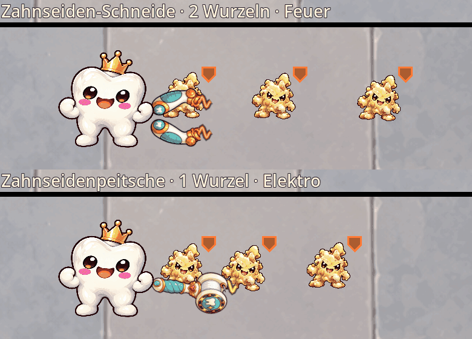

# Zahnseide: feste Griffe und ausfahrende Elementfäden

Stand: 27.10.2026. Die Griffe von Zahnseiden-Schneide (ehemals Garotte) und
Zahnseidenpeitsche bleiben bei Denti. Nur der Faden fährt nach vorn aus und
zieht sich zurück. Die Schneide besitzt zwei Fäden, die Peitsche einen.

Beide Waffen treffen Gegner entlang der tatsächlich gezeichneten Fäden,
einschließlich mehrerer Ziele hintereinander. Ein näherer Gegner verkürzt den
Schlag nicht. Es gibt keinen unsichtbaren Rundumschnitt oder 150°-Fächer mehr.
Ausholen und Rückzug verursachen keinen Schaden. Zwei Fäden wenden den
Waffentreffer und Blutung pro Ziel trotzdem nur einmal an.

| Waffe | Wurzeln | Fäden | Reichweite Mk I / II / III / IV |
| --- | ---: | ---: | --- |
| Zahnseidenpeitsche | 1 | 1 | 180 / 190 / 200 / 210 |
| Zahnseiden-Schneide | 2 | 2 | 220 / 235 / 250 / 270 |

Die Peitsche erhält gegenüber ihren bisherigen 115–140 Reichweite genug Platz
für den sichtbaren Vorwärtsschlag vor ihrem festen Griff. Schaden, Skalierung,
Angriffstakt und Blutung bleiben bei beiden Waffen erhalten. Die Schneide
behält ihren kurzen radialen Rückstoß vor Gegnerresistenzen.

Feuer, Eis, Gift, Elektro, Blutung und Wasser bestimmen den ganzen Faden,
bewegte Partikel und das Fadenende. Dazu kommen passende gemalte Griffbilder
und die bestehenden Einschläge. [Alle 14 nativen Ansichten](screenshots/floss_cut/anchored/elements.png).

## Aufbau und Kompatibilität

`WeaponFlossMotion` hält die Griffpositionen relativ zu Denti konstant.
Die Griffe drehen zum Ziel, ohne dorthin zu wandern. Ihr gemalter Anschluss
bleibt exakt mit dem Anfang der Fadenkurve verbunden. Verdichtung der
Ausrüstung verkleinert die Griffe, ohne die Schlagreichweite zu verkürzen.

`WeaponStrike` prüft die sichtbaren Kurven mit Zwischenproben über den
ausgeführten Physikschritt. Damit werden auch übersprungene Zwischenbilder
bei hohem Angriffstempo berücksichtigt. Die Entscheidung ist kein abweichender
Kegel- oder Radius-Test. `WeaponFlossCut` zeichnet die Kurven mit den vorhandenen
animierten Elementtexturen und bewegten Partikeln.

Die sieben vorhandenen Zeichnungen liefern je zwei Griffteile der Schneide
und einen Griff der Peitsche: insgesamt 21 Texturen mit 512×512 Pixeln und
Mipmaps. Der Skin-Compiler reproduziert die Masken und Fadenanschlüsse aus
`data/weapon_skins/rigs.json`. Originalvorlagen bleiben unverändert.

Die IDs `floss_garrote` und `floss_whip` bleiben erhalten. Shop, Startauswahl,
Verzauberung, Fusion und bestehende Spielstände übernehmen den Aufbau.
Das vorhandene Bewegungs-Snapshot erhält Phase, getroffene Ziele und Restzeit;
Fortsetzen verursacht keine erneuten Treffer auf bereits getroffene Gegner.

## Messung und Prüfung

30 Sekunden echte Angriffe bei 60 Physikschritten/s und festem Zufall.
Unsterbliche stationäre Ziele ohne KI, Rüstung, Wache oder Rückstoßverschiebung.
Einzelziele stehen bei 65 % der jeweiligen Reichweite, fünf Ziele einer Reihe
bei 25–85 %. Der Vergleich zeigt Trefferabdeckung und Rohleistung und ersetzt
keinen Balancepass gegen bewegliche Gegner.

| Situation | Mk | Originale Garotte | Aktuelle Schneide |
| --- | ---: | ---: | ---: |
| Einzelziel-DPS | I | 46,4 | 46,4 |
| Fünf Ziele hintereinander, DPS | I | 188,4 | 235,5 |
| Einzelziel-DPS | IV | 129,4 | 129,4 |
| Fünf Ziele hintereinander, DPS | IV | 388,3 | 647,2 |

Die Peitsche bleibt bei 25,0 Einzelziel-DPS auf Mk I beziehungsweise 63,7 auf
Mk IV. Eine seitlich verteilte Gruppe wird nun schlechter erfasst als beim
alten Rundumschnitt beziehungsweise Frontfächer. Das ist die Folge der
sichtbaren Vorwärtsgeometrie; zusätzliche seitliche Gegner werden nicht
unsichtbar mitgetroffen. [Rohdaten vorher](balance_floss_cut_before.json),
[Rohdaten nachher](balance_floss_cut_after.json).

`tools/benchmark_floss_cut.gd` reproduziert die aktuelle Messung.
`tools/preview_floss_cut.gd` erfasst echte Angriffe; `--weapon=floss_whip`
wählt die Peitsche, `--element=electric` ihr Element. `--sheet` ergänzt alle
14 Formen. Die Vorschau prüft drei Treffer entlang des Schlags.

`tests/weapon_floss_cut.gd` prüft feste Griffe, verbundene Fadenenden, ein/zwei
Fäden, nahe und entfernte Ziele, einmaligen Schaden, Windup, Rückzug,
Rückstoß, Fortsetzen, Spielerbewegung, Richtungen, Ausrüstungsdichte und alle
Elementformen. 22 gezielte Waffen-, Element-, Startauswahl- und
Kampffeedbacktests bestanden. Der DPS-Test prüft den Gruppennutzen der Fäden
an einer Gegnerreihe, passend zur neuen Angriffsform.
Ein isoliertes Projekt lädt alle 21 Grifftexturen mit Mipmaps aus dem
exportierten Ressourcenpaket; die beiden Laufzeitskripte sind enthalten.
