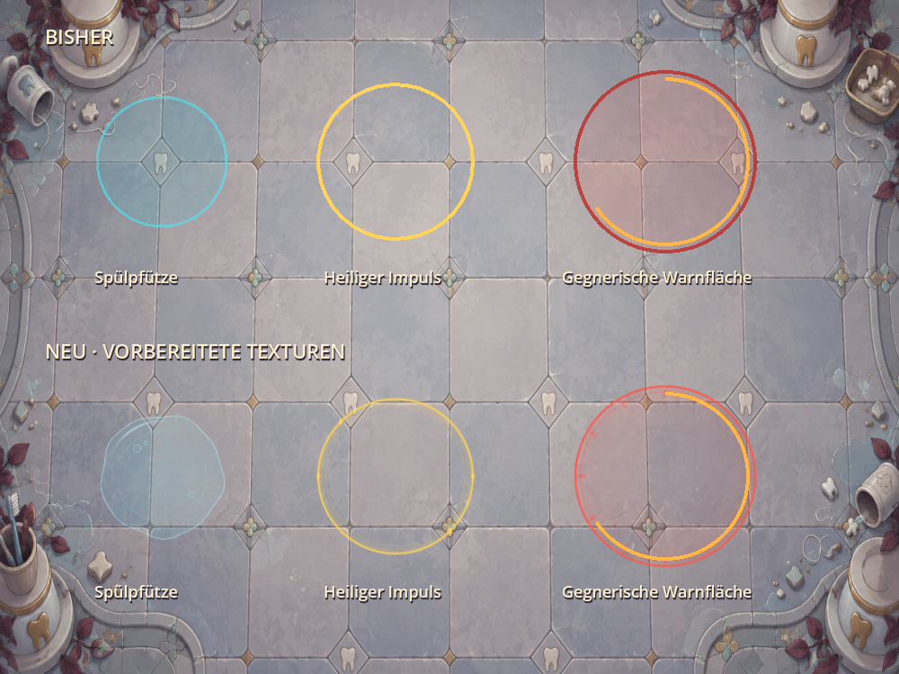

# Vorbereitete Boden- und Flächeneffekte

Erster Stil-Durchgang für Spülpfützen, Wasser-Evolutionsflächen, Item-/Reliktimpulse
und kreisförmige gegnerische Flächenwarnungen. Andere Warnungen, Statusringe und
Waffenstrahlen behalten zunächst ihre bisherige Darstellung.

Die neuen Flüssigkeitsflächen haben leicht unregelmäßige Ränder, kleine
Schaumblasen und dezente Reflexe. Impulse bekommen glatte Doppelkonturen und
kleine Glanzpunkte. Gegnerische Flächen behalten einen klaren roten Außenrand
am unveränderten Schadensradius und den bisherigen gelben Fortschrittsring.
Alle Kampfwerte, Timer, Trefferprüfungen und gespeicherten Zustände bleiben gleich.

`tools/bake_ground_effects.gd` rastert drei Formen offline in einen gemeinsamen
1152 × 384 RGBA-Atlas. `GroundEffects` zeichnet pro Fläche ein Texturrechteck;
es werden im Kampf keine Pixel, Polylinien oder neuen Materialien erzeugt.
Der Atlas wird im vorhandenen Menü-Warmup einmal gezeichnet. Unkomprimiert
benötigen seine Pixel ungefähr 1,69 MiB; hinzu kommen Engine-Verwaltungsdaten.

## Prüfung

Im nativen Compatibility-Renderer (RTX 4070) benötigt ein isolierter Aufbau aus
60 Spülpfützen bisher 120 Zeichenaufrufe und mit dem Atlas einen. Dieser Aufbau
überschreitet die normale Anzahl der Itempfützen (höchstens vier). Er zeigt die
Bündelung gleichartiger Effekte und ist weder ein vollständiger Kampfvergleich
noch eine Prognose für Browser-FPS. Andere Texturen, Ebenen und Zeichenreihenfolgen
können die Bündelung im vollständigen Kampf unterbrechen. Durch die transparenten
Rechtecke bleibt Pixelarbeit bestehen.

`tests/ground_effects.gd` prüft die Gefahrenkontur am tatsächlichen Radius, freie
Impulsmitte und transparente Zellränder. Der Warmup-Test prüft das tatsächliche
Einplanen des neuen Atlasses zum Zeichnen. Bestehende Kampf-/Item-/Relikttests
prüfen die unveränderten Effekte auf den Spielzustand.



```powershell
$env:APPDATA = 'D:/Projekte/denti/.godot/ground_effects_userdata'
Godot_v4.7.2-stable_win64_console.exe --headless --path . --script res://tools/bake_ground_effects.gd
Godot_v4.7.2-stable_win64_console.exe --headless --editor --path . --import --quit
Godot_v4.7.2-stable_win64_console.exe --path . --script res://tools/preview_ground_effects.gd -- --benchmark
```

Der Baker ersetzt ausschließlich den abgeleiteten Effektatlas. Die Vorschau
schreibt `docs/screenshots/ground_effects_comparison.png`. Die isolierten
Benutzerdaten schützen normale Einstellungen und Spielstände.
