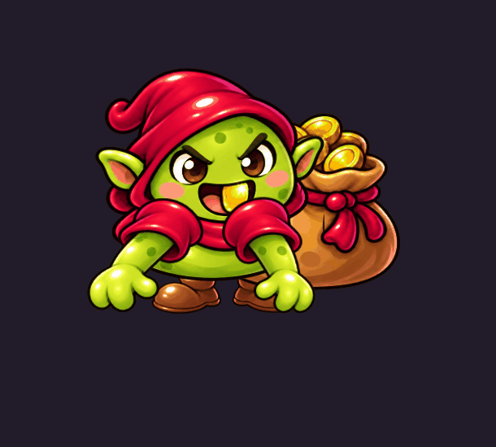
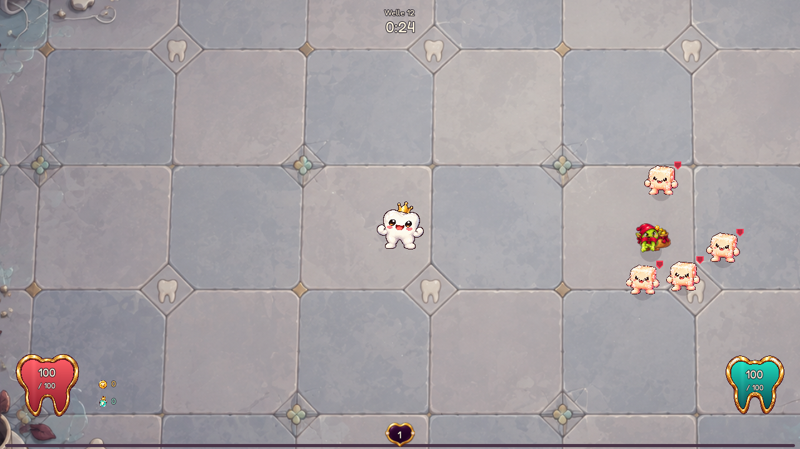

# Goldzahn-Gauner

Umgesetzt am 22.10.2026. Ein seltener, flinker Beutedieb schafft während der Welle eine freiwillige Jagd. Er stiehlt ausschließlich noch nicht eingesammelte Münzen. Wer ihn ignoriert, kann Gold verlieren; wer ihn erwischt, bekommt eine goldene Upgrade-Kapsel.



## Begegnung

| Regel | Startwert |
| --- | --- |
| Erste mögliche Welle | 8 |
| Häufigkeit | 25 % pro geeigneter Welle, ein einziger Versuch |
| Zeitpunkt | bei 25 Sekunden Restzeit |
| Bosswellen | ausgeschlossen, auch im Endlosmodus |
| Höchstzahl | einer pro Welle |
| Beutebeutel | maximal 30 Münzen |
| Aufheben | alle 0,12 Sekunden sämtliche geeigneten Münzstapel im Radius von 80 Einheiten, auch während der Flucht |
| Kurzer Sprint | 0,55 Sekunden, höchstens alle 3 Sekunden |
| Verschnaufpause danach | 0,65 Sekunden bei 42 % Bewegungstempo |

Der Gauner sucht lose Münzen in seiner Umgebung. Nahe Denti weicht er aus und bewertet Fluchtziele hinter anderen Gegnern. Er sammelt im Vorbeilaufen, ohne für einzelne Münzen stehenzubleiben. Ein Sammelvorgang kann mehrere Stapel nehmen und erzeugt eine gemeinsame Münzflug-Animation. Die Route darf nicht durch Denti führen; Arenawände begrenzen sie. Ein voller Beutel verlangsamt ihn um 10 %. Die Planung läuft viermal pro Sekunde, verwendet die vorhandenen Raumindizes und berücksichtigt höchstens 24 Deckungsgegner.

Er verursacht keinen Kontaktschaden und verbraucht beim Berühren keine Schilde. Nässe und andere normale Statuswirkungen funktionieren. Sein Tempo hängt von Schwierigkeit und Endloswelle ab, nicht von Dentis aktuellem Bewegungstempo. Easy/Normal/Hard/Hell verwenden 90/100/108/115 % seines Grundtempos von 195. Gesundheit und Verteidigung verwenden die gemeinsame Gegner-Skalierung. Es gibt keinen Elite-Schadensschutz.

Bei einem simulierten zwölfsekündigen Verfolgen mit unverstärktem Denti entstehen auf allen vier Schwierigkeitsgraden wiederholt Nahkampfgelegenheiten. Das prüft Erreichbarkeit, ersetzt aber keine menschlichen Kämpfe mit echten Builds.

### Korrektur nach dem ersten Spieltest

Der erste Gauner starb in Welle 11 zu schnell und sammelte zu langsam. Die alte KI unterbrach das Aufheben beim Fliehen vollständig und benötigte zusätzlich 0,38 Sekunden Stillstand pro Stapel. Sammeln und Flucht laufen jetzt unabhängig. Dentis Sammelpriorität und das Limit von 30 Münzen gelten weiterhin.

Die Basisgesundheit beträgt jetzt 420 statt 180, der Zuwachs pro Welle 150 statt 42 und die späte Beschleunigung 6 statt 1,8. Auf Normal in Welle 11 ergeben sich 2070 statt 645 Leben; es gibt weiterhin keinen Elite-Schadensschutz und keine neue Unverwundbarkeitszeit. Bewegungstempo und Verschnaufpausen bleiben erhalten.

Der [reproduzierbare Verfolgungsvergleich](loot_goblin_chase_balance.json) nutzt echtes Waffenspiel bei 60 Hz, unverstärktes Bewegungstempo und fünf konfigurierte Waffen, ohne Items, Verzauberungen oder weitere Gegner:

| Schwierigkeit / Welle | Waffen | Vorher | Jetzt |
| --- | --- | ---: | ---: |
| Normal / 11 | Mk II | 3,7 s | ca. 7,4 s |
| Normal / 11 | Mk III | 1,8 s | ca. 4,8 s |
| Normal / 19 | Mk IV | 3,0 s | ca. 5,5 s |
| Hell / 11 | Mk II | ca. 5,6 s | ca. 11,4 s |
| Hell / 11 | Mk III | 3,9 s | ca. 7,3 s |
| Hell / 19 | Mk IV | 5,0 s | ca. 11,5 s |

Dies sind konfigurierte Vergleichsbuilds und einzelne Messungen, keine vollständigen Runs. Sehr starke Builds dürfen weiterhin schneller töten. Baseline-Modus des Werkzeugs verwendet die alten Lebenswerte mit der aktuellen KI; im Vergleich liegen keine Münzen, sodass der neue Sammelablauf das Ergebnis nicht beeinflusst.



## Geld und Belohnung

- XP, Kapseln und Dentis Münzbestand bleiben unberührt. Münzen in Dentis Sammelradius gehören Denti; der Dieb darf sie nicht mehr nehmen.
- Beim Stehlen wird der tatsächliche Münzstapel verkleinert. Teilbeträge bleiben auf dem Boden. Dabei entstehen keine Einsammel-Effekte.
- Beim Töten fällt der gestohlene Betrag wieder auf den Boden. Er wird nicht erneut durch Goldsonde oder Goldextraktor vergrößert. Die spätere erste Spieleraufnahme kann reguläre Pickup-Effekte auslösen.
- Zusätzlich fällt genau eine goldene Upgrade-Kapsel. Ihr Inhalt wird beim Erscheinen festgelegt und beim Fortsetzen erhalten. Es gibt keinen zusätzlichen festen Goldbonus und keinen zweiten gewöhnlichen Gegnerdrop. Bestehende Kill-Itemeffekte bleiben wirksam.
- Am Wellenende verschwindet der lebende Gauner mit seinem Beutel **vor** dem Loot-Sweep. Die gestohlenen Münzen werden nicht nachträglich eingesammelt.
- Die Kapsel gehört zur bestehenden Belohnungswarteschlange nach der Welle. Die Jagd öffnet kein Kampfmodal.

Die Inspiration ist Brotatos fliehender [Looter](https://brotato.wiki.spellsandguns.com/Enemies), der beim Tod Beute liefert. Der begrenzte tatsächliche Münzdiebstahl, die Gegnerdeckung, die Verschnaufpausen und die goldene Denti-Kapsel sind unsere eigenen Regeln. Der Gauner ist kein Ersatz für eine verlässliche Geldsenke: Seine Anwesenheit ist zufällig und ein erfolgreicher Spieler kann das Gold zurückholen.

## Allgemeine Economy-Korrektur

Der frühe Aufbau bleibt erhalten: Welle 1–4 behalten ihre Goldchance. Ab Welle 5 gilt auf Normal der Faktor

`max(1 - 0,015 * Welle - 0,009375 * (Welle - 4), 0,40)`.

Damit beträgt er in Welle 10 etwa 79,4 %, in Welle 20 55 % und später mindestens 40 %. Schwierigkeitsfaktoren und garantierte Elitenmünzen bleiben bestehen; XP ändert sich nicht.

Wiederholtes Neuwürfeln verwendet den Zuschlag `n * (n + 1) / 2`, wobei `n` die bereits bezahlten Versuche dieses Shops beziehungsweise dieser Level-Auswahl zählt. Ein normaler Shop kostet **2, 3, 5, 8, 12, 17, 23, 30, 38, 47 …**. Zehn Versuche kosten zusammen 185 statt bisher 65 Münzen. Ein neuer Shop und die nächste Level-Auswahl setzen ihren eigenen Zähler zurück. Endlosshops behalten ihren erhöhten Startpreis und multiplizieren den Zuschlag mit ihrem bisherigen Kostenschritt.

Angebots-/Verkaufspreise, Pins und Economy-Items bleiben erhalten. Ein gespeicherter alter Shop behält den angezeigten nächsten Preis; danach greift die neue Kurve. Neue Spielstände speichern Zähler und Preis.

Die [Prognose mit zwölf Spawnplänen je Schwierigkeit](loot_goblin_economy.json) vergleicht dieselben angeforderten Gegner vor und nach der Dropänderung:

| Schwierigkeit | Welle 1 | Welle 10 vorher → nachher | Welle 19 vorher → nachher |
| --- | ---: | ---: | ---: |
| Easy | 44 → 44 | 139,9 → 130,6 | 291,7 → 239,1 |
| Normal | 53 → 53 | 148,3 → 138,4 | 287,5 → 235,7 |
| Hard | 53,1 → 53,1 | 152,5 → 142,4 | 328,5 → 271,0 |
| Hell | 54,4 → 54,4 | 152,4 → 142,3 | 335,3 → 278,8 |

Das sind erwartete Münzwerte bei vollständigen Kills ohne Gegnerlimit, Builds, Itemboni, Kapselzerlegen, Gaunerverluste oder Ausgaben. Es ist eine Einkommensprognose, kein gemessener vollständiger Run. Die späte Reduktion beträgt hier etwa 17–18 %; die zusätzliche Wirkung der teureren Rerolls hängt vom Kaufverhalten ab.

## Grafik, Technik und Speicherung

Die sechs gemalten Teile wurden mit dem eingebauten ImageGen-Werkzeug anhand vorhandener Denti-Gegner als Stilreferenzen erzeugt. [Atlas und vollständige Prompts](../assets/enemies/loot_goblin/prompt.md). Sechs Knochen bewegen Körper, Beutel, Arme und Füße. Die Teile behalten ihr Seitenverhältnis; es gibt keine verformten Einzelbilder. Ein einmal vorbereiteter Atlas mit Mipmaps hält die Figur auch in Kampfgröße glatt. Der Menü-Warmup zeichnet das Rig bereits vor dem ersten Auftauchen.

`LootGoblinData` und `data/encounters/loot_goblin.tres` halten die Begegnungswerte. `LootGoblin` steuert die KI; `LootGoblinRig` die Darstellung. `Enemy` behält Schaden, Statuseffekte, Index und Todesabwicklung. Der Wellencontroller würfelt den Auftritt einmal und reserviert bis dahin bei geeigneten Wellen einen zusätzlichen Gegnerplatz. Frühe und Bosswellen verlieren dadurch keinen Platz.

Save/Resume erhält Münzbesitz, Kapselinhalt, KI-Zustand, Sprintpause, Sammel-Cooldown und den bereits erfolgten Spawnversuch. Alte Spielstände mit einem unterbrochenen stationären Aufheben beginnen nach dem Laden mit einer neuen Zielsuche. Bereits belohnte, zur Löschung vorgemerkte Gegner werden nicht erneut gespeichert. Telemetrie speichert Erscheinen, gestohlene, gerettete und verlorene Münzen sowie Kills/Fluchten pro Welle und Run; zurückgeholte Münzen tragen die Einnahmequelle `goblin_return`.

## Reproduktion und Prüfung

```powershell
# GODOT bezeichnet die lokale Godot-4.7-Konsole.
& $env:GODOT --path . --script res://tools/preview_loot_goblin.gd
& $env:GODOT --path . --script res://tools/preview_loot_goblin.gd -- --play
& $env:GODOT --headless --path . --script res://tools/measure_goblin_economy.gd
& $env:GODOT --headless --fixed-fps 60 --path . --script res://tools/benchmark_loot_goblin.gd -- --baseline
& $env:GODOT --headless --fixed-fps 60 --path . --script res://tools/benchmark_loot_goblin.gd
python tools/run_tests.py --godot $env:GODOT --filter loot_goblin --filter loot_goblin_motion --filter economy_pressure
```

Die Vorschau schreibt ausschließlich in `.godot/goblin_preview/` und berührt den normalen Spielstand nicht. `--play` startet eine Welle 12 mit drei Mk-II-Waffen, 300 Leben und garantiertem Gauner bei 25 Sekunden Restzeit. Ohne Parameter entstehen native Bildschirmaufnahmen und 48 Rig-Frames für das GIF.

Die ursprüngliche Umsetzung wurde mit der vollständigen Suite von **140 Testskripten** geprüft. Die Haltbarkeits-/Sammelkorrektur besteht zusätzlich **10 gezielte Testskripte**, darunter den neuen `loot_goblin_pressure`-Test: Sammeln mehrerer Stapel während des Sprints, kurze Wiederaufnahme, Beutelgrenze, geschützte Spielerbeute und tatsächliche W11-Verfolgung mit Mk-III-Waffen. Automatische Prüfungen decken außerdem Spawnbegrenzung/Bossausnahmen, Platzreservierung, Teilstapel, echten JSON-Save/Resume einschließlich Sammel-Cooldown, ungültige Save-Container, einmalige Todesbelohnung, fehlendes Kampfmodal, Flucht vor dem Sweep, Deckung, zentrale Bewegung und Nahkampfverfolgung auf allen Schwierigkeiten ab. Economy-Tests prüfen Kostenkurven, alte Shops, Reset, Goldgrenzen und unverändertes XP. Menschliche Jagd-/TTK-Vergleiche mit frühen und starken Builds sowie Browser-Performance bleiben die nächste Balance-Abnahme.
