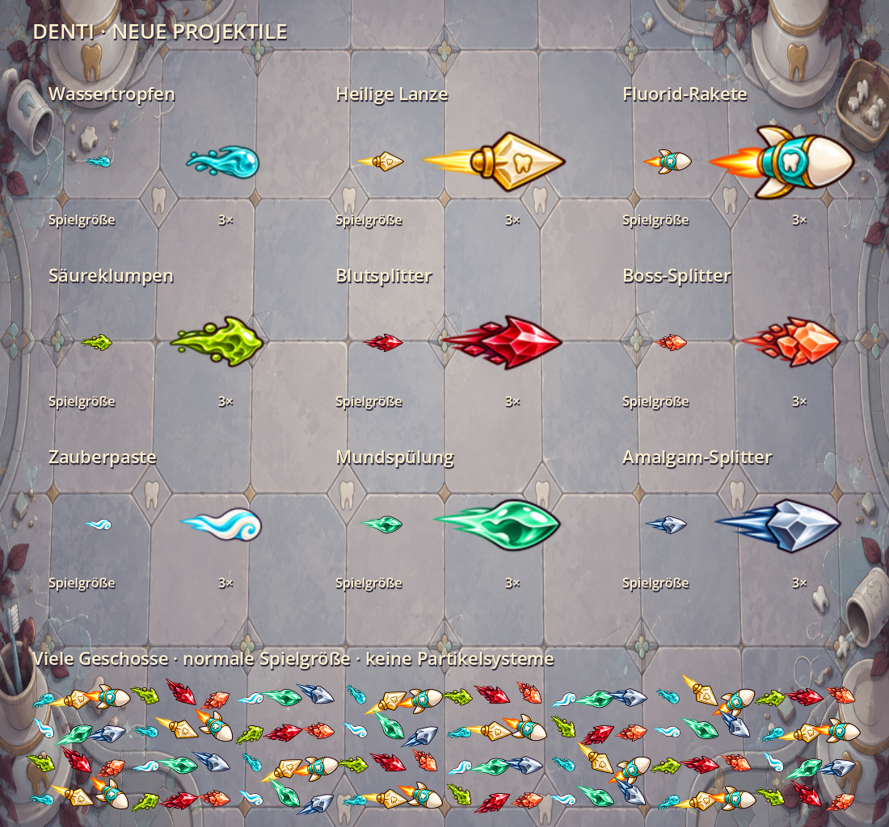

# Gemalte Projektile

Die bisher überwiegend kreisförmigen Geschosse verwenden jetzt neun gemalte
Motive: Wasser, Zauberpaste, Mundspülung, Metall, heilige Lanze, Fluoridrakete,
Säure, Blut- und Boss-Splitter. Gegnerische Säure bleibt grün, Blut rot und
Boss-/Radialsplitter warm orange beziehungsweise rot. Die bestehenden Ressourcenfarben
wählen die passenden Familien; Farbwerte, Trefferregeln und Status-Payloads bleiben
gespeichert. Individuelle Farbnuancen sind im Motiv zu einer gemeinsamen Palette
zusammengefasst, keine pixelgenaue Übernahme aller bisherigen Farbtöne.

Die Art wurde mit der eingebauten Imagegen-Funktion erzeugt. Als Stilreferenz
diente der vorhandene gemalte Item-Atlas. Originalreferenzen wurden nicht verändert.

## Dateien und Einbau

- `assets/vfx/projectile_art_source.png`: sechs Originalmotive, 1536 × 1024.
- `assets/vfx/projectile_art_extra_source.png`: drei ergänzende Originalmotive, 2172 × 724.
- `assets/vfx/combat_textures.png`: vorbereitete Spielerprojektile und bestehende Beutegrafiken.
- `assets/vfx/enemy_projectiles.png`: vorbereitete Gegnergeschosse und Gefahrensäume.
- `scripts/systems/projectile_paint.gd`: Motivauswahl und Packvorbereitung mit justierten Kopfankern.

Kopfanker und Größe werden beim Backen normalisiert, damit der feste Geschosskopf
am Kollisionsursprung sitzt und der Schweif nach hinten zeigt. Spielerprojektile
verwenden einen Sprite statt der bisherigen drei Ebenen. Flugrichtung einschließlich
Rückflug dreht die gesamte Grafik. Große gegnerische Raumverweigerungsgeschosse
skalieren die kompakte Körpergrafik; ihr Kollisionssaum bleibt unabhängig vom Puls.
Orbitgeschosse folgen der Kreistangente. Flug- und Rückflugrichtung werden aus
Weltkoordinaten in die lokale Sprite-Ausrichtung umgerechnet, auch unter gedrehten,
gespiegelten oder nichtuniform skalierten Arenaknoten. Die gespeicherte
Angriffsrichtung wird durch die visuelle Orbit-Ausrichtung nicht verändert.
Einschläge verwenden den vorbereiteten Impuls aus dem neuen Boden-Effektatlas.
Die alten drei Geschossebenen werden nicht mehr im Spieleratlas vorbereitet;
die entsprechenden Helfer bleiben für historische Vergleichswerkzeuge verfügbar.

Es gibt keine zusätzlichen Partikelsysteme, dynamischen Shader oder Kampf-Nodes
für Schweif und Reflexe. Die vorhandenen Pools und das Menü-Warmup bleiben aktiv.
Alle Standardwaffen, Tiers und Evolutionen verwenden gebackene Texturen. Die
hochauflösenden Quellen werden im normalen Kampf nicht eingelesen/rasterisiert;
nur Baker, Prüfwerkzeuge und der gecachte Fallback für neue, noch nicht gebackene
Ressourcen benötigen sie.

Schaden, Tempo, Lebensdauer, Trefferkreise, Durchschlag, Orbit, Rückflug und
Save-Format bleiben unverändert. Der gemalte Schweif ist dekorativ und zählt nicht
als Trefferfläche, wie bereits der bisherige Kreisschweif.

Verzauberungen reisen weiterhin als Payload jedes Geschosses mit und werden beim
Treffer ausgelöst. Sie überstehen Pool-Wiederverwendung und Save/Resume. Mehrere
Verzauberungen ergänzen jetzt gemeinsam vorberechnete Partikelanimationen um das
Grundmotiv, weiterhin mit einem Sprite pro Geschoss. Einzelheiten und Grenzen:
[animierte Verzauberungen](ENCHANTMENT_PROJECTILES.md). Die bestehenden Reaktionen
am Ziel (DoTs, Statusmarkierungen, Kettenblitze und Lichtstöße) bleiben bestehen.

## Prüfung und Grenzen

Nativer Compatibility-Test auf RTX 4070: 200 gleichartige Wassergeschosse benötigen
vorher 600 und jetzt 200 Sprites. Beide Varianten werden bereits zu einem Draw Call
gebündelt. Dieser Vergleich belegt weniger Nodes und Zeichenbefehle, keinen
zusätzlichen Draw-Call-Gewinn oder Browser-FPS-Gewinn. Die statische Vorschau misst
weder CPU-Framezeit noch Simulation; es ist keine End-to-end-Leistungsmessung.

Die Prüfungen decken Einzel-Sprites und Wiederverwendung, Drehung bei Rückflug,
Kopfanker, alle ausgerüsteten Standardtypen/Tiers/Evolutionen ohne Runtime-Rasterung,
Atlas-Pixel, Gegnerprojektilbewegung und Treffer, feste Orb-Säume, Save/Resume,
Bossdruck und Evolutionsregeln ab.



Nach einem Import lassen sich die Atlasdateien mit den bisherigen Werkzeugen
neu erzeugen:

```powershell
$env:APPDATA = 'D:/Projekte/denti/.godot/projectile_art_userdata'
Godot_v4.7.2-stable_win64_console.exe --headless --path . --script res://tools/bake_enemy_projectiles.gd
Godot_v4.7.2-stable_win64_console.exe --headless --path . --script res://tools/bake_combat_textures.gd
Godot_v4.7.2-stable_win64_console.exe --headless --editor --path . --import --quit
Godot_v4.7.2-stable_win64_console.exe --path . --script res://tools/preview_projectile_art.gd -- --benchmark
```

## Verwendete Prompts

Eingebaute Imagegen-Funktion, transparenter Hintergrund. Erster Aufruf mit
`assets/items/item_icons_expansion_2.png` als Stilreferenz:

```text
Use case: stylized-concept. Asset type: production 2D projectile sprite atlas for a top-down dental arena-survivor game. Reference image is STYLE ONLY: match its glossy hand-painted cartoon game-art, warm dark outlines, chunky shapes, ivory shine, pleasing restrained highlights. Create a BRAND NEW transparent PNG sprite sheet, landscape 1536x1024, EXACTLY 3 columns x 2 rows of equal 512x512 cells. No grid, no labels, no lettering, no background. SIX isolated projectiles. Each points RIGHT, with its solid impact HEAD centered at the exact center of its cell; short tapering motion tail extends LEFT only. Keep generous empty transparent margins and keep entire artwork in each own cell. Very important: these must read at 24-36 px, bold clean silhouettes, crisp edges, little internal detail, no huge glows, no floating sparkle particles outside silhouettes. Upper-left: glossy turquoise WATER TEARDROP comet, round liquid head on right, tapered curved water tail left, two white highlights. Upper-middle: HOLY LIGHT LANCE, pointed ivory-gold diamond spearhead on right, golden tapered short streak left, tiny engraved tooth-like notch, elegant warm gold silhouette. Upper-right: FLUORIDE MICRO ROCKET, ivory enamel rocket nose pointing right with turquoise collar, two tiny fins, compact orange exhaust left; silhouette of a small dental capsule rocket. Lower-left: ENEMY ACID GLOB, angular asymmetrical lime green slime dart with dark plum outline, liquid folds and short dirty olive tail left, clearly different from friendly cyan water. Lower-middle: ENEMY BLOOD SHARD, ruby crimson jagged crystal arrowhead, deep burgundy rim, pale pink central shine, dark red short tail left. Lower-right: ENEMY BOSS EMBER SHARD, threatening coral-orange faceted enamel fragment arrowhead, dark purple rim and bright cream highlight, short muted coral tail left. Keep all heads centered and horizontal orientation identical. Actual alpha transparency, no checkerboard, no text. Professional polished cohesive sprite sheet, simple enough for intense bullet-hell combat.
```

Zweiter Aufruf mit dem ersten Motivbogen als Stilreferenz:

```text
Use case: stylized-concept. Production 2D projectile sprite sheet for Denti dental arena game. Reference is STYLE ONLY. Brand-new transparent PNG, 1536x512, EXACTLY three equal square 512x512 cells in one horizontal row. No labels, no grid, no background. Match reference glossy painted cartoon sprites, dark warm-purple outlines, bold clean silhouettes, minimal detail for 20px gameplay. Each projectile flies RIGHT, short baked-in tail extends LEFT, solid HEAD is centered around x=360,y=256 within each cell. Art must stay inside its cell with transparent margins. Left cell: MAGIC TOOTHPASTE BOLT, pearly ivory white paste slug with mint-blue spiral groove and short soft cyan-white tapered tail on left, irregular rounded toothpaste silhouette, polished highlights. Middle cell: MOUTHWASH MINT CAPSULE, jade emerald and mint-green liquid droplet, slightly elongated angular capsule head, white highlight and short clear mint tail, distinguish from blue water. Right cell: AMALGAM METAL SLUG, small cool silver-blue faceted dental filling shard, chunky bevelled metal wedge head pointing right, two white reflections, short dark-blue speed streak on left; distinguish from golden holy lance. No big halo, no diffuse colored haze, no surrounding sparkles, no detached debris. Real alpha transparency. Cohesive professional game art, crisp edge readable at tiny scale.
```
