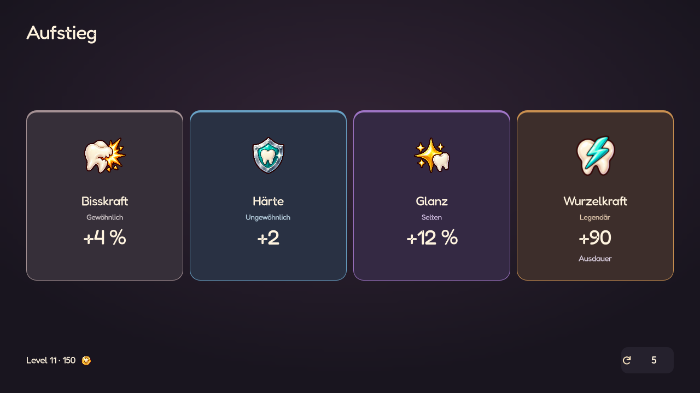

# Seltenheit auf einen Blick

Stand: 22.10.2026. Nach dem Umbau der Belohnungsbühne war Seltenheit dort fast nur noch am kleinen Wort unter dem Namen zu erkennen. Die Farbcodierung gilt jetzt wieder für die gesamte Darstellung des jeweiligen Objekts.

## Gemeinsame Sprache

- Die bestehende Zuordnung bleibt erhalten: **Gewöhnlich** warmes Grau, **Ungewöhnlich** Blau, **Selten** Violett, **Legendär** Orange, **Mythisch** Pink.
- Karten erhalten eine sichtbare vier Pixel starke obere Farbkante, eine dünne restliche Kontur und eine mit 16 % Seltenheitsfarbe getönte dunkle Fläche. Die offenen Bühnen, großen gemalten Motive und Abstände bleiben erhalten.
- Kleine Schrift bleibt hell und kontrastreich. Sie ist nicht der einzige Farbhinweis. Die Seltenheitsbezeichnung bleibt als zusätzliche Information erhalten.
- Hover, Drücken und gesperrte Angebote behalten ihre Seltenheitsfarbe. Auswahl und Fokus liegen als unabhängige helle Kontur darüber; die gewählte Zielwaffe trägt weiterhin ihr Häkchen.
- **Keine doppelte Fassung:** Eine bereits eingefärbte Ersatzkarte enthält keinen weiteren farbigen Seltenheitskasten. Effekt und Seltenheit stehen darin als einfacher Text. Ein kleiner Farbmarker wird nur bei eigenständigen Verzauberungszeilen verwendet, die keine eigene Seltenheitsfläche besitzen.
- Waffen-Mk und die Qualität einzelner Waffenwerte bleiben getrennt. Der Rahmen folgt Mk; eine farbige Unterstreichung am konkreten Wert zeigt dessen Rollqualität. Ein guter Schadenswert färbt nicht die gesamte Mk-I-Waffe legendär.

## Bestandsaufnahme und Umsetzung

| Element | Befund | Umsetzung |
| --- | --- | --- |
| Aufstiegskarten | Alle Stufen hatten dieselbe neutrale Fläche | Gemeinsame Farbkante und Tönung für jede Stufe |
| Relikt- und Itemfund | Seltenheit fast nur im Wort sichtbar | Orange Relikte und alle fünf Itemfarben auf der Karte |
| Kapselangebote | Farbige kleine Schrift, neutrale Karten | Dieselbe Farbfassung wie Aufstiege, auch bei blockierter Aktion |
| Zielwaffen der Kapsel | Nur die gewählte Waffe hatte eine Goldkontur | Mk-Farbe an jeder Zielwaffe, helle Auswahlkontur und unveränderte Bildzentrierung |
| Verzauberung ersetzen | Auswahlstil überschrieb die Seltenheit | Seltenheitsfläche bleibt erhalten; eine separate Auswahlmarkierung, kein innerer Farbkasten |
| Goldene Kapsel | Titel war genauso cremefarben wie gewöhnliche Kapseln | Titel verwendet warmes Gold; Angebote behalten ihre individuellen Farben |
| Shopangebote und Details | Farben bereits vorhanden, aber andere Behandlung als Belohnungen | Gemeinsame Flächen und Kanten; unveränderte Farbidentität beim Öffnen der Details |
| Ausrüstung, Pause und gesammelte Items | Vorhandene Seltenheitsflächen | Verwenden automatisch denselben gemeinsamen Stil; Mk-Badges und Stapelzahlen bleiben |
| Einzelne Waffenwerte | Dunkle Farben auf dunkler Fläche, leicht zu übersehen | Heller Text plus schmale Farblinie am konkreten Wert, unabhängig vom Mk-Rahmen |
| Verzauberungsdetails | Kleine dunkle Seltenheitsschrift | Heller Text mit kleinem Farbmarker für die jeweilige Verzauberung |
| Dentikon | Itemeinträge hatten keinen sichtbaren Seltenheitskontext | Liste verwendet die tatsächliche Itemfarbe; Detail nennt Seltenheit mit Farbmarker. Relikte verwenden Orange |

Keine Spielwerte, Seltenheitswürfe, Kaufregeln oder Speicherdaten wurden für diese Darstellung geändert. Die normalen Run-Vorbereitungsfelder erhalten keine künstliche Seltenheit.

## Native Ansichten

| Ansicht | Aufnahmen |
| --- | --- |
| Aufstieg | [1280×720](screenshots/rarity/levelup_1280x720.png), [360×640](screenshots/rarity/levelup_360x640.png), [568×320](screenshots/rarity/levelup_568x320.png) |
| Item und Relikt | [Mythischer Fund](screenshots/rarity/mythic_item_1280x720.png), [Relikte](screenshots/rarity/relics_1280x720.png) |
| Kapsel | [Angebote und Ersatzoptionen](screenshots/rarity/capsule_1280x720.png), [mobile Ersatzwahl](screenshots/rarity/capsule_replace_360x640.png), [goldene Kapsel](screenshots/rarity/capsule_golden_360x640.png) |
| Shop | [1280×720](screenshots/rarity/shop_1280x720.png), [360×640](screenshots/rarity/shop_360x640.png), [mobile Details](screenshots/rarity/shop_details_360x640.png) |
| Besitz und Nachschlagen | [Gesammelte Items](screenshots/rarity/owned_1280x720.png), [Dentikon](screenshots/rarity/dentikon_1280x720.png) |

Alle Aufnahmen stammen direkt aus Godot 4.7.2. Das Vorschauwerkzeug nutzt die echten UI-Komponenten und reale Katalogeinträge. Es isoliert Spielstand, Einstellungen und Fortschritt unter `.godot/rarity_preview/`:

`godot --path . --script res://tools/preview_rarity.gd`

**140 unterschiedliche Testskripte erfolgreich geprüft**, einschließlich gezielter Wiederholungen nach der Anpassung alter Farb-/Rahmen-Erwartungen. Die bestehenden Layout-, Auswahl-, Shop-, Verzauberungs- und Dentikon-Prüfungen laufen weiter. Der Kontrasttest umfasst zusätzlich die neue `RewardCard` und prüft Namen, Effekte und Seltenheitstext über alle fünf Stufen und vier Interaktionszustände. Native Hoch-/Querformatbilder prüfen die tatsächliche Farbwahrnehmung und die Abwesenheit doppelter Ersatzkarten-Rahmen.
