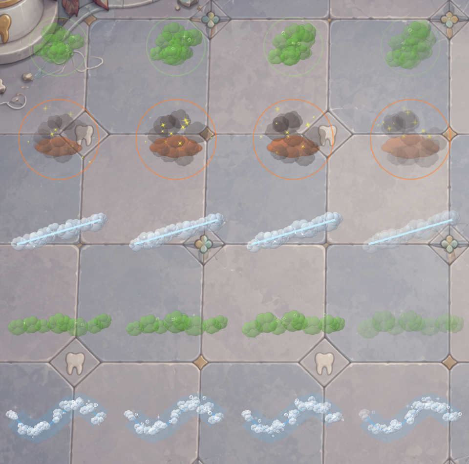

# Animierte Skill-Wolken

Stand: 21.11.2026. Flächenskills sollen nach ihrem Material aussehen statt nach
einem geometrischen Kreis. Gameplay, Radien, Breiten, Dauer, Ticks und
Spielstände bleiben unverändert.



| Skill | Darstellung | Lesbarkeit |
| --- | --- | --- |
| Assassine: Giftwolke | grüne Schwaden, aufsteigende Blasen | schwache Linie am Wirkungsradius |
| Assassine: Giftschneise nach dem Schnitt | Schwaden entlang der Schneise | helle Füllung und Randlinie der Kapsel |
| Glutzahn: Hitze-Kern | Rauch über glühendem Boden, aufsteigende Glut | orangefarbener Ring am Radius |
| Frostwächter: Eiswand | Eisnebel mit Glitzern | dünne helle Linie an der exakten Wand |
| Spültechniker: Wischspur | weiße Schaumflocken mit Bläschen | dünne blaue Spurlinie und schwacher Streifen |

## Aufbau

- `assets/vfx/skill_puffs.png` enthält vier neutrale, von oben links beleuchtete
  Wolken-Puffs (je 256 px), eine Blase und einen Funken (je 64 px). Alles ist
  weiß/grau und wird beim Zeichnen eingefärbt. Ein Atlas reicht daher für Gift,
  Frost, Rauch, Schaum und weitere Elemente.
- `SkillCloudStyle` (`data/vfx/skill_clouds/*.tres`) beschreibt das Aussehen:
  Farbe, Tiefenschattierung, Anzahl, Größe und Streuung der Puffs, Drift,
  Atmen, Deckkraft, Bodenschatten (farbig als Glutbett), Randlinie, Blasen
  oder aufsteigende Funken, Glitzern sowie Dauer von Entstehen und Auflösen.
  Alle Größen sind relativ zum Spielradius bzw. zur Breite. Farbwerte über 1
  hellen die neutrale Schattierung auf, etwa für weißen Schaum und Eisnebel.
- `SkillPuffs.draw_cloud()` zeichnet eine runde Wolke, `SkillPuffs.draw_lane()`
  Puffs entlang einer Strecke (Wände, Schneisen). Beide arbeiten **zustandslos**
  aus Alter, Restzeit und einem Seed aus der Position. Es gibt keine Partikelobjekte,
  keine Nodes und keine gespeicherten Zusatzdaten. Eine fortgesetzte Wolke
  sieht deshalb genauso aus wie vor dem Speichern.

Alter und Restzeit kommen aus den vorhandenen Skilldaten (Restzeit, bei der
Spülspur das gespeicherte Segmentalter). Puffs werden von hinten nach vorne gezeichnet, hintere dunkler, vordere
heller. Sie kreisen langsam, atmen und wiegen nur leicht, damit das eingebackene
Licht oben links bleibt. Blasen steigen auf und platzen mit einem kurzen Funken.
Eine schwache Linie markiert weiterhin den exakten Wirkungsradius. Die Wolke
liegt auf Ebene 2, also unter Gegnern, Gegnergeschossen und Denti.

Alles stammt aus einer Textur und wird im selben Canvas-Item gezeichnet. Der
Atlas ist im vorhandenen Menü-Warmup enthalten; es gibt keinen Shader und keine
Laufzeit-Generierung. Im sparsamen Grafikmodus werden 60 % der Puffs gezeichnet.

## Warum keine Godot-Partikel

`GPUParticles2D`/`CPUParticles2D` bräuchten pro Wolke einen Node mit eigenem
Lebenszyklus, Aufräumen und Save/Resume-Sonderfällen. GPU-Partikel kompilieren
im Compatibility-Renderer zudem ihren Shader beim ersten Auftauchen; solche
Ruckler wurden gerade aus dem Kampf entfernt. Das eigene System kostet pro
Wolke beziehungsweise Bahn etwa 10–25 Texturrechtecke im gemeinsamen Zeichenaufruf. Der Nachteil:
Einstellungen erfolgen über die `.tres`-Werte statt im Partikel-Editor.

## Gemalte Puffs einsetzen

Die aktuellen Puffs sind prozedural gebacken (`tools/bake_skill_puffs.py`).
Gemalte Puffs passen besser zum restlichen Stil und ersetzen sie ohne
Codeänderung:

```powershell
python tools/bake_skill_puffs.py --painted pfad/zu/vier_puffs.png
& Godot_v4.7.2-stable_win64_console.exe --headless --path . --import
& Godot_v4.7.2-stable_win64_console.exe --fixed-fps 60 --path . --script res://tools/preview_skill_clouds.gd
```

Das Bild braucht vier Puffs nebeneinander in gleich großen quadratischen
Zellen auf transparentem Hintergrund. Der Befehl schneidet jede Zelle auf ihren
Inhalt zu, skaliert sie in die 256-px-Zelle und behält Blase und Funken.

### Prompt

```text
Use case: stylized-concept
Asset type: production transparent VFX sprite sheet for the 2D cartoon dental roguelite Denti: Divine Dentistry.
Primary request: Create exactly FOUR distinct soft cartoon smoke/gas puffs in a strict FOUR-COLUMN by ONE-ROW regular grid, landscape canvas 2048x512 pixels (aspect ratio 4:1); each of the four equal square cells contains exactly one complete, centered, isolated puff with generous transparent margin. Genuine transparent background everywhere outside the puffs, no grid lines, labels, ground, shadows or drop shadows.
Colour: NEUTRAL white to light grey only, no hue at all. The game tints these puffs green for poison, icy blue for frost, grey for smoke and so on, so any colour would break tinting.
Shape: billowy cauliflower cloud made of 6-9 rounded lobes, fuller on top and slightly flatter at the bottom; each puff has a different silhouette. Soft volumetric gas, not solid cotton balls and not hard spheres.
Style: match the polished hand-painted cartoon game art of the supplied references: soft dimensional shading lit from the TOP-LEFT, brighter lobe tops, gentle grey shade where lobes overlap and toward the lower right, a thin darker grey contour, slightly translucent wispy edges. Readable when drawn small (about 60-120 px on screen) and semi-transparent over a grey stone floor.
Input images: style references only (supply e.g. assets/vfx/element_hit_splats.png and an enemy sprite); do not copy their content or colour.
```

## Nächste Kandidaten

- Glutzahn-Feuernova und Molar-Feuerwerk: kurzer Rauchring statt Bogenblitz.
- Itempfützen und Gift-Depot: dieselben Puffs als niedrige Bodennebel.
- Gemalte Puffs (siehe Prompt) für alle Stile auf einmal.

## Prüfen

`tests/skill_puffs.gd` prüft Lebenszyklus, Determinismus, Sparmodus,
Atlaslayout, alle Stile als Wolke und Bahn in allen Phasen, entartete Bahnen
und die Zuordnung der Stile zu den Skills.
