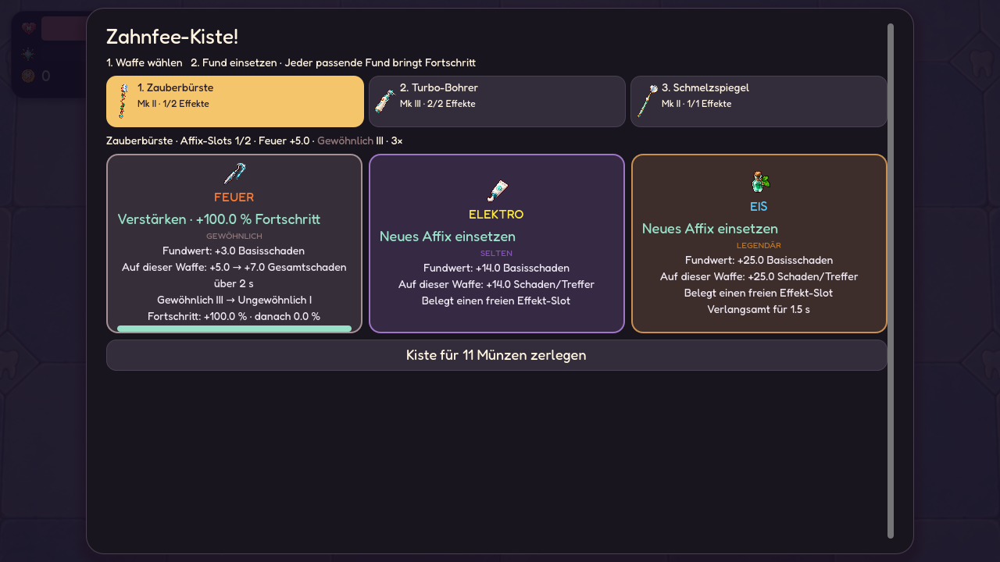
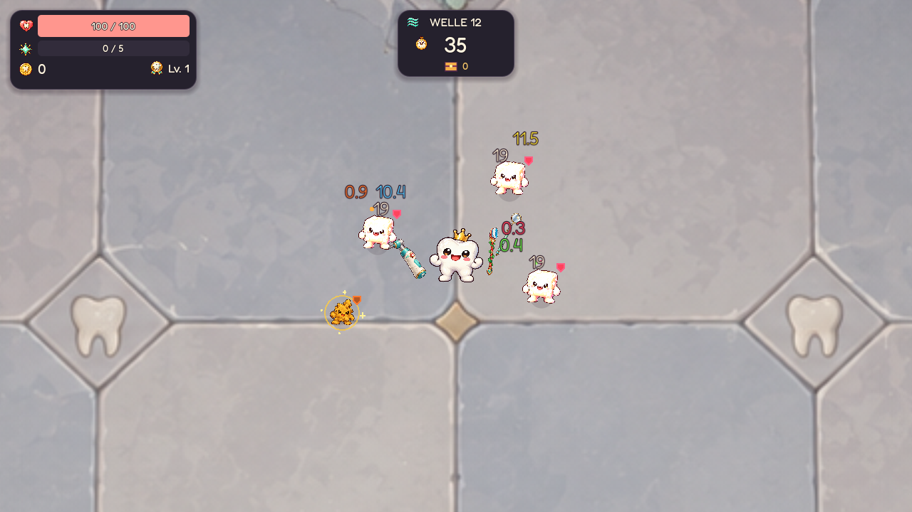
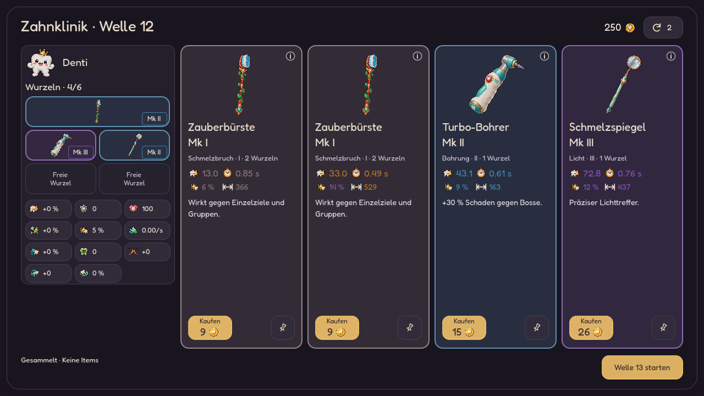

# Zufällige Affix-Kisten

Erster spielbarer Stand: Kisten verbessern eine konkrete Waffeninstanz. Es gibt
keine festen Kistenwellen, keine garantierte Run-Gesamtzahl und keine Maximalstufe
für den Schaden eines Affixes. Waffen bleiben Shopkäufe; ihre Werte werden pro Angebot individuell gewürfelt.



## Funde und Entscheidungen

- Drei unterschiedliche Angebote werden beim Drop festgelegt und gespeichert.
- Nach Loot-Sweep und ausstehenden Level-ups wird die Zielwaffe gewählt.
  Alle Waffen stehen als anklickbare Karten bereit; auch ersetzbare Effekte haben
  eigene Buttons. Es gibt keine Dropdowns.
- Gleiche Art und Seltenheit erhöht die Ausbaustufe I → II → III.
  Nach III folgt beim nächsten passenden Fund die nächste Seltenheit I.
- Ein höherer Fund derselben Art springt direkt auf seine Seltenheit I. Niedrigere
  Funde geben 50 % / 25 % / 12,5 % Fortschritt bei einer / zwei / drei Seltenheiten Abstand.
  Der Schaden steigt zwischen den Ausbaustufen anteilig; kein passender Fund ist wertlos.
- Sobald Affixe vorhanden sind, enthält jede neu gedroppte Kiste mindestens einen
  passenden Fund mit mindestens der Seltenheit eines vorhandenen Affixes.
  Die übrigen Typen bleiben zufällig und unterscheiden sich vom passenden Fund.
- Eine Waffe startet mit einem Slot. Ab Welle 2 ersetzt ein Slotfund mit 20 %
  Wahrscheinlichkeit das dritte Angebot, solange mindestens eine Waffe den
  vierten Slot noch nicht besitzt. Die maximale Affixanzahl ist vier. Slotfunde öffnen
  den jeweils nächsten Slot; der dritte und vierte Slot stehen ebenfalls zur Wahl.
- Ein neuer Effekt belegt einen freien Slot. Sind alle Slots belegt, muss der
  Spieler ausdrücklich den zu ersetzenden Effekt auswählen. Wiederholungen
  verbessern den passenden Effekt unabhängig von dieser Ersatzwahl.
- Alternativ wird die ganze Kiste für Münzen zerlegt. Ohne ausgerüstete Waffe
  bleibt diese Option verfügbar.
- Zielwaffe, Ersatzwahl und alle drei Funde überstehen Fortsetzen unverändert.
- Alte gespeicherte Item-Kisten bleiben KEEP/SCRAP-Belohnungen.

Seltenheit und Ausbau stehen getrennt neben dem elementaren Effekt. Seltenheitsnamen
verwenden dieselben Farben wie Mk-Stufen: Gewöhnlich = Mk I, Ungewöhnlich = Mk II,
Selten = Mk III, Legendär = Mk IV. Elementnamen und Trefferzahlen behalten ihre
Elementfarbe. Details, Ersatzwahl und Kisten zeigen I/II/III bzw. III+.

| Seltenheit | I | II | III |
| --- | --- | --- | --- |
| Gewöhnlich | 3 | 4 | 5 |
| Ungewöhnlich | 7 | 9 | 11 |
| Selten | 14 | 17 | 20 |
| Legendär | 25 | 30 | 35 |

Nach Legendär III bringt jeder weitere legendäre Fund derselben Art +2 Schaden.
Alte Waffen behalten ihren bereits gespeicherten Schaden als Untergrenze; ihre
neue Ausbaustufe startet bei I. Gespeicherte neue Stufen und legendäre Beiträge
werden unverändert wiederhergestellt.

## Zusätzlicher Schaden

| Affix | Schadenszahl | Zusätzliche Mechanik |
| --- | --- | --- |
| Feuer | Orange | Gesamtschaden über 2 s |
| Eis | Blau | Direkter Zusatzschaden; 15 % Slow für 1,5 s |
| Gift | Grün | Gesamtschaden über 5 s; weitere Treffer bauen das Budget auf |
| Blutung | Rot | Gesamtschaden über 3 s |
| Elektro | Gelb | Direkter Zusatzschaden |

Feuer, Gift und Affix-Blutung verbrauchen das bisherige Zusatzschadensbudget
über Zeit statt beim Einschlag. Alle 0,5 s wird eine anteilige Rate abgerechnet.
Jeder Treffer bringt sein eigenes vollständiges Budget mit; Wiederholungen
addieren Raten, ohne alte Laufzeiten neu zu starten oder alte DPS zu multiplizieren.
Das ist für Gift ein Aufbau über mehrere Treffer, für Feuer ein kürzerer Brand.
Waffen-/Item-Blutung bleibt ein separates System, teilt aber die Blutungsresistenz.
Elektro bleibt direkt; Kettenblitze sind noch kein Bestandteil dieses Affixes.

Neue Funde starten auf Stufe I ihrer Seltenheit. Die Ressourcen unter `data/affixes/`
enthalten die zwölf Ausbauwerte. Bei der Verwendung skaliert der Zusatz mit
`(Basisintervall / 0,65)^0,65` und Bisskraft. Schwere, langsamere Waffen erhalten
größere Ergänzungen pro Treffer; schnelle Waffen kleinere. Karten und Details
zeigen zuerst den festen Fundwert (Basisschaden auf Stufe I), danach ausdrücklich
„Auf dieser Waffe“ mit dem angepassten Gesamtschaden samt Dauer bzw. direktem
Schaden pro Treffer. Diese Werte gelten vor Gegnerresistenzen. Upgrades zeigen dort
den bisherigen und den neuen Gesamtschaden des Affixes. Beim Waffenwechsel bleibt
der Fundwert gleich; nur die Vorschau der Waffenwirkung verändert sich.

Mk, Crit und situative Item-Schadensboni multiplizieren diesen Zusatz nicht.
Seitliche Bürstengeschosse und zusätzliche Offenbarungsstrahlen skalieren auch
ihren Affixschaden mit ihrem jeweiligen Schadensanteil. Rückflug verwendet den
gleichen Rückflugfaktor wie der Grundschaden. Evolutions-Sekundärschaden startet
keine neuen Affix-Procs.

Grundschaden und direkte Zusätze bilden weiterhin einen gemeinsamen Treffer für
Verteidigung, Bossphasen und Boss-/Elite-Schadensbudgets. DoT-Anwendungen werden
bei einem akzeptierten Treffer auf überlebenden Gegnern gespeichert. Ihre späteren
Ticks durchlaufen dieselbe Verteidigung und dieselben Schutzbudgets. Während
Unverwundbarkeit verfallene Ticks werden nicht nachträglich ausgezahlt.
DoT-Fraktionen haben keinen künstlichen Mindestschaden von 1; Overkill wird in
der Telemetrie auf verbleibendes Leben begrenzt. Item-/Relikt-On-Hit-Mechaniken
laufen nur am Grundtreffer; DoTs starten keine rekursiven Treffer-Procs.

Die neue Komponente `EnemyAffixEffects` speichert höchstens die feste Anzahl
zukünftiger Halbsekunden-Raten je Effekt, unabhängig von der Trefferzahl.
Restzeit und Raten werden beim Fortsetzen erhalten, ohne die Resistenz erneut
anzurechnen. Treffer gegen bereits tote Gegner erzeugen keine weiteren DoTs.

Eis und Nass verwenden die stärkere Verlangsamung, ohne sie zu multiplizieren.
Eliten erhalten die halbe Eiswirkung, Bosse ein Viertel. Angekündigte Anstürme
bleiben wie bei Nass unverändert. Schadenszahlen bleiben im bestehenden
Darstellungsbudget; der tatsächlich berechnete Schaden wird nie verworfen.
Treffer und Heilungen zeigen nur Zahlen in ihrer jeweiligen Farbe, keine Typnamen.



## Zufällige Drops und goldene Gegner

- Normaler Kill: 1,6 % Kistenchance.
- Elite-Kill: 16 %.
- Glück multipliziert die Chancen mit `1 + 3 × max(Glück, 0) / (max(Glück, 0) + 100)`.
  Bei 100 Glück: 4 % normal / 40 % Elite; Obergrenze: vierfache Chance.
- Höchstens drei gewöhnliche Zufallsfunde pro Welle. Neue normale Drops bleiben
  an die aktive Timerzeit gebunden. Bosse selbst droppen weiterhin keine Kiste.
- Ab Welle 3 kann ein regulär gespawnter normaler Gegner mit 0,17 % Chance ein
  goldener Träger werden. Glück erhöht diese Chance um höchstens 50 %.
- Höchstens ein goldener Träger pro Welle, ohne feste Spawnzeit oder Wellenliste.
- Träger besitzen 2,8× Leben und 85 % Laufgeschwindigkeit, goldene Färbung und
  Glitzer. Ihr Kill während aktiver Timerzeit garantiert eine goldene Kiste,
  auch wenn alle drei gewöhnlichen Zufallsfunde bereits gefallen sind.
- Goldene Funde sind mindestens Ungewöhnlich; ihre Seltenheit würfelt mit
  vier zusätzlichem Wellenfortschritt auf der vorhandenen, begrenzten Kurve.
- Grundwert beim Zerlegen: `5 + floor(Welle / 2)`, goldene Kisten zusätzlich +5;
  vorhandene Zerlegeboni bleiben wirksam.

Die Häufigkeit ist eine großzügigere erste Balancehypothese. Es gibt keinen
festen Zielzähler und keinen Ausgleich für lange Durststrecken. Reale Run-Berichte
sollen zeigen, wie viele Kisten fallen, wie viel zusätzlicher Schaden entsteht
und wie sich Boss-TTK verändert. Affixschaden steht als `affix_fire`, `affix_ice`,
`affix_poison`, `affix_bleed` und `affix_electric` in der bestehenden Proc-Telemetrie.

## Fusion und Fortsetzen

Waffeninstanzen besitzen eine dauerhafte ID, Slotkapazität und eigene Effektliste.
Gleiche Fusionsaffixe behalten die höhere Seltenheit und ihren Ausbau. Bei gleicher
Seltenheit wird der Ausbau des zweiten Affixes als passende Beiträge angerechnet;
Niedrigere Beiträge liefern anteiligen Fortschritt. Legendäre Zusatzbeiträge
werden übernommen. Der höhere bereits vorhandene Schadenswert bleibt mindestens erhalten. Unterschiedliche Effekte werden übernommen, sofern ihre
Anzahl in die größere Slotkapazität beider Waffen passt. Andernfalls bleibt die
Fusion gesperrt. Es wird kein wertvoller Effekt still verworfen. Dieselben
Regeln gelten für Zwei-Waffen-Evolutionen. Die Primär-ID bleibt bei Fusion und
Evolution erhalten. Verkauf erstattet weiterhin nur investierte Münzen.

Alte Waffen erhalten einen leeren Slot und keine Affixe. Neue Instanzfelder sind
additive Save-Erweiterungen; die globale Save-Version bleibt kompatibel.
Aktive Projektile speichern ihre eigene Affixkopie und den Schadensfaktor.
Recycelte Projektile erhalten beim Start neue Daten und übernehmen keine
Affixe ihres vorherigen Einsatzes. Goldene Gegner, Eiszeit, Kisten auf dem Boden
und offene Belohnungen werden ebenfalls gespeichert.



## Prüfung und Vorschau

`tests/weapon_affixes.gd` prüft getrennte Exemplare, 100 niedrigere Funde mit weiterlaufendem Fortschritt,
Seltenheitsschutz, Slots, bewusstes Ersetzen, Fusionsschutz, Glück, Farben,
Bossbudgets, Overkill, Projektilquellen, garantierte goldene Drops, Combat- und
Reward-Resume sowie unterbrechungsfreie Sammlung und Layouts bis 360×640 und 568×320.

`tools/preview_weapon_affixes.gd` rendert Desktop-/Mobilkisten und die arrangierte
Kampfvorschau mit echten Schadenspfaden und getrenntem Spielstand:

```bash
godot --path . --fixed-fps 60 --script res://tools/preview_weapon_affixes.gd
```

## Individuelle Shop-Waffen

Mk-Stufe und individuelle Qualität sind getrennte Eigenschaften. Jedes neue
Waffenangebot würfelt vier Werte innerhalb seiner Qualitätsbandbreite:

| Wert | Gesamtbereich relativ zur Standardwaffe |
| --- | --- |
| Grundschaden | 60–170 % |
| Angriffspause | 72–135 % (kleiner ist schneller) |
| Reichweite | 80–125 % |
| Zusätzliches Crit | 0–10 Prozentpunkte |

Qualitäten heißen Schrott, Solide, Meisterwerk und Göttlich. Ihre Wertebereiche
überlappen; einzelne Werte werden getrennt gezogen. Höhere Wellen und Glück
verbessern die Qualitätschancen innerhalb fester Grenzen. Mk färbt weiterhin
Waffennamen (z. B. „Zauberbürste · Mk I“), Rahmen und Stufenmarker. Individuelle
Qualität färbt ausschließlich die vier Zahlenwerte, separat nach ihrer Position
im jeweiligen Rollbereich: unter 38 % gewöhnlich, ab 38 % ungewöhnlich, ab 68 %
selten, ab 90 % legendär. Bei Angriffspause ist kleiner besser. Ein Mk-I-Angebot
mit sehr guten Werten bleibt dadurch ein Mk-I-Angebot. Tooltips nennen die
Wertequalität; Karten, DPS und Vergleich zeigen die tatsächlichen Werte.
Preise verwenden weiterhin die bestehende Mk-/Wellenkurve.

Reservierte Angebote behalten ihre Werte. Kauf und Fortsetzen würfeln nichts neu.
Manuelle Fusion behält den gesamten Roll der ausgewählten Primärwaffe und verbindet
Affixe beider Exemplare nach den Ausbau-Regeln. Beim Kauf mit vollen Wurzeln kann man in den Details
zwischen bisherigen und neuen Grundwerten wählen; Affixe bleiben in beiden Fällen
erhalten. Der direkte Kartenkauf behält bisherige Werte. Evolution übernimmt die
Rollfaktoren der Primärwaffe auf die neue Waffenbasis. Alte Saves bleiben neutral.
Affix-Beiträge skalieren mit dem Standardintervall des Waffentyps, unabhängig vom
individuellen Tempo-Roll, damit ein Wertewechsel die gespeicherten Beiträge nicht ändert.

`tests/weapon_rolls.gd` prüft Vielfalt, tatsächlichen Kauf, Reservieren, Shop- und
Waffen-Resume, Fusion, bewusste Rollübernahme, Projektil-Resume und Dropfrequenz.
Eine Simulation mit 20/30/40/55/60/70/80/90 normalen Kills je Welle und 300 Seeds
liefert im Mittel 6,8 Kisten ohne Glück und 14,7 mit konstant 100 Glück bis Welle 8.
Das ist ein Vergleichsmodell, keine garantierte Run-Ausbeute.

`tests/affix_progression.gd` prüft alle Ausbauübergänge, Seltenheitssprünge,
endloses legendäres Wachstum, Fusion, Migration, passende Angebote und Mk-Farben.

Die höhere Gegnerdichte und HP-Kurve nach Einführung der Affixe kompensieren
deren zusätzlichen Schaden. [Zahlen und Vergleich](AFFIX_PRESSURE_BALANCE.md).

## Gegnerresistenzen

Resistenzen reduzieren ausschließlich den passenden Affix-Zusatzschaden (und bei
Blutung auch die bestehende Waffen-/Item-Blutung). Der Grundtreffer verwendet
weiterhin das normale Verteidigungssystem. Resistenzen wirken einmal vor normaler
Schadensreduktion; sie verändern die Eis-Verlangsamung nicht. Standard ist 0 %,
die Datenobergrenze 60 %. Es gibt in diesem Stand keine Immunitäten.

| Gegner | Resistenz |
| --- | --- |
| Plaque | Feuer 25 % |
| Bakterium | Gift 30 % |
| Giftkeim | Gift 50 % |
| Säurespucker | Gift 35 % |
| Zuckerstück | Blutung 35 % |
| Säurekrone | Eis 30 % |
| Jagdkeim | Elektro 25 % |

Ein kleines Schild in Elementfarbe am Gegner zeigt die Resistenz. Farbige Punkte
über dem Gegner zeigen laufende Affix-DoTs. Im Dentikon erklärt „Resistenzen“
die Farben und konkreten Gegnerprofile; der Begriff ist aus den Waffendetails
verlinkt. Schadenszahlen bleiben reine Zahlen mit Elementfarbe.

`tests/affix_damage_over_time.gd` prüft Budgeterhaltung, getrennte Laufzeiten,
Wiederholungen, Bruchteile, Resistenz und Verteidigung, Overkill, Boss-Schutz und
Fortsetzen. Der zentrale Bewegungstest vergleicht beide Simulationspfade auch
mit laufendem Feuer und Gift.

## Waffenwerte, vier Slots und Mk-Funde

Reichweite und Angriffstempo sind eigene Affixe und belegen einen der bis zu vier
Slots. Ihre Ausbauwerte sind Prozentpunkte (3/4/5, 7/9/11, 14/17/20, 25/30/35).
Weitere legendäre Beiträge liefern +2 Prozentpunkte. Reichweite multipliziert
Basisreichweite und alle Stufenbereiche; Angriffstempo verkürzt die Angriffspause
über Division durch `1 + Tempo / 100`. Beide verändern nur die gewählte Waffe und
verursachen keinen zusätzlichen Elementarschaden. Entfernen oder Ersetzen nimmt
auch ihren Bonus zurück. Der ursprüngliche Shop-Roll bleibt erhalten.

Ab Welle 8 können Kisten sehr selten einen Mk-Aufstieg auf dem dritten Platz
enthalten, sofern mindestens eine Waffe die Basisstufe IV erreicht hat: 2,5 %,
mit Glück bis höchstens 4 %. Der Fund braucht keinen Affix-Slot. Je Fund erhält
die gewählte Waffe +1 Mk, +10 % Basisschaden sowie +3 % Tempo und Reichweite.
Diese Zuschläge summieren sich gegenüber der Waffenbasis; sie potenzieren sich
nicht miteinander. Shop und normale Fusion enden weiter bei IV. Mk V, VI usw.
kommen ausschließlich aus Kisten. Die Angriffsmuster/Pierce-/Geschossstaffeln
bleiben auf dem Mk-IV-Muster; höhere Mk erhöhen die genannten Waffenwerte.

Evolutionen sind separate Waffenformen auf Basisstufe IV. Sie erhalten Rollen,
Affixe und Mk-Funde; bei zwei Zutaten werden deren Mk-Funde zusammengeführt.
Eine Evolution allein vergibt keine zusätzliche Mk-Stufe mehr. Stufenanzeige und
Rahmen entsprechen der tatsächlichen Mk-Stufe, statt pauschal Mk V zu behaupten.

Anwendbare Funde tragen eine sichtbare Aktionszeile. Schwächere gleiche Affixe
zeigen Fortschrittsgewinn, einen Balken und vorher/nachher. Volle Slots verlangen
sichtbar eine Ersatzwahl; Slotfunde bei vier Slots und Mk-Funde unter IV nennen
den konkreten Grund. Im HUD steht die Anzahl bereits eingesammelter Kisten
der laufenden Welle, einschließlich goldener und eingesammelter Restbeute.
Der Zähler wird bei neuer Welle zurückgesetzt und beim Fortsetzen wiederhergestellt.

`tests/weapon_chest_expansion.gd` prüft Wirkung, Fortschritt, vier Slots, seltene
Mk-Funde, Save/Resume für Waffen und Projektile sowie den Wellenzähler.
