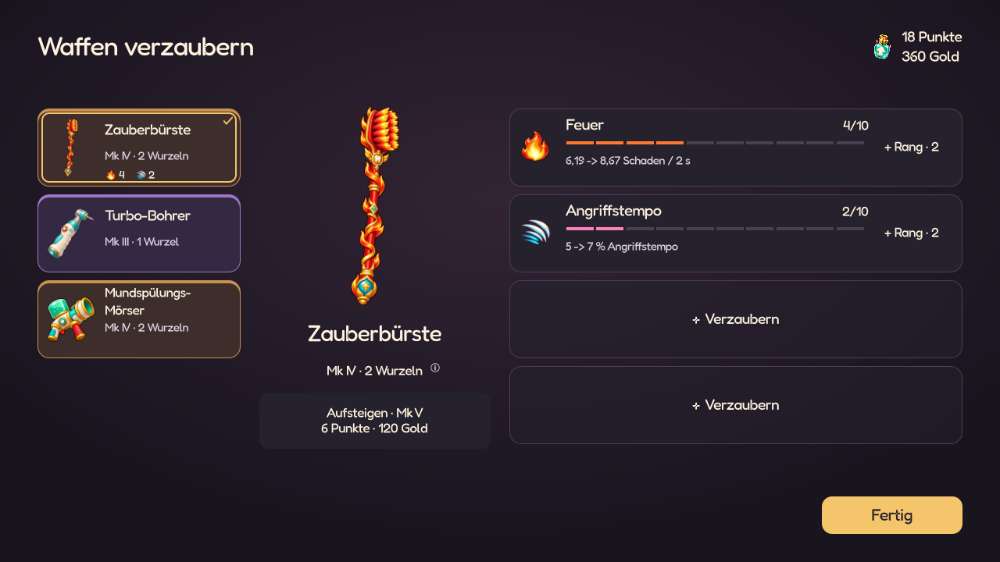

# Gezielter Waffenaufstieg auf Mk V+

Stand: 31.10.2026. Aufstieg und Verzauberungen verwenden dieselbe Vorschau.



Eine normale oder entwickelte Mk-IV-Waffe erhält im Verzauberungsfenster eine
eigene Aktion **Aufsteigen · Mk V**. Jeder weitere Aufstieg erhöht die angezeigte
Mk-Stufe, den Basisschaden um 10 % sowie Tempo und Reichweite um 3 % der Basis.
Die Boni addieren sich je Aufstieg. Vier Effektplätze, ein Element und die
Mk-IV-Angriffsmuster gelten weiter.

## Preise

| Aufstieg | 1 Wurzel | 2 Wurzeln |
| --- | --- | --- |
| IV → V | 3 Punkte + 60 Gold | 6 Punkte + 120 Gold |
| V → VI | 5 Punkte + 100 Gold | 10 Punkte + 200 Gold |
| VI → VII | 8 Punkte + 160 Gold | 16 Punkte + 320 Gold |
| VII → VIII | 12 Punkte + 240 Gold | 24 Punkte + 480 Gold |
| VIII → IX | 17 Punkte + 340 Gold | 34 Punkte + 680 Gold |

Für den `n`-ten Aufstieg über IV kostet eine Wurzel `2 + n(n+1)/2` Punkte und
`40 + 10n(n+1)` Gold. Beide Beträge werden mit den Wurzelkosten multipliziert.
Bis Welle 20 gelten die Tabellenpreise. Danach wird ausschließlich der Goldbetrag
mit `EndlessRules.price_factor(wave)` multipliziert und aufgerundet. Beispiel:
Mk V einer Zwei-Wurzel-Waffe kostet in Welle 30 sechs Punkte und 147 Gold.
Der Aufstieg benötigt keinen besonderen Mk-Fund und keinen vollständigen
10/10-Ausbau der Effekte.

## Vorschau und Fortsetzen

Ein Klick plant den nächsten Aufstieg. Waffenbilder, Mk-Anzeige und der nächste
Preis aktualisieren sich; Punkte- und Goldbestand zeigen den verbleibenden
Vorschauetat. Rückgängig nimmt den letzten Aufstieg oder Effektrang zurück.
**Fertig** übernimmt sämtliche Schritte gemeinsam. Fehlende Ressourcen,
geänderte Zielwaffen und manipulierte Preise verhindern die gesamte Übernahme.

Die konkrete Waffen-ID, Aufstiegsfolge und die unveränderten Ressourcen werden
gespeichert. Fortsetzen rekonstruiert die Vorschau zu den gültigen Preisen;
ungültige Schritte geben den vorgemerkten Etat frei. Bestätigte Aufstiege werden
nicht erneut berechnet oder bezahlt. Goldausgaben erscheinen als `mk_upgrade`
in der Economy-Telemetrie und erhöhen den investierten Waffenwert für den Verkauf.

Im Shop bleibt **Verzaubern** bei Mk-IV-Waffen auch mit null Punkten zugänglich.
So sind Preise und fehlende Ressourcen weiterhin sichtbar. Auf kleinen Displays
bleiben Rückgängig und Fertig erreichbar; im kurzen Querformat steht der Aufstieg
oben neben der Waffenwahl.

## Evolutionen und Altbestand

Gekaufte Mk-Stufen speichern zusätzlich ihr tatsächlich bezahltes Punktebudget.
Eine Evolution rechnet dieses Budget zu den Wurzelkosten der Ergebniswaffe um.
Restpunkte werden zusammen mit den übrigen Fusionspunkten erstattet; die Vorschau
zeigt die resultierende Mk-Stufe. Dadurch entstehen weder kostenlose Zusatzstufen
noch verlorene Punktereste bei einem Wechsel der Wurzelkosten. Die investierten
Münzen gehen wie bisher in den Waffenwert des Ergebnisses ein.

Alte Mk-Funde bleiben als historische Stufen erhalten. Ihre bisherige Vererbung
wird weiter unterstützt; sie erzeugen keine nachträglich erstattbaren Punkte.
Noch offene alte Mk-Kapseln bleiben anwendbar.

## Zugang und Kapselnachschub

Eine große Waffe benötigt für Mk V **drei gewöhnliche Kapseln**. Der bestehende
Nachschub bleibt: zwei Punkte pro Kapsel, bis zu drei gewöhnliche Funde pro Welle,
zusätzliche goldene Träger/Gauner sowie begrenzte Glücks- und Runenpolitur-Boni.
Mk IV über Waffenfunde/Fusion und das Zurücklegen der Punkte sind die Voraussetzungen.

[`measure_ascension_access.gd`](../tools/measure_ascension_access.gd) verwendet echte
Spawnpläne, Dropchancen, Shoppreise und Fusionen. [Messdaten](weapon_ascension_access.json):
30 feste Seeds je Szenario, vier Schwierigkeiten, jeweils 25/50/75 % zufällig
ausgewählte besiegte Gegner. Ohne Glück, Items, goldene Träger, Gauner oder
Boss-Verlängerung ergeben sich bei 25 % besiegten Gegnern im Mittel 24,6 / 29,5 /
36,9 / 44,5 gesammelte Punkte bis Welle 20 (Easy / Normal / Hard / Hell).

Der Shopteil kauft ausschließlich die Start-Zauberbürste, fusioniert passende
Exemplare und bezahlt höchstens einen Reroll pro Welle. Alle Punkte werden gespart;
andere Shopkäufe und Verzauberungen entfallen. In dieser gezielten Modellstrategie
ist Mk V bei 25 % besiegten Gegnern im Median nach Welle 11 / 10 / 10 / 9 finanzierbar.
Das ist eine Zugangsprognose, kein gemessener Spieler-Run: echte Buildkäufe,
Verzauberungen, Killrate, Positionierung und Zufall verändern den Zeitpunkt.
Die Dropchancen werden aus dieser Prognose nicht pauschal erhöht.

## Prüfung und native Ansichten

`weapon_ascension` prüft Preise, gleiche Wurzelbudgets, Endloskosten, gemischte
Entwürfe, fehlende Ressourcen, manipulierte/stale Preise, Undo, tatsächliche
UI-Klicks, JSON-Fortsetzen, additive Werte, Evolutionserstattung und sieben Größen.
Die bestehenden Waffen-, Fusions-, Reward- und Save-Tests sichern die Anschlusswege.

[Hochformat geplant](screenshots/weapon_ascension/planned_320x568.png) ·
[Kurzes Querformat](screenshots/weapon_ascension/ready_568x320.png)

```powershell
Godot_v4.7.2-stable_win64_console.exe --headless --path . --script res://tools/measure_ascension_access.gd
Godot_v4.7.2-stable_win64_console.exe --path . --script res://tools/preview_weapon_ascension.gd
python tools/run_tests.py --godot Godot_v4.7.2-stable_win64_console.exe --filter weapon_ascension
```
