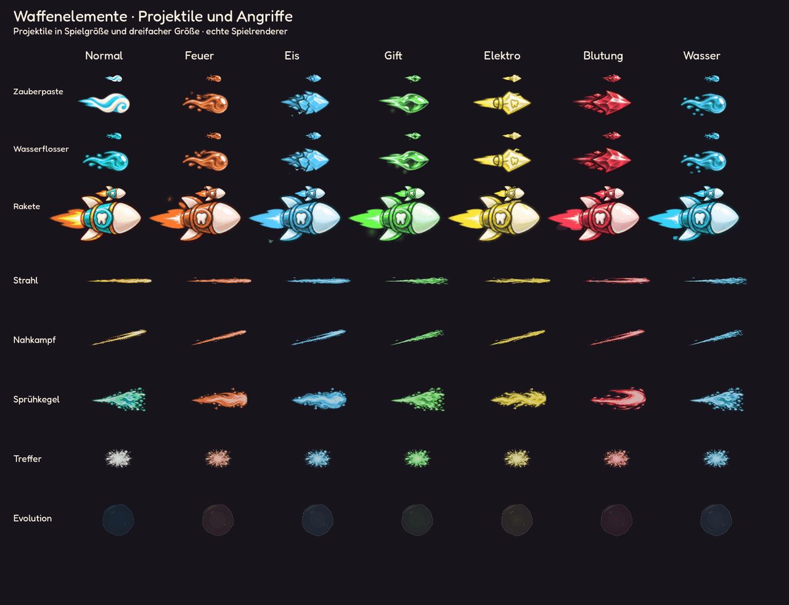
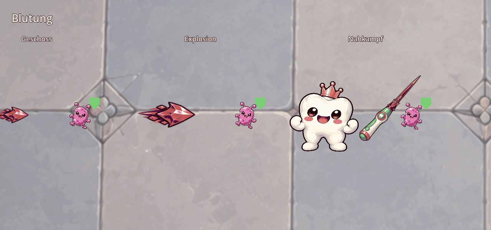

# Elementare Projektile und Angriffe

Stand: 27.10.2026. Die sechs Waffenelemente bestimmen neben dem Waffenbild auch
Geschosskern, Begleitpartikel, Mündungsblitz, Nahkampfspur, Strahl, Sprühkegel,
Treffer und Explosion. Evolutionen übernehmen die Darstellung für Fäden,
Aufladeeffekte, Strahlen, Markierungen und ihre Bodenflächen.



| Element | Geschoss und Bewegung der Effekte |
| --- | --- |
| Feuer | Orange Feuerkugel, Glut und fließende Flammenspur |
| Eis | Blaue facettierte Splitter, kühle Spur mit langsamerer Effektanimation |
| Gift | Grünes flüssiges Geschoss, Blasen und sprühender Giftstrom |
| Elektro | Gelber Energiepfeil, schnelle elektrische Bögen und Funken |
| Blutung | Rote Kristallsplitter, schmale Schnittspuren ohne Gore |
| Wasser | Runde blaue Tropfen, Wellen und Spritzer |

Raketen behalten ihre Raketenform; Gehäuse, Abgas und Begleitpartikel nehmen das
Element auf. Ohne Element bleibt die bisherige waffenspezifische Darstellung.
Reichweite, Tempo und andere Verstärkungen wechseln den Geschosskern nicht.
Bei alten gemischten Elementen gilt dieselbe stärkste Verzauberung wie bei
Waffenbild und Name; ihre weiteren Partikeleffekte bleiben erhalten.

Es ändern sich ausschließlich die Grafiken und deren Animationsrate, nicht
Angriffspause, Fluggeschwindigkeit, Richtung, Reichweite, Trefferflächen, Schaden,
Rückflug oder die Mechaniken der Evolutionen. Gegnergeschosse und Warnungen
verwenden weiterhin ihre eigenen bisherigen Darstellungen.

## Vorbereitung und Fortsetzen

### Einschläge und Bodenspuren

Seit 27.10.2026 enden elementare Treffer nicht mit dem Geschoss. Ein gemeinsamer
`ElementImpactBatch` erzeugt am tatsächlichen Treffer eine kurze Materialexplosion
und eine unabhängig ausblendende Bodenspur. Direkte Geschosse, Durchschläge,
Rückflüge, kreisende Treffer, Nahkampf, Strahlen und Sprühangriffe nutzen den
gemeinsamen Trefferweg. Waffenexplosionen erzeugen einmalig einen großen radialen
Effekt in ihrer Explosionsgröße. Kettenblitze, Eissplitter und Evolutionslinien
verwenden passende Folgeeffekte. DoT-Ticks starten keine neue Einschlagsanimation.

| Element | Einschlag |
| --- | --- |
| Feuer | Ausbrechende Glut, aufsteigende Funken und verkohlter Flammenfleck |
| Eis | Wegfliegende Splitter und geborstene Eisfläche |
| Gift | Aufplatzende Blasen und grüner Schleimspritzer |
| Elektro | Flackernde elektrische Fragmente und verzweigter Bodenblitz |
| Blutung | Gerichtete rote Tropfen und aufplatzende Blutlache |
| Wasser | Spritzende Tropfen und schaumige Wasserfläche |

Trefferpartikel bleiben 0,28–0,54 Sekunden, Bodenreste 0,36–1,15 Sekunden sichtbar.
Die Profile unter `data/vfx/impacts/` regeln Bewegung, Dauer, Deckkraft und Material.
Die Flecken sind rein visuell; sie erzeugen keine zusätzliche Schadensfläche.
Sie bleiben am Einschlag liegen, auch wenn das Ziel verschoben oder das Projektil
wiederverwendet wird. Am Wellenwechsel und beim Fortsetzen werden sie gelöscht.

Zwei gemeinsame Zeichenebenen ersetzen einzelne Effektknoten: Bodenreste liegen
unter Gegnern und Warnflächen, die kurzen Trefferpartikel vor gewöhnlichen Gegnern
und hinter gegnerischen Geschossen und Denti. Höchstens 96 Flecken und 32 aktive
Trefferwolken; nahe Einschläge desselben Elements werden innerhalb von 55 ms und
22 Pixeln zusammengefasst, ohne die Lebenszeit zu verlängern. Die Begrenzung
beeinflusst weder Schaden noch Treffer. Das System verwendet keinen Kampfzufall.
Der gemalte [Atlas samt Erzeugungsprompt](art/element_impacts.md) und vorhandene
Geschosstexturen werden vorgeladen. Keine Bildberechnung oder Textur-Uploads beim
Einschlag, keine zusätzlichen Knoten je Treffer.

`tests/element_impacts.gd` prüft die sechs Elemente über tatsächliche Geschoss-,
Nahkampf- und Explosionstreffer, Größe, unabhängige Lebenszeit, rein visuelle
Pfützen, DoT-Verhalten, Zusammenfassung, Limits, Zeichnungsreihenfolge, unveränderten
Kampfzufall und Fortsetzen. Die 18 gezielten Kampf-/Projektiltests bestehen.

Native Aufnahme: `tools/preview_element_impacts.gd`; mit `-- --element=bleed`
entsteht zusätzlich eine vergrößerte Aufnahme mit echtem Speerstoß.



### Flug, Spuren und Strahlen

`WeaponAffixData` enthält Farben, Quellformen und Effekt-Animationsraten.
`tools/bake_weapon_element_effects.gd` kompiliert vorhandene gemalte Vorlagen
in zwei zusätzliche Atlanten: 18 Geschossstile (klein, groß, Rakete pro Element)
und 120 Effektframes. Originalbilder und bestehende Atlanten bleiben unverändert.

`WeaponElementVisuals` zeichnet diese Frames ohne neue Effektknoten oder
Rasterarbeit pro Kampfbild. Die bestehende Geschossvorbereitung setzt Kern und
Partikel beim Ausrüstungswechsel zusammen; jedes fliegende Geschoss bleibt ein
einziger Sprite. Sechs verschiedene Stile teilen weiterhin einen vorbereiteten
Atlas. Bereits fliegende Geschosse behalten ihre alte Darstellung, wenn die Waffe
danach verzaubert wird. Fortsetzen leitet das Element aus den gespeicherten
Verzauberungen des jeweiligen Geschosses ab.

## Prüfung und Vorschau

19 gezielte Prüfungen für Projektile, Pooling, Texturen, Verzauberungen, Schaden,
Evolutionen und Waffenbewegung bestanden. `tests/weapon_element_visuals.gd`
prüft die sechs unterschiedlichen Geschosskerne, Kollisionsmittelpunkte,
120 Effektregionen, Atlasränder, wiederverwendete Geschosse und Fortsetzen.
Vorbereitete Salven erzeugen keine zusätzlichen Bilder, Uploads oder Knoten.

Die native Vorschau verwendet echte `WeaponProjectile`-Knoten und dieselben
Zeichenfunktionen wie der Kampf. Sie zeigt Normalzustand und alle sechs Elemente:

```powershell
Godot_v4.7.2-stable_win64_console.exe --path . --script res://tools/preview_weapon_element_effects.gd
```

`overview.png` liegt unter `docs/screenshots/weapon_element_effects/`, Animationsframes
unter `.godot/weapon_element_effect_frames/`. Den tatsächlichen Kampftest für alle
24 Waffen, fünf Richtungen und zwei Ausrüstungsdichten kann man auch mit einem
Element ausführen, etwa `tests/weapon_visual_contract.gd -- --capture --element=fire`.
