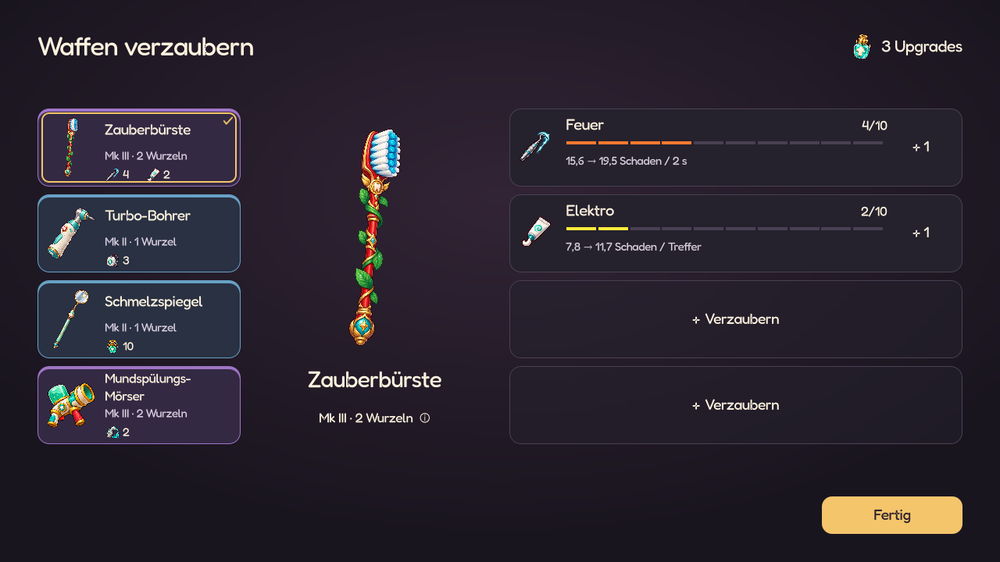
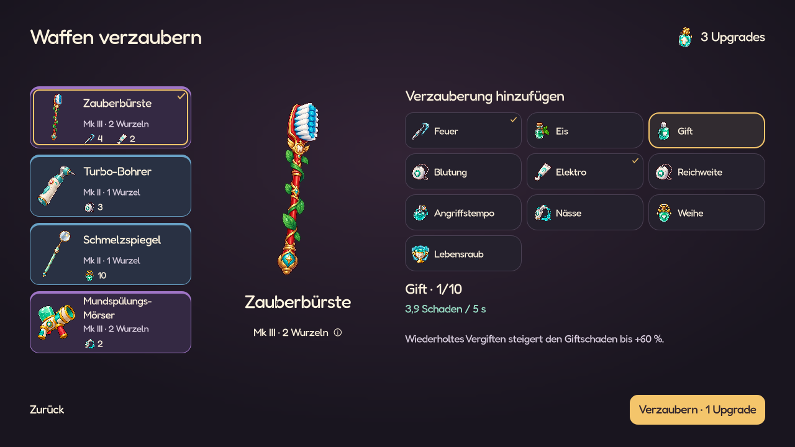
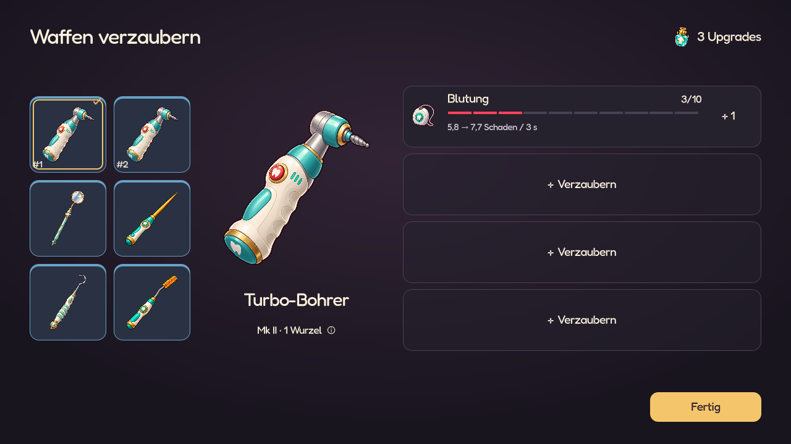
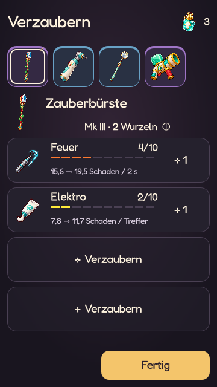

# Waffen gezielt verzaubern – UI-Studie

Stand: 26.10.2026. Vorschlag zur Prüfung, **keine Änderung des Spielsystems**.
Die anschließende [Spielintegration](WEAPON_UPGRADES.md) ist inzwischen umgesetzt.
Nutzerkorrektur gegenüber dieser ersten Studie: Mk I–IV schaltet jeweils einen
bis vier Plätze frei; die Plätze sind nicht mehr alle sofort verfügbar.
Die ausführbare Godot-Studie verwendet Originalbilder, Fredoka, die gemeinsame
Nachtklinik-Palette, `RewardStage`, die bestehenden Auswahlmarkierungen und
das vorhandene Detailfenster. Ihre Beispieldaten leben ausschließlich im Speicher.

## Befund

`WeaponChestPanel` verbessert bereits eine konkrete `WeaponInstance`, identifiziert
durch ihre dauerhafte ID. In der Darstellung dominieren jedoch drei zufällige
Funde. Das Ziel steht als kleinere Auswahl darüber; die eigentliche Entscheidung
sieht dadurch eher wie ein allgemeines Upgrade aus.

Hinzu kommen mehrere sich überlagernde Fortschritte: Seltenheit, I–III,
Teilfortschritt schwächerer Funde, zusätzliche Slots und seltene Mk-Angebote.
Für eine gezielte Waffenentwicklung ist ein einziger Rang 1/10–10/10 verständlicher.

Die neue Startauswahl gibt die Gestaltungsrichtung vor: gemalte Motive, deutliche
Objektwahl, große Vorschau, kurze Werte, Details erst auf Anfrage. Die Studie
übernimmt diese Sprache statt einer neuen Gem-/Inventaroberfläche.

## Vorgeschlagene Ansicht



- Links die ausgerüsteten Waffen, einschließlich ihrer bisherigen Effekte.
  Die Mk-Farbe bleibt am Rand; Goldkontur und Häkchen markieren das ausgewählte
  Exemplar. Sechs Waffen wechseln in ein kompaktes 2×3-Raster.
- In der Mitte das große Originalmotiv, Waffenname, Mk und Wurzelkosten.
  Die vier Effektplätze stehen unmittelbar daneben. Beim Waffenwechsel wechseln
  alle vier Plätze zusammen mit dem Motiv.
- Ein vorhandener Effekt zeigt Bild, Name, **4/10**, zehn Segmente und den
  konkreten nächsten Wert, beispielsweise **15,6 → 19,5 Schaden / 2 s**.
  **+ 1** verbraucht genau einen Upgradepunkt. Bei 10/10 steht **MAX**.
- Jeder freie Platz zeigt **+ Verzaubern**. Alle vier Plätze stehen sofort
  bereit; es gibt keinen zusätzlichen Slotkauf. Die erste Investition schaltet
  den gewählten Effekt auf **1/10** frei.
- Der Kapselzähler zeigt das verfügbare gemeinsame Budget. Mehrere Funde einer
  Welle werden in derselben Ansicht verteilt. Keine neue Ansicht nach jedem Punkt.
- **Rückgängig** ist nach einer Investition sichtbar. **Fertig** bleibt die einzige
  volle goldene Hauptaktion. Im Effektkatalog bestätigt sie stattdessen
  **Verzaubern · 1 Upgrade**.



Der Katalog enthält alle zehn vorhandenen Effekte in stabiler Reihenfolge.
Bereits an dieser Waffe vorhandene Effekte bekommen ein Häkchen und können nicht
doppelt aktiviert werden. Erst die gewählte Option zeigt einen kurzen Mechaniktext
und ihre Stärke auf dieser Waffe. Der Katalog ersetzt nur den rechten Bereich;
Waffenwahl und Vorschau bleiben stehen. Zurück kostet keinen Punkt.

Zusätzliche Effektdetails sind über das Effektbild erreichbar. Die Wurzelzeile
öffnet die Erklärung zur Skalierung. Es stehen keine wiederkehrenden
Bedienungsanleitungen im normalen Fenster.

Auf schmalen Ansichten: Waffenicons oben, kompakte Waffenzeile darunter, dann die
vier Plätze. Der Kapselzähler wird zu Icon und Zahl. Die Abschlussaktion bleibt
fest erreichbar, bei Platzmangel scrollt nur der Inhalt. Die 360×640-Übersicht
zeigt alle vier Plätze; die vollständige Effektauswahl darf scrollen.

## Mengen und Buildentscheidung

Annahme: Aktivieren ist bereits Rang 1/10. Danach folgen neun weitere Schritte.
Damit kostet ein Effekt insgesamt **10**, eine Waffe mit vier maximalen Effekten
**40** Upgradepunkte. Würde Aktivieren zusätzlich zu zehn Verbesserungen zählen,
wären es 44 – das entspricht nicht der hier gezeigten 1/10-Darstellung.

| Ausrüstung | Vollausbau aller Effekte | Bedeutung bei angenommenen 40–60 Punkten |
| --- | --- | --- |
| Eine Waffe | 40 | Schwerpunkt plus übrige Punkte für weitere Waffen |
| Drei Zwei-Wurzel-Waffen | 120 | Spezialisierung oder breit verteilte mittlere Ränge |
| Sechs Ein-Wurzel-Waffen | 240 | Bewusste Auswahl weniger Effekte und Zielwaffen |

Das ist ein brauchbares Entscheidungsbudget; alle Waffen müssen nicht voll werden.
Vier Plätze sind eine Obergrenze, kein verpflichtendes Sammelziel.

**40–60 Funde sind eine Schätzung, kein gemessener Durchschnitt.** Aktuell gelten
1,6 % je normalem Kill, 16 % je Elite, höchstens drei gewöhnliche Kapseln pro Welle
und ab Welle 3 höchstens ein möglicher goldener Träger. Glück verändert die Chancen
begrenzt. Ein konkreter Run kann deshalb außerhalb der Schätzung liegen.
Quelle: `ChestRewards` und der normale/goldene Droppfad; siehe
[bestehende Regeln](WEAPON_AFFIXES.md).

Die bessere Planbarkeit ist selbst ein Machtzuwachs. Die vorhandenen starken
Wasser-, Elektro-, Crit- und Blutungskombinationen wären zuverlässig erreichbar.
Deshalb erst Fundzahlen und Boss-TTK messen; nicht gleichzeitig die Werte aller
Effekte erhöhen. Auch die Dauer der gesamten Belohnungsphase gehört zur Messung.

## Wurzelkosten als Stärke

Empfehlung für Schaden: zunächst **Wirkungsbudget proportional zu den Wurzeln**
erproben. Zwei Wurzeln bekommen auf demselben Rang ungefähr das doppelte Budget
einer Ein-Wurzel-Waffe. Das Budget muss anschließend auf Angriffspause, mehrere
Projektile und Folgetreffer verteilt werden. Ein pauschales Verdoppeln des
Schadens jedes einzelnen Projektils würde schnelle Mehrfachangriffe bevorzugen.

Die heutige Formel gewichtet das Basisintervall mit einer Potenz von 0,65 und
berücksichtigt Wurzelkosten nicht direkt. Diese Berechnung wurde für die Studie
nicht verändert. Die angezeigten Schadenswerte sind ausdrücklich Beispiele:
`3 × Rang × Wurzeln × Basisintervall` je ursprünglichem Einzelangriff, vor Crit,
Gegnerresistenzen und weiteren Buildwerten. Es findet keine Kampfsimulation statt.

Nässe, Kontrolle, Heilung, Reichweite und Tempo benötigen eigene Rangkurven und
Obergrenzen. Ein gleicher Rang muss eine vergleichbare Investition bedeuten,
aber nicht überall denselben Faktor oder eine verdoppelte Proc-Häufigkeit.
Die Beispielkurven der Studie sind keine freigegebene Balance.

## Für eine spätere Spielintegration

Empfohlene Richtung:

- Kapseln liefern frei einsetzbare Punkte. Keine zufällige Effektzuweisung und
  keine zusätzliche Raritäts-/I–III-Achse innerhalb des neuen 1–10-Ausbaus.
  Mk und gewürfelte Grundwerte bleiben beim Waffensystem im Shop.
- Unverbrauchte Punkte mitnehmen, statt vor dem Shop Pflichtklicks zu erzeugen.
  **Fertig** schließt in dieser separaten Studie nur die Vorschau. Es gibt hier
  weder eine Speicherung noch eine Weiterleitung in den echten Shop.
- Rückgängig gilt für die laufende Verteilung. Es ist kein unbegrenzter Umbau
  bereits bestätigter Builds. Austausch eines belegten Effekts braucht später
  eine eigene, bewusste Regel; die Studie bietet ihn nicht an.
- Goldene Kapseln und Glück brauchen eine passende Rolle im Punktesystem.
  Eine goldene Kapsel wurde hier nicht stillschweigend in mehrere Punkte umgerechnet.
- Fusion, Verkauf und Evolution dürfen investierte Punkte nicht unbemerkt
  löschen oder vervielfachen. Für gleiche Effekte bei 10/10 ist eine explizite
  Überschussregel notwendig. Ebenso für eine komplett ausgebaute Ausrüstung.
- Die bestehende Belohnungskoordination bleibt maßgeblich: Kampf → Loot-Sweep →
  Level-ups → Waffenverzauberung/weitere Belohnungen → Shop. Level-up-Stats werden
  durch diese Idee nicht zu Waffenupgrades umdefiniert.
- Ziel-ID, Punkte, Ränge, offene Auswahl und bestätigter Intermissionsschritt
  müssen gespeichert werden. Alte offene Zufallsangebote und unbegrenzt
  gewachsene Affixe lassen sich nicht verlustfrei durch ein bloßes Umbenennen
  in 1–10 überführen; Migration oder Übergangsregeln sind separat zu entscheiden.

## Native Vorschau und Prüfung

```powershell
Godot_v4.7.2-stable_win64_console.exe --path . --script res://tools/preview_weapon_enchantment_study.gd -- --interactive
```

Ohne `-- --interactive` erstellt das Skript die Aufnahmen und prüft echte
Godot-Klicks: nur die gewählte Waffe wird verbessert, Aktivierung kostet einen Punkt
und startet bei 1/10, Rückgängig stellt Zustand und Budget wieder her, 10/10 und
leeres Budget sperren weitere Investitionen. Zwei gleiche Waffen bleiben getrennte
Ziele. Geprüfte Formate: 1280×720, 1040×600, 360×640, 320×568, 568×320 und 720×1280.
Kein Gameplay-Script wurde umgestellt, kein normaler Spielstand verändert.




