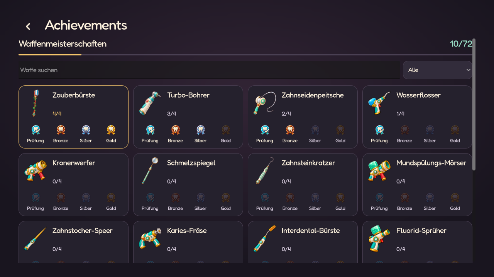

# Waffenmeisterschaften

Stand: 27.10.2026. Erster dauerhafter Achievement-Baustein, im Spiel umgesetzt.



## Regeln

Jede der 18 normalen Startwaffen besitzt vier Auszeichnungen, insgesamt 72.

| Siegel | Bedingung |
| --- | --- |
| Zahnprüfung | Ersten Boss in Welle 5 besiegen, auch auf Easy |
| Bronze | Welle 20 auf Normal oder höher abschließen |
| Silber | Welle 20 auf Hard oder höher abschließen |
| Gold | Welle 20 auf Hell abschließen |

Ein höherer Sieg schließt alle niedrigeren Siegel ein. Ein erster Sieg direkt
auf Hell kann damit alle vier Auszeichnungen dieser Startwaffe vergeben.
Alle Standardwaffen bleiben verfügbar; die Siegel verleihen keine Statboni.

Es zählt die ausdrücklich bestätigte Startwaffe. Verkauf, neue Waffen,
Mk-Fusionen und Evolutionen ändern diese Zuordnung nicht. Arena- und Story-Runs
zählen gleichermaßen. Niederlage entfernt keine erreichten Erfolge, auch nicht
nach einer Endlosfortsetzung. Der Sieg zählt bereits beim normalen Welle-20-Ende.
Eine Auszeichnung wird nur einmal vergeben; wiederholte Ereignisse, Bestätigungen
oder Fortsetzen erzeugen keine doppelten Erfolge.

Testarenen und Runs nach Debug-Eingriffen oder Wellenwechseln vergeben keine
weiteren Siegel. Das bloße Öffnen des Debugmenüs disqualifiziert nicht.

## Darstellung

- **Achievements** ist ein eigener Menüpunkt im Hauptmenü und in der Zahnpause.
  Der Zugriff verändert weder einen gespeicherten Run noch die Run-Vorbereitung.
- Die Übersicht zeigt alle 18 Waffen als Karten mit den vier gemalten Siegeln,
  eigenem Fortschritt und einem Gesamtzähler von 0 bis 72. Gemeisterte Waffen
  besitzen eine goldene Kontur; offene Siegel sind gedämpft dargestellt.
- Suche und Filter **Alle / Offen / Gemeistert** grenzen die Übersicht ein.
  Ein Kartenklick öffnet die Anforderungen. Escape schließt zunächst die Details,
  danach führt es zum Haupt- beziehungsweise Pausenmenü zurück.
- Startwaffenauswahl und Run-Vorbereitung enthalten keine Meisterschaftssiegel,
  Zähler oder Achievement-Details mehr. Die Dentipedia erklärt nur die Regeln.
- Neue Erfolge werden weiterhin nach dem Loot-Sweep vier Sekunden lang als
  nichtinteraktives Banner gezeigt und im Run-Rückblick genannt.

[Hochformat](screenshots/weapon_masteries/achievements/overview_320x568.png),
[kurzes Querformat](screenshots/weapon_masteries/achievements/overview_568x320.png),
[Anforderungen](screenshots/weapon_masteries/achievements/requirements_320x568.png),
[Suche](screenshots/weapon_masteries/achievements/search_360x640.png),
[mobile Projektskalierung](screenshots/weapon_masteries/achievements/mobile_project.png).

## Daten und Fortsetzen

Vier `WeaponMasteryData`-Ressourcen unter `data/masteries/` enthalten IDs,
Anforderungen, Flag, Schwierigkeit und Iconindex. `WeaponMasteries` wertet die
Ereignisse aus. `RunWeaponMastery` speichert die Startwaffe, Zulässigkeit sowie
neue und noch zu meldende Erfolge; es wirkt nicht auf Stats oder Kampfwerte.

`ProgressionStore.weapon_masteries` speichert die erreichten Flags pro
Standardwaffen-ID in `user://progression.cfg`. Der atomare Austausch per
temporärer Datei erhält Hell-Freischaltung, entdeckte Evolutionen und andere
bestehende Konfigurationsabschnitte. Unbekannte IDs und ungültige Werte werden
ignoriert. Vergabe wird nach erfolgreicher Speicherung an den Run gemeldet.

`RunSnapshot` erhält den Ursprung über Speichern/Fortsetzen. Alte laufende Saves
ohne nachweisbare Startwaffe bleiben spielbar und vergeben keine nachträgliche
Meisterschaft; ein neuer Run startet die Erfassung. Die aktuelle Ausrüstung wird
nicht als vermeintliche Startwaffe herangezogen. Alte Fortschrittsdateien starten
mit leeren Meisterschaften und behalten alle vorherigen Freischaltungen.

## Prüfung

`tests/weapon_masteries.gd` prüft alte Accountdateien, atomisches Speichern,
bestätigten Ursprung, echte Boss-Todesereignisse, Meldungszeitpunkt, Niederlage,
JSON-Fortsetzen, kumulative Siege, Endlos, Doppelauslösung, Story, Debug/Test und
alte Saves. `tests/weapon_mastery_ui.gd` prüft das eigene Haupt-/Pausenmenü, unveränderte
Spielstände beim Browsen, Karten, Gesamtfortschritt, Suche und Filter, Anforderungen,
Escape-/Fokus-Rückkehr, sieben Größen, mobile Projektskalierung und die wieder
auf reine Waffenwahl begrenzte Run-Vorbereitung.

Native Vorschau mit isolierten Spielständen:

```powershell
Godot_v4.7.2-stable_win64_console.exe --path . --script res://tools/preview_weapon_masteries.gd
```

[Grafikquelle und finaler Imagegen-Prompt](art/weapon_mastery_badges.md).

Die ursprüngliche Vergabelogik wurde am 27.10.2026 mit **156/156 Godot-Tests** geprüft;
für das anschließend eigenständig gestaltete Achievement-Menü bestehen zusätzlich
**14/14 betroffene Menü-, Navigations-, Such-, Filter-, Layout- und Save-Tests**.
Import und Diff-Prüfung ohne Fehler. Native Ansichten wurden auf Desktop,
Hochformat und kurzem Querformat sowie mit tatsächlicher mobiler Projektskalierung
und Desktop-Stretch geprüft. Der ältere Elite-Aura-Test isoliert nun auch den
unabhängigen Gaunerwurf, entsprechend der bestehenden Elite-Druckprüfung.
