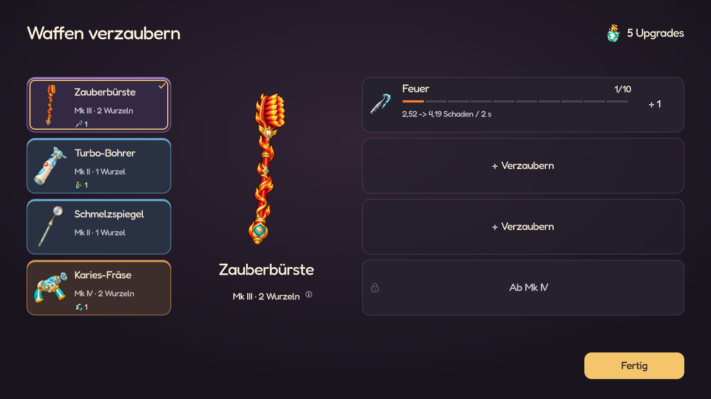

# Waffenbilder im Spiel

Stand: 27.10.2026. Alle **18 Standardwaffen und sechs Evolutionen** verwenden
ihre neuen Normal-, Feuer-, Eis-, Gift-, Elektro-, Blutungs- und Wasserformen.
Die Form folgt dem Element der konkreten Waffeninstanz. Verstärkungen verändern
das gewählte Element nicht. Bei alten gemischten Verzauberungen entscheidet
dieselbe stärkste Elementverzauberung wie beim Namenszusatz.



Die Auswahl zeigt schon vor dem Verzaubern die passende Form. Geplante Upgrades
und Rückgängig verändern die Vorschau; erst die Bestätigung ändert die Ausrüstung.
Shop, Inventar, Pause, Starterauswahl, Dentipedia und Kampf verwenden die zugehörigen
Bilder. Fusion, Evolution und Fortsetzen leiten die Form erneut aus den gespeicherten
Waffen- und Verzauberungsdaten ab; ein zusätzliches Save-Feld ist nicht nötig.

## Quellen und Laufzeitdaten

- `assets/weapons/reference/element_forms/`: unveränderte 1024×1536-Originalvorlagen,
  Galerie, Prompts und Prüfsummen; weiterhin vom Godot-Import ausgeschlossen.
- `assets/weapons/element_forms/`: 168 kompilierte 512×512-Spieltexturen und
  63 passende Animationsteile. Alle Texturen besitzen Mipmaps für kleine Darstellungen.
- `data/weapon_skins/rigs.json`: Griff-/Mündungspositionen und Trennung der
  beweglichen Teile in Quellkoordinaten; `floss_cut` verwendet seine explizite
  512-Pixel-Leinwand für Griffmasken und Fadenanschlüsse. Sieben Formen teilen je Waffe denselben
  Bildausschnitt und Maßstab. Die Karten verwenden einen eigenen zentrierten Ausschnitt.
  `combat_visible_size` hält die sichtbare Länge der bisherigen Normalgrafik fest.
  Der Compiler berechnet daraus `held_scale` für den Kampf. Transparente Ränder
  und größere Elementverzierungen verändern damit nicht den Grundmaßstab.
- `data/weapons/*.tres`: Normalform und Verweise auf die sechs Elementressourcen.
- `data/weapon_skins/<waffe>/<element>.tres`: Bild und passende Griff-/Mündungsdaten.
- `data/weapon_skins/build_manifest.json`: Quellprüfsummen und Packdaten.

`python tools/pack_weapon_skins.py` reproduziert die Laufzeitbilder und Ressourcen
aus den freigegebenen Vorlagen und Rigdaten; dafür wird Pillow benötigt.
Das Werkzeug malt keine neuen Inhalte und überschreibt keine Originalvorlagen.
Fräse und Polierer behalten ihre perspektivisch projizierten rotierenden Flächen.
Die Schleuder trennt Griff, Beutel und Gummi. Die [Zahnseiden-Schneide](FLOSS_CUT.md)
und die Peitsche verwenden zwei beziehungsweise einen festen Griff und live
gezeichnete ausfahrende Fäden mit Elementanimationen.
Die Animationsteile stammen für jede Elementform aus deren eigener Zeichnung.

Elementressourcen werden bei Ausrüstungs- und Vorschauänderungen geladen, nicht
pro Kampfbild. Der zusätzliche Form-Cache hält höchstens zwölf Einträge.
Kampfwerte, Reichweiten und vorhandene Evolutionsmechaniken bleiben erhalten;
die Grafikintegration ändert keine Balancingwerte. Das Element bestimmt inzwischen
auch [Projektile und Angriffseffekte](WEAPON_ELEMENT_EFFECTS.md).

## Sichtbare Größe neben Denti

Beim Wechsel auf die gemeinsamen 512×512-Leinwände blieben `visual_size` und die
allgemeinen Obergrenzen gleich. Die Motive hatten jedoch andere transparente
Ränder: Bürste, Spiegel und Bohrer wurden kleiner, Fräse und Polierer größer.
Seit 27.10.2026 gleicht `held_scale` diesen Unterschied für alle 24 Waffen aus.
Referenz ist die sichtbare längste Seite der alten Normalform (Alpha ≥ 16/255),
unter Berücksichtigung der bestehenden Größenobergrenzen. Alle sieben Formen
teilen denselben Faktor; Elementverzierungen dürfen die Grundform erweitern.
Der Faktor liegt auf `WeaponData` und wird nicht vom Skin überschrieben.

Der Mörser hatte bereits dieselbe sichtbare Länge und bleibt bei Faktor 1,0.
Ein pauschales Verkleinern aller Waffen würde die vorherigen Proportionen nicht
wiederherstellen. Denti, Kartenbilder, Originalvorlagen und die 512×512-Texturen
werden durch diese Korrektur nicht verändert. Reichweiten und Schadenswerte
bleiben erhalten; die vorhandene Kontaktbewegung berücksichtigt die Bildlänge.

`tools/preview_weapon_scale.gd` zeigt denselben Drei-Waffen-Build mit gleicher
Haltung und Kamera: [alte Grafiken](screenshots/weapon_scale/legacy.png),
[vor Korrektur](screenshots/weapon_scale/before.png),
[korrigierter Maßstab](screenshots/weapon_scale/after.png).
Die Vergleichsdaten der alten Bilder stehen in
`docs/art/weapon_elements/size_reference.json`; sie werden nur vom Vorschauwerkzeug
gelesen. `tests/weapon_skins.gd` misst die sichtbare Länge jeder Normalform und
prüft denselben Maßstab für alle sechs Elementformen, auch nach Fortsetzen.

## Prüfung

`tests/weapon_skins.gd` prüft alle 168 Formen, Mipmaps, die animierten Teile,
getrennte Exemplare, Vorschau/Rückgängig, direkte Übernahme, Fusion, alle sechs
Evolutionen mit geerbtem Element, alte Mk-Kapseln, gemischte Altsaves und Fortsetzen.
`tests/weapon_visual_contract.gd` prüft alle 24 Waffen in fünf Richtungen und zwei
Ausrüstungsdichten einschließlich Mündungen, Kontakt, Laser-Verfolgung und Fortsetzen.
Die bestehenden Waffen-, Shop- und Startauswahltests bleiben erhalten.

Am 27.10.2026 bestanden alle **22 gezielten Waffen-/UI-Tests**. Ein lokal
exportiertes Ressourcenpaket enthält alle 168 Formen einschließlich ihrer
Texturimporte; die großen Referenzbilder bleiben außerhalb des Builds.

Native Ansichten mit getrenntem Testspielstand:

```powershell
Godot_v4.7.2-stable_win64_console.exe --path . --script res://tools/preview_weapon_skins.gd
Godot_v4.7.2-stable_win64_console.exe --path . --script res://tools/preview_weapon_skin_rigs.gd
```

Die erste Vorschau erfasst Shop, Kampf und Verzauberung in Desktop-/Hochformat.
Die zweite zeigt alle 21 animierten Formen und schreibt Animationsframes in
`.godot/weapon_skin_rig_frames/`. Aufnahmen liegen unter `docs/screenshots/weapon_skins/`.
