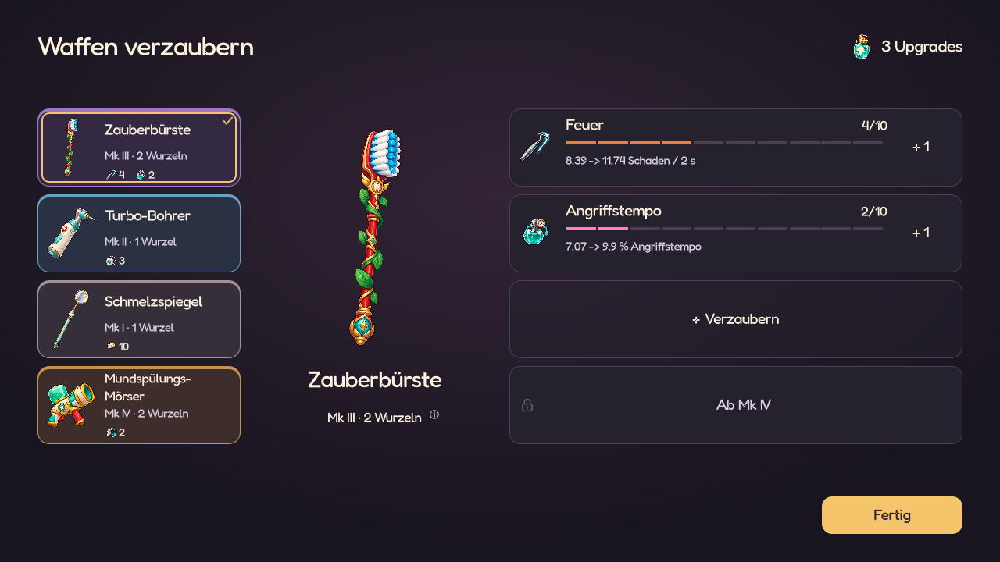
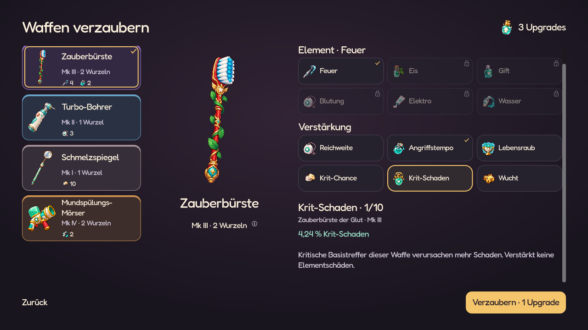
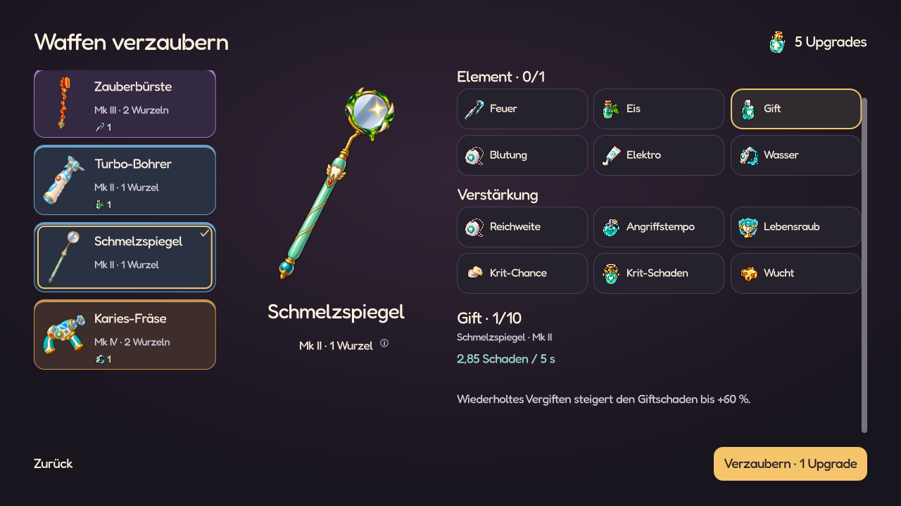

# Waffen gezielt verzaubern

Stand: 31.10.2026. Im echten Belohnungsablauf einschließlich aller Waffenformen umgesetzt.



## Regeln

- Jede neue Upgrade-Kapsel gibt **zwei frei einsetzbare Punkte**, auch eine goldene.
  Gewöhnliche Drops bleiben auf drei pro Welle begrenzt; goldene Träger und Gauner
  liefern zusätzliche Funde. Bonuskapseln aus Glück und Runenpolitur zählen nicht
  zum gewöhnlichen Limit.
- Aktivieren startet bei **1/10**, **10/10** bleibt die Obergrenze. Jeder Rang kostet
  **einen Punkt pro Wurzel** der Zielwaffe: 1 oder 2 Punkte. Vier volle Effekte kosten
  40 Punkte auf einer kleinen, 80 auf einer großen Waffe. Sechs kleine oder drei
  große Waffen benötigen damit jeweils 120 Kapseln für den vollständigen Ausbau.
- Glück würfelt nach dem vollständigen Loot-Sweep einmal eine zusätzliche Kapsel:
  `0,25 × Glück / (Glück + 150)` für positives Glück; 10 % bei 100, maximal 25 %.
  Kein neuer Wurf beim Fortsetzen, keine Unterbrechung des Kampfes.
- **Runenpolitur**, ungewöhnlich, 12 Münzen, einmal kaufbar: Jede fünfte seit dem Erwerb
  eingesammelte Kapsel gibt eine Bonuskapsel. Goldene Funde zählen mit, Boni nicht.
  Fortschritt bleibt über Wellen und Speichern/Fortsetzen erhalten.
- Die Mk-Stufe bestimmt die Plätze: **Mk I → 1**, **Mk II → 2**, **Mk III → 3**,
  **Mk IV → 4**. Die UI zeigt immer alle vier. Gesperrte Plätze nennen die nötige
  Mk-Stufe und öffnen sich durch den Waffenaufstieg, nicht durch einen Punktkauf.
- Pro Waffe ist höchstens **ein Element** wählbar: Feuer, Eis, Gift, Blutung,
  Elektro oder Wasser. Auch ein rein physischer Ausbau ohne Element ist möglich.
  Die übrigen Plätze tragen Verstärkungen: Reichweite, Angriffstempo, Lebensraub,
  Krit-Chance, Krit-Schaden oder Wucht. Jeder Effekt belegt nur einen Platz.
  Jedes Waffenexemplar bleibt ein eigenes Ziel. Weihe ist nicht mehr neu auswählbar.
- Die gesamte Wellenbeute wird zuerst eingesammelt. Nach den Level-ups und eventuell
  noch gespeicherten alten Kapsel-/Itementscheidungen folgt die Waffenverzauberung,
  danach Relikte, Story und Shop. Der Kampf wird nicht unterbrochen.
- **+ Rang · Preis** plant eine Verbesserung; **Rückgängig** nimmt die letzte geplante Investition
  zurück. **Fertig** übernimmt die vollständige gültige Verteilung gemeinsam.
  Nicht ausgegebene Punkte bleiben für spätere Wellen gespeichert. Bei komplett
  ausgebauter oder fehlender Ausrüstung kann die Ansicht ebenfalls beendet werden.
- Neue Kapseln würfeln keine Effekt-Seltenheiten, Slotfunde oder zusätzlichen Mk-Stufen.
  Mk-Fusion und individuell gewürfelte Shop-Grundwerte bleiben eigene Systeme.
- **Gezielter Mk-V+-Aufstieg ab Mk IV:** je Wurzel 3/5/8/12 Punkte und
  60/100/160/240 Gold für V/VI/VII/VIII. Zwei-Wurzel-Waffen bezahlen das Doppelte;
  im Endlosmodus wächst der Goldanteil mit dem Endlosfaktor. Jeder Aufstieg gibt
  additiv +10 % Basisschaden und +3 % Tempo/Reichweite. Er nutzt dieselbe Vorschau,
  Rückgängig und Bestätigung wie Effektränge. [Regeln und Nachschubmessung](WEAPON_ASCENSION.md).

## Oberfläche

Die freigegebene Nachtklinik-Gestaltung bleibt die Grundlage: Pflaumenflächen,
Fredoka, Originalmotive, Goldkontur für die Waffenwahl und eine goldene Hauptaktion.
Mk-Farbe, Auswahl und Tastaturfokus bleiben unterscheidbar.

Waffen links, große Vorschau in der Mitte, vier zugeordnete Plätze rechts.
Bestehende Effekte zeigen Rang, zehn Segmente und den tatsächlich berechneten
nächsten Wert einschließlich Einheit. Effektbild und Wurzelzeile öffnen Details.
Das Effektraster ersetzt nur den rechten Bereich; vorhandene Effekte sind markiert.
Es gibt keine wiederkehrenden Anleitungssätze.

Das Raster trennt Elemente und Verstärkungen. Ein gewähltes Element sperrt die
anderen Elemente mit konkretem Grund im Tooltip. Die Vorschau wird nach einer
Auswahl in den sichtbaren Bereich gescrollt und nennt Zielwaffe, Mk, Rang und Wert.
Das bleibt auch bei mehreren Exemplaren derselben Waffe eindeutig.

Kleine Formate ordnen die Waffenicons und die kompakte Zielwaffe über den Effekten
an. Im kurzen Querformat stehen Waffen und Effekte nebeneinander. Nur der Inhalt
scrollt; Abschluss und Zurück bleiben erreichbar. Bei sechs Waffen dient ein
kompaktes Raster als Auswahl; gleiche Waffentypen erhalten zusätzlich eine Nummer.



## Stärke, Fusion und alte Spielstände

`WeaponAffixData.upgrade_steps` enthält die zehn neuen Rangwerte. Die bisherige
I–III-/Seltenheitskurve bleibt für alte gespeicherte Effekte und Kapseln verfügbar.

Neuer direkter oder zeitlich verteilter Zusatzschaden bekommt ein Budget
pro Wurzel. Der gespeicherte Wert berücksichtigt die Basis-Angriffspause und die
gewichtete anfängliche Projektilsalve (`1 + 0,55 × zusätzliche Projektile`). Zusammen
mit der bestehenden Trefferrechnung wächst das Budget linear mit dem Basisintervall.
Bei Fusion oder Evolution wird es aus Rang und endgültiger Waffe neu berechnet.
Bisskraft, vorhandene Effektrollen, DoT-Dauern, Resistenzen, Proc-Limits und
Boss-Schutzbudgets gelten weiterhin.

Verstärkungen besitzen je Rang die gleichen Werte für kleine und große Waffen.
Prozentboni wirken bereits auf den gesamten Waffengrundwert; die zusätzliche
Quadratwurzel-Gewichtung entfällt. Das Heilbudget des Lebensraubs einschließlich
Basiswert und Obergrenze wächst linear mit den Wurzeln. Gleiche belegte Wurzeln
haben damit das gleiche theoretische Heilbudget bei gleichwertigem Ausbau.
Lebensraub besitzt ein eigenes Heilintervall von **0,6 s je Waffenexemplar**.
Mehrere Waffen heilen unabhängig. Salven, durchschlagende Geschosse und
Flächentreffer derselben Waffe teilen sich das Intervall; DoTs und Folgeeffekte
heilen nicht. Der Heilanteil bleibt 5 % des wirksamen Treffers; die Obergrenze beträgt 2 HP pro Wurzel. Waffen-IDs reisen mit
Geschossen und werden zusammen mit den Intervallen beim Fortsetzen erhalten.
Seit dem [Balancepass vom 01.11.2026](BALANCE_FIRST_PASS.md) wächst der Heilwert
oberhalb von 0,75 HP pro Wurzel nur noch mit 40 % des bisherigen Zuwachses.
Rang 1–4 bleibt gleich, Rang 10 liefert 1,11 statt 1,65 HP pro Wurzel und Impuls.
Jeder Rang verbessert die Heilung; Karten und Kampf verwenden dieselbe Kurve.

Evolutionen öffnen eine reversible Fusionsvorschau. Bei normalen Mk-Fusionen
erscheint sie bei Platz-, Element- oder Rangkonflikten. Die Ausgangswaffen bleiben
bis zur Bestätigung unverändert. Gleiche Effekte legen ihre mit den ursprünglichen Wurzelkosten bezahlten Punkte
zusammen. Die Ergebnis-Wurzelkosten bestimmen daraus ganze Ränge, maximal 10/10; ausgewählt werden höchstens so viele Effekte wie die Ergebnisstufe erlaubt,
mit höchstens einem Element. Der Elementwechsel ersetzt die vorherige Auswahl.
Nicht verwendete Punkte, auch Reste unter den nächsten Rangkosten, werden vollständig
erstattet. Beispiel: Zwei kleine Waffen mit Feuer 7 + 6 ergeben für eine kleine
Ergebniswaffe Feuer 10 und drei Punkte; für eine große Feuer 6 und einen Punkt.
Die Effektstärke wird für die fertige Waffe neu berechnet. Erstattete Punkte lassen
sich direkt im Shop verzaubern oder aufbewahren; der Shop bietet bei Restpunkten
„Verzaubern“. Punkte und offene Verzauberungsentwürfe bleiben beim Fortsetzen
erhalten. Eine unbestätigte Fusionsauswahl wird beim Fortsetzen verworfen; die
unveränderten Zutaten bleiben erhalten. Verkauf erstattet weiterhin nur Münzen.

Alte freie Punkte werden einmalig verdoppelt (gespeicherte Economy-Version 2).
Offene Entwürfe werden mit den tatsächlichen Wurzelkosten erneut geprüft. Bereits
verzauberte Ränge bleiben erhalten; Prozent- und Heilwerte folgen der neuen Balance.
Noch nicht eingesammelte alte Punktekapseln geben ebenfalls zwei Punkte.

Alte Waffen behalten ihren gespeicherten Schaden und vorhandene Effekte,
einschließlich früher freigeschalteter zusätzlicher belegter Plätze. Neue
Investitionen nehmen keinen Schaden weg und reichen höchstens bis 10/10.
Vorhandene gemischte Elementwaffen werden nicht ungefragt umgebaut. Neue
Elementtypen lassen sich nicht ergänzen. Rein alte I–III-/Seltenheitsaffixe behalten
bei konfliktfreier Mk-Fusion ihren bisherigen Ablauf. Die manuelle Fusionsauswahl
verwendet die Elementgrenze; übernommene alte Effekte behalten ihren gespeicherten
Schaden. Für ihre Erstattung gilt der entsprechende Rang im neuen System. Vorhandene Weihe bleibt funktionsfähig und ausbaubar.
Alte bereits gewürfelte offene Kapseln werden mit ihren gespeicherten Angeboten
über den bisherigen Entscheidungsablauf abgewickelt. Neue Funde verwenden Punkte.

Save/Resume erhält Bank, geplante Investitionen, Ziel-ID, offenen Effektkatalog,
gewählten Effekt und Intermissionsschritt. Die Ausrüstung bleibt bis zur Bestätigung
unverändert. Ein ungültiger Entwurf gibt die betroffenen Punkte frei, ohne einen
halben Build anzuwenden. Die bestehenden numerischen Reward-Schritte bleiben stabil;
der neue Schritt wurde angehängt.

## Wasser und ergänzende Verstärkungen

Wasser verwendet die bisherige gespeicherte ID `wet`, verursacht jetzt aber
direkten Zusatzschaden mit Faktor 0,65 und demselben Wurzel-/Intervallbudget wie Eis.
Die bisherige begrenzte Nassdauer und ihre Synergien bleiben zusätzlich erhalten.
Zucker hat **50 %**, Plaque **25 %** Wasserschwäche. Negative Einträge in
`EnemyData.affix_resistances` bilden Schwächen ab, begrenzt auf -0,5; positive
Resistenzen bleiben auf 0,6 begrenzt. Der Faktor verändert nur das jeweilige
Schadenspaket, nicht den Grundtreffer oder andere Elemente. Boss-Schutzbudgets gelten.
Elektro wird nun über andere Waffen mit Wasser kombiniert.

Neue Verstärkungen haben jeweils zehn Kurvenwerte in eigenen Affix-Ressourcen:

| Effekt | Rang I–X vor Wurzelgewichtung | Wirkung |
| --- | --- | --- |
| Krit-Chance | 1, 2, 3, 4, 5, 6, 8, 10, 12, 15 | zusätzliche Prozentpunkte nur für diese Waffe |
| Krit-Schaden | 3, 6, 9, 12, 15, 18, 22, 27, 33, 40 | Prozentpunkte auf ihren Krit-Multiplikator; keine Multiplikation von Elementen |
| Wucht | 1, 2, 3, 4, 5, 7, 9, 11, 13, 16 | flacher zusätzlicher Rückstoß, auch bei Grundwert 0; Gegnerresistenz gilt |

Die Werte werden aus Katalog, Rollen und gespeicherten Affixen neu aufgebaut.
Wiederholtes Aktualisieren, Fusion und Fortsetzen multiplizieren die Boni nicht.
Elemente bestimmen bei neuen Punktaffixen den Namenszusatz vor Verstärkungen.

## Elementformen im Spiel

Seit 27.10.2026 sind alle **168 Formen für 18 Standardwaffen und sechs Evolutionen**
eingebunden. Die Elementwahl verändert die große Vorschau bereits vor der
Bestätigung. Geplante und rückgängig gemachte Upgrades aktualisieren die Vorschau;
erst die gemeinsame Bestätigung übernimmt die Bilder in die Ausrüstung.



Die Form bleibt bei Fusion, Evolution und Fortsetzen dem gewählten Element
zugeordnet. Fräse, Polierer und Schleuder verwenden dazu eigene bewegliche Teile.
Originalvorlagen, kompakte Spieltexturen, Ressourcen und Prüfungen stehen in
[Waffenbilder im Spiel](WEAPON_SKINS.md).

## Prüfung und Vorschau

`tests/weapon_upgrades.gd` prüft den echten Weg von Kampf und Loot-Sweep über
Level-ups und native UI-Klicks bis zum Shop; zusätzlich Mk-Plätze, getrennte
Exemplare, 1/10-Aktivierung, Rückgängig, JSON-Fortsetzen mit offenem Katalog,
Restpunkte, Wurzelkosten-Vollausbau, Wurzel-/Salvenbudget, Fusionsschutz und Altbestand.

`tests/weapon_upgrade_layout.gd` ergänzt sieben Fenstergrößen, sechs gleichartige
Waffen, vier belegte Effekte, Katalog, Mk-Sperren, leere Ausrüstung und ungültige
Speichercontainer. Es prüft Textgrenzen und die tatsächlich mitgelieferten
Schriftzeichen, damit die Darstellung auch ohne Windows-Schriftfallback funktioniert.

`tests/weapon_elements.gd` prüft alle Elementpaare, kompatible Verstärkungen,
Fusion, ungültige ältere Entwürfe ohne Punktverlust, tatsächliche Krits und
Rückstoßbewegung, alle Wasser-Schwächen und Resistenzen, getrennte Waffenwerte
sowie wiederholtes Aktualisieren und Fortsetzen ohne Multiplikation.

Vollständiger Testlauf am 26.10.2026: **147/147 erfolgreich**. Die neue Auswahl
wurde zusätzlich als native Ansicht in allen sieben Größen aufgenommen und
visuell geprüft. Die Elementgrafiken sind inzwischen ebenfalls im Spiel eingebunden;
`tests/weapon_skins.gd` ergänzt die Prüfung aller Formen und ihrer Übernahme.

Native Produktionsansichten mit einem getrennten Testspielstand:

```powershell
Godot_v4.7.2-stable_win64_console.exe --path . --fixed-fps 60 --script res://tools/preview_weapon_upgrades.gd
```

Mit `-- --interactive` bleibt die Vorschau bedienbar; **Fertig** führt in den echten
Shop dieses separaten Testlaufs. Aufnahmen und Textgrenzen werden in 1280×720,
1040×600, 360×640, 320×568, 568×320, 720×1280 und 1920×1080 geprüft, zusätzlich
mit dem normalen Projekt-Stretching. Originalreferenzen und normale Saves bleiben erhalten.

## Manuelle Fusion: Prüfung

`tests/weapon_fusion.gd` prüft zwei vollständig verzauberte Zutaten, zusammengeführte
Ränge, vier Plätze, Elementwechsel samt Bild, Wurzelskalierung, exakte Erstattung,
Abbrechen, veränderte Zutaten, Doppelbestätigung, Mk-Konflikte, direktes Ausgeben im
Shop und Save/Resume. Native Ansichten: [1280×720](screenshots/weapon_fusion/desktop.png),
[Hochformat](screenshots/weapon_fusion/portrait.png), [kurzes Querformat](screenshots/weapon_fusion/landscape.png).

## Neue Ökonomie prüfen

`tests/weapon_upgrade_economy.gd` prüft sechs kleine gegen drei große Waffen,
Kosten/Undo/Manipulation, alte und neue JSON-Saves, echte Heiltreffer, Prozentwerte,
Fusion bei wechselnden Wurzelkosten, Restpunkte, Itemlimit, Kapselzählung ohne
Bonusrekursion, Glücksgrenzen und die echten UI-Preise.

Prüfung am 27.10.2026: **154/154 Godot-Tests erfolgreich** (199 s), einschließlich
der neuen Ökonomieprüfung und der bestehenden Kampf-, Shop-, Save- und UI-Tests.
Native Aufnahmen mit dem aktuellen Regelwerk, einschließlich 320 × 568:
[Desktop](screenshots/upgrade_economy/overview_1280x720.png),
[Hochformat](screenshots/upgrade_economy/overview_320x568.png),
[Effektauswahl](screenshots/upgrade_economy/picker_360x640.png).

Reproduzieren: `Godot_v4.7.2-stable_win64_console.exe --path . --fixed-fps 60 --script res://tools/preview_weapon_upgrades.gd -- --economy`.
